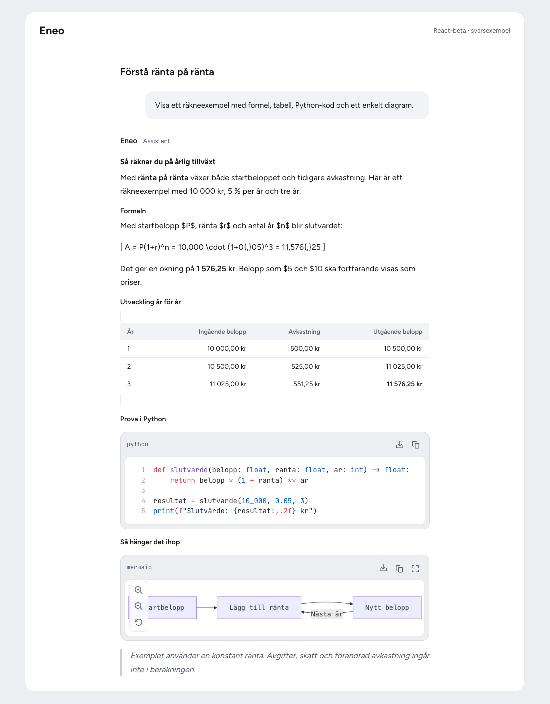
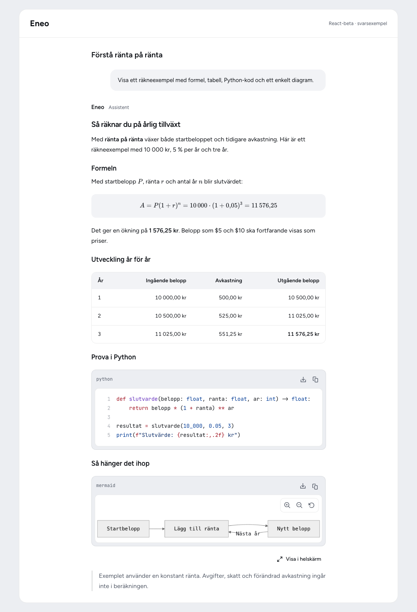
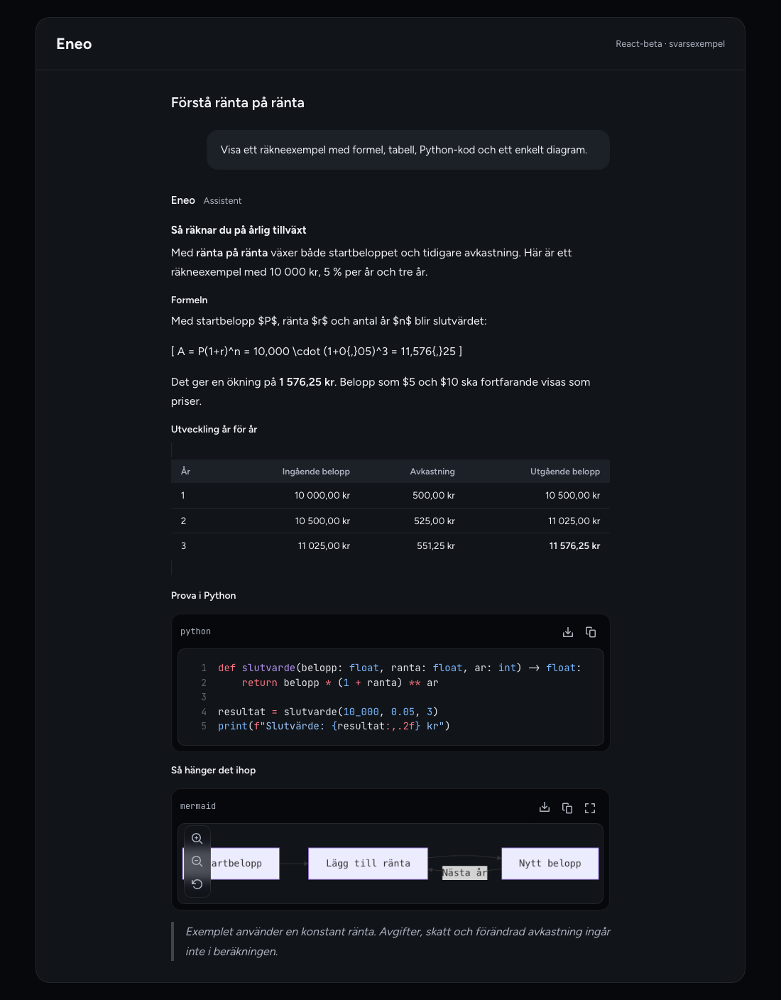
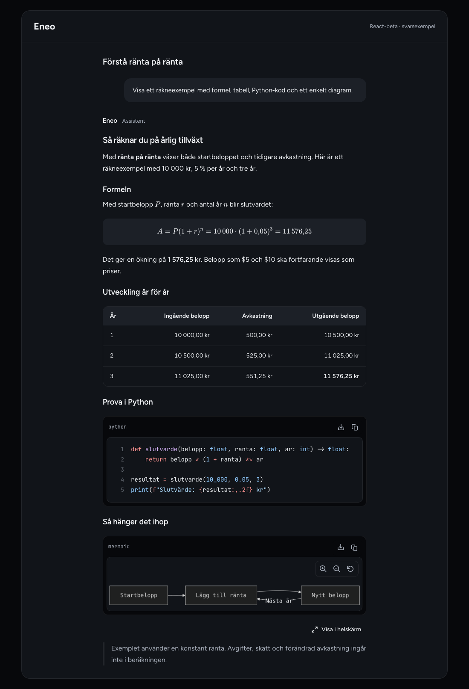
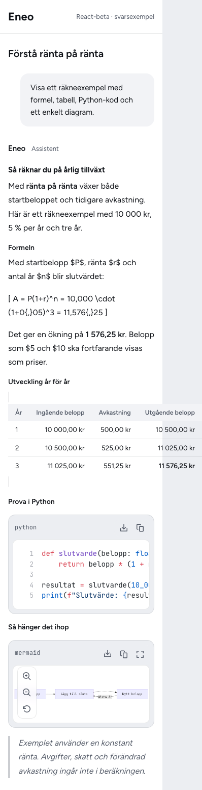
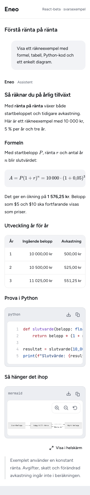
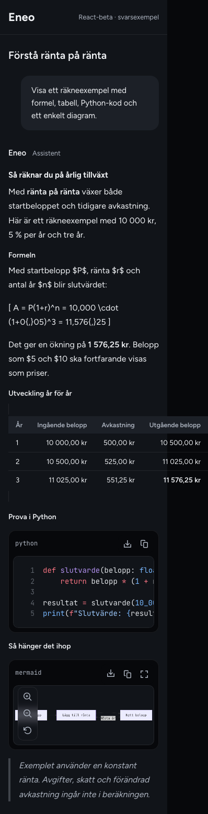
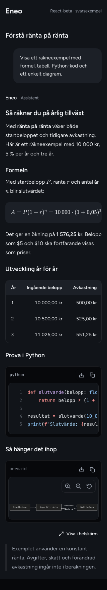

# Answer presentation: review evidence

Before/after screenshots of the real React beta answer components with the same fictional Swedish answer. Captured at 1100 px and 320 px, in light and dark mode.

These are isolated rendering fixtures, not an authenticated production-app session. Code blocks and Mermaid diagrams already existed before; this change adds the broader formula grammar and improves presentation, overflow, rich-text copying and diagram accessibility.

Before: develop at db8d37d048cf9083ccbda941d996aa10d8441792.
After: implementation recorded in 460d479334, rebased onto develop as 627fb955dd. Rendering sources are unchanged by that rebase.

Automated fixture checks: keyboard scrolling, code copy, fullscreen focus and return, page overflow, light/dark contrast and axe WCAG 2.2 A/AA scans. Manual screen-reader testing, real Word paste, and production-app CSP/E2E validation remain outstanding.

This branch contains review assets only and is not intended to be merged. Keeping the branch preserves the images embedded in the implementation PR.

## 1100 px, light

| Before | After |
| --- | --- |
|  |  |

## 1100 px, dark

| Before | After |
| --- | --- |
|  |  |

## 320 px, light

| Before | After |
| --- | --- |
|  |  |

## 320 px, dark

| Before | After |
| --- | --- |
|  |  |

