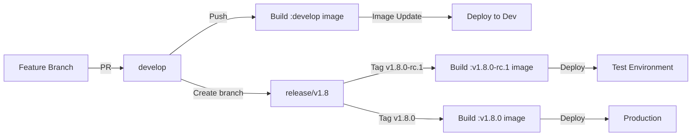
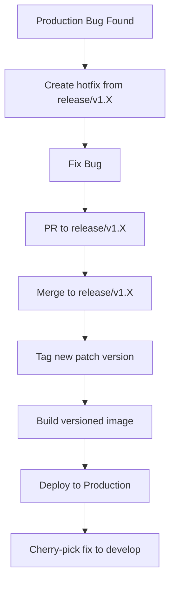

# Deployment Workflow

This document describes our Git workflow and deployment process. Please read it carefully before contributing.

## Table of Contents
- [Overview](#overview)
- [Environments](#environments)
- [Branch Strategy](#branch-strategy)
- [Development Workflow](#development-workflow)
- [Release Process](#release-process)
- [Release Stabilization (RC Process)](#release-stabilization-rc-process)
- [Hotfix Process](#hotfix-process)
- [Backporting](#backporting)
- [Security Patches Across Multiple Releases](#security-patches-across-multiple-releases)
- [Backflow: Release to Develop](#backflow-release-to-develop)
- [Support / Maintenance Policy](#support--maintenance-policy)
- [Docker Images](#docker-images)
- [Documentation Versions](#documentation-versions)
- [FAQ](#faq)

## Overview

We use a Git Flow-inspired workflow with **persistent release branches**. Every minor version gets a `release/v1.X` branch. Tags always live on release branches. Deployment systems watch for new image tags and deploy them automatically.



```
feature/* ──► develop ──► release/v1.8 ──► v1.8.0, v1.8.1, ...
                     ──► release/v1.9 ──► v1.9.0, ...

Backflow (patches):
  release/v1.X (hotfix) ──cherry-pick──► develop
```

## Environments

| Environment | Purpose | Branch/Tag | Image Tag | Deployment Method |
|------------|---------|------------|-----------|-------------------|
| **Development** | Latest features, may be unstable | `develop` | `:develop` | Auto (on image update) |
| **Test** | Pre-production testing via RC tags | `v*-rc.*` tags on `release/v1.X` | `:v1.8.0-rc.1` | Manual deploy |
| **Production** | Live system | `v*` tags on `release/v1.X` | `:v1.8.0` | Manual deploy |

## Branch Strategy

### Long-lived Branches

#### `develop`
- Integration branch for new features
- Always deployable to dev environment
- Protected: requires a PR approved by a member of `@eneo-ai/core-maintainers`, merged through the merge queue

#### `release/v1.X`
- Created from `develop` when ready to release or stabilize a minor version
- Persistent home for all patches to that minor version
- All version tags (`v1.X.Y`) live here
- Test via RC tags (`:v1.8.0-rc.1`) before creating the final release
- **Never merged back** — fixes flow to `develop` via cherry-pick only
- Protected: only members of `@eneo-ai/core-maintainers` can create, push to or delete release branches and create `v*` tags, so the release steps below require Core Maintainer access. See [Governance and Roles](../frontend/apps/docs-site/src/content/contributing/governance.mdx)

### Supporting Branches

#### `feature/*`
- Created from: `develop`
- Merged into: `develop`
- Naming: `feature/descriptive-name`
- Example: `feature/add-user-authentication`

#### `hotfix/*`
- Created from: the target `release/v1.X` branch
- Merged into: the target `release/v1.X` branch (then cherry-picked to `develop`)
- Naming: `hotfix/issue-description`
- Example: `hotfix/fix-payment-processing`

## Development Workflow

### Step-by-Step Guide

#### 1. Start a New Feature

```bash
# Always start from latest develop
git checkout develop
git pull origin develop

# Create your feature branch
git checkout -b feature/your-feature-name

# Make your changes
git add .
git commit -m "feat: add new feature"

# Push to GitHub
git push origin feature/your-feature-name
```

#### 2. Create Pull Request

1. Go to GitHub and create a PR from your feature branch to `develop`
2. Fill in the PR template
3. Request review from team members
4. Address any feedback

#### 3. After PR Approval

Once merged to develop:
- GitHub Actions automatically builds Docker images tagged `:develop`
- Images are automatically deployed to internal dev environment

## Release Process

### Creating a Production Release

Every release goes through at least one RC tag for testing. See [Release Stabilization (RC Process)](#release-stabilization-rc-process) for the full flow.

Once the RC is stable, run **Actions → Prepare and Publish Release → Run workflow**
on `develop`, entering only the final version without `v`, for example `2.4.0`.

1. The controller uses `release_notes.py finalize` to date the existing notes
   and validate them. The first preparation uses the Stockholm calendar date;
   retries preserve that date. It opens a labelled PR to `release/v2.4`.
2. Review and merge that PR through the normal repository rules. It changes
   only `releases.json` and `.github/release-request.json`. The request records
   the version and preparation base commit; a hotfix with no separate news
   still gets a reviewable request.
3. Successful **push CI on the merged commit** creates a draft GitHub release
   and a create-only tag at that exact commit. A changed release-branch head
   stops tagging and requires a fresh preparation and review.
4. The existing image workflow builds, validates and attests the images, smoke
   tests the complete bundle and attaches the bundle and SBOMs to the draft.
5. Only success of that entire workflow allows the trusted controller to
   verify the bundle's attestation, source commit and version, the derived
   deployment environment and every SBOM asset against its signed checksum
   inventory, then publish the release. It promotes `latest` if this is the newest **published** final
   release, and opens a history PR to `develop` using `release_notes.py port`.
6. Review and merge the history PR. Shipped entries move out of `next` while
   later features stay upcoming; aliases, permissions and translations survive.

`releases.json` remains the single source of news and dates for the app and
documentation. The request file contains no duplicate date or news. GitHub's
generated release changelog remains developer/operator-facing. Dates record
the first preparation, not the time of an eventual retry or publication.

#### Release App setup (once)

Managed publication is off until repository variable `RELEASE_MANAGED` is
`true`. Before that, final tags created in the Releases UI build and promote
exactly as before, and **Prepare and Publish Release** stops with a message
naming this section. Complete the steps in order; only the last one changes
behaviour:

1. An organisation owner creates a GitHub App and installs it on this
   repository only, with **Contents, Pull requests and Issues: read/write** and
   **Actions and Attestations: read**. Contents permits the preparation branch,
   tag and release; Issues permits the required PR labels.
2. Configure repository variable `RELEASE_APP_CLIENT_ID` and repository secret
   `RELEASE_APP_PRIVATE_KEY`. The private key is never checked into the repository.
3. Adjust the `v*` tag rules as described below so the App may create tags.
4. Set repository variable `RELEASE_MANAGED` to `true`. From then on, a final
   tag without a reviewed request fails its image build, and the controller
   drives every final release. Setting it back stops automatic transitions
   and leaves managed finals as drafts for recovery.

The ordinary job token retains only repository read access and package write
access for alias promotion.

Allow this App to **create** `v*` tags in the repository tag rules. Keep tag
updates/deletions protected and retain all PR, CI and merge-queue rules. The
controller never merges its PRs and never force-updates or deletes a tag.
Do not grant it a general branch-protection bypass or administrator access.
If creation and tag immutability currently share one ruleset, separate the
creation restriction first: allow the App to bypass only tag creation,
and keep it out of the update/deletion ruleset's bypass list.

Use an App token because PR and tag events must trigger downstream checks and
image workflows; the ordinary `GITHUB_TOKEN` does not drive this complete
event chain. See [GitHub's event-triggering guidance](https://docs.github.com/en/actions/how-tos/write-workflows/choose-when-workflows-run/trigger-a-workflow).
Tokens are minted for one job and revoked by the pinned token action on exit.
Privileged jobs always execute controller code from `develop`, never scripts
from a PR, release checkout, artifact or event-supplied ref.

#### Recovery and existing release lines

| State | Recovery |
| --- | --- |
| Open preparation PR | Rerun preparation with the same version. Reuse its PR, commit and date. |
| Branch created but PR creation failed | Rerun preparation or reconciliation. A branch that no PR references is reused when its content matches and replaced otherwise. |
| Merged PR, CI still running or failed | Fix the CI failure. A successful push-CI event resumes tagging. Rerunning preparation also checks CI. |
| Release branch advanced before tagging | Prepare the same version again. A new base commit produces a new request PR for review, and the earlier open preparation PR is closed with a comment naming it. |
| Checker or schema differs from `develop` | Backport `scripts/check_whats_new.py` and `releases.schema.json` to the release branch, then prepare again. Preparation and the tag build must validate the notes with identical rules. |
| Draft created, tag creation failed | Fix App/tag permissions and rerun the failed controller job or preparation. The same draft and commit are reused. |
| Images, smoke tests or SBOM generation failed | Rerun failed jobs in **Build and Push Docker Images**. The release stays a draft and its `latest` aliases are not promoted. |
| Publication, alias promotion or history PR failed | Rerun the failed **Prepare and Publish Release** reconciliation. It revalidates the tag and bundle, preserves publication metadata, reuses an open history PR and recreates an interrupted history branch from the current `develop`. |
| Existing tag names another commit | Stop. The controller refuses to replace it; use a new version. |

Publication transitions and image builds use queued concurrency so a newer
event does not replace a pending release. GitHub permits up to 100 pending
runs per concurrency group; if that limit is reached, rerun a canceled event.

This flow applies to release branches carrying the managed-publication changes
in `build_and_push_images.yml` and the release scripts, including the existing
`cut`/`finalize`/`port` tooling. Backport the complete automation and release-note
tooling changes, with their checker, schema and tests, before preparing an older
release line. Already shipped tags
without a request keep their existing publication behavior; their tag-local
workflows are never rewritten. RC publication is unchanged. Do not manually
publish a managed draft or create its final tag in the Releases UI.

GitHub Actions will automatically build production images:
- `ghcr.io/eneo-ai/eneo-backend:v1.8.0`
- `ghcr.io/eneo-ai/eneo-frontend:v1.8.0`

Deploy to production by updating your deployment config to point at the new version tag.

### Semantic Versioning

We use semantic versioning: `MAJOR.MINOR.PATCH`

- **MAJOR** (1.0.0 → 2.0.0): Breaking changes
- **MINOR** (1.0.0 → 1.1.0): New features (backwards compatible)
- **PATCH** (1.0.0 → 1.0.1): Bug fixes

## Release Stabilization (RC Process)

RC tags also live on the release branch. Create the release branch from `develop` when you're ready to **start** stabilizing:

```
develop ──► create release/v1.8
                 │
                 ├──► v1.8.0-rc.1 (tag, pre-release) → deploy to test env
                 ├──► fix directly on branch or via PR
                 ├──► v1.8.0-rc.2 (tag, pre-release)
                 └──► v1.8.0 (final release)
```

**1. Create release branch from `develop`:**

```bash
git checkout develop && git pull
git checkout -b release/v1.8
python3 scripts/release_notes.py cut 1.8   # the "next" What's new block becomes 1.8.0
git commit -am "docs(whats-new): name the release notes for v1.8.0"
git push origin release/v1.8
```

CI rejects a `next` block on a release branch and an undated release block on `develop`, so the cut cannot be forgotten and notes for an unreleased version cannot land on `develop` under a version number.

**2. Create the first RC via GitHub UI:**

1. Go to **Releases** → **Draft a new release**
2. Click **Choose a tag** → type `v1.8.0-rc.1` → select **Create new tag**
3. Set **Target** to `release/v1.8`
4. Set **Release title** to `v1.8.0-rc.1`
5. Check **Set as pre-release**
6. Click **Publish release**

**3. Fix issues** directly on the release branch (or via `hotfix/*` PRs to `release/v1.8`)

**4. Create subsequent RCs** the same way via GitHub Releases (tag `v1.8.0-rc.2`, target `release/v1.8`, mark as pre-release)

**5. When stable, create the final release** via GitHub Releases:
- Tag `v1.8.0`, target `release/v1.8`
- Leave **Set as pre-release** unchecked
- Add full release notes

During stabilization, `develop` can continue receiving new features for the next release.

## Hotfix Process

One consistent flow for all hotfixes, regardless of which version is affected:



### Hotfix Example

**1. Create hotfix from the affected release branch:**

```bash
git checkout release/v1.7
git pull origin release/v1.7
git checkout -b hotfix/fix-critical-bug

# Make your fix
git add .
git commit -m "fix: resolve critical payment processing error"

# Push and create PR to the release branch
git push origin hotfix/fix-critical-bug
# Create PR on GitHub: hotfix/fix-critical-bug → release/v1.7
```

**2. After PR merge, create the patch release via GitHub UI:**

1. Go to **Releases** → **Draft a new release**
2. Click **Choose a tag** → type `v1.7.4` → select **Create new tag**
3. Set **Target** to `release/v1.7`
4. Set **Release title** to `v1.7.4`
5. Describe the fix in the release notes
6. Click **Publish release**

GitHub Actions builds `v1.7.4` images. The `:latest` tag is NOT overwritten if `v1.8.0` already exists.

**3. Deploy** `v1.7.4` to the affected production instance.

**4. Cherry-pick the fix to develop:**

Use the **squashed commit on the release branch** as the cherry-pick source, not the original commit from your `hotfix/*` branch. Because PRs are squash-merged, the commit on `release/v1.7` is the authoritative one; the hotfix branch's pre-squash SHA won't exist after the branch is deleted.

```bash
# Grab the SHA from the release branch (the squashed merge commit)
git checkout release/v1.7 && git pull
git log -1 --format=%H  # copy this SHA

git checkout develop && git pull origin develop
git cherry-pick <sha-from-release-branch>
git push origin develop
```

## Backporting

When a bug is fixed on `develop` but also affects an older release:

**1. Cherry-pick the fix to the release branch:**

```bash
git log --oneline develop  # identify the fix commit
git checkout release/v1.7
git pull origin release/v1.7
git cherry-pick <commit-hash>
git push origin release/v1.7

# If conflicts, resolve them and create a PR instead:
git checkout -b fix/backport-xyz
git push origin fix/backport-xyz
# Create PR: fix/backport-xyz → release/v1.7
```

**2. After the fix lands on the release branch, tag via GitHub UI:**

1. Go to **Releases** → **Draft a new release**
2. Tag: `v1.7.5`, Target: `release/v1.7`
3. Describe the backported fix
4. Click **Publish release**

## Security Patches Across Multiple Releases

When a security fix must go to multiple supported releases:

1. **Fix on the oldest affected release branch first**
2. **Cherry-pick forward** to each newer release branch
3. **Cherry-pick to `develop`**
4. **Tag new patch versions** on each affected release branch

Order matters: **oldest → newest → develop**. This minimizes merge conflicts since newer branches are closer to develop.

**Example: security fix needed on v1.6, v1.7, and v1.8:**

At each step, the `<commit-hash>` is the SHA of the **squashed merge commit on the branch you just merged into** — re-read it from that branch before cherry-picking forward.

```bash
# 1. Fix on oldest affected branch
git checkout release/v1.6
git checkout -b hotfix/security-fix
# ... fix ...
git push origin hotfix/security-fix
# PR → release/v1.6, merge (squash)

# Grab the squashed SHA from release/v1.6
git checkout release/v1.6 && git pull
SHA=$(git log -1 --format=%H)

# 2. Cherry-pick forward (re-read SHA from each branch after it lands)
git checkout release/v1.7 && git pull
git cherry-pick "$SHA"
git push origin release/v1.7
SHA=$(git log -1 --format=%H)  # new SHA on release/v1.7

git checkout release/v1.8 && git pull
git cherry-pick "$SHA"
git push origin release/v1.8
SHA=$(git log -1 --format=%H)  # new SHA on release/v1.8

# 3. Cherry-pick to develop
git checkout develop && git pull
git cherry-pick "$SHA"
git push origin develop
```

**Then create releases for each branch via GitHub UI:**

| Tag | Target | Pre-release? |
|-----|--------|-------------|
| `v1.6.3` | `release/v1.6` | No |
| `v1.7.5` | `release/v1.7` | No |
| `v1.8.1` | `release/v1.8` | No |

For each: **Releases** → **Draft a new release** → set tag, target, and release notes → **Publish release**.

## Backflow: Release to Develop

**Every fix that lands on a release branch must also be cherry-picked to `develop`.** If you skip this, the fix will be missing in the next release.

After merging a hotfix PR to a release branch:

1. **Immediately cherry-pick** the fix commit to `develop`
2. **Use the squashed commit on the release branch as the source** — not the original commit from your `hotfix/*` branch (which won't survive the branch deletion)
3. If cherry-pick conflicts, create a PR to `develop` with the manual resolution

```bash
# Get the SHA from the release branch
git checkout release/v1.7 && git pull
git log -1 --format=%H  # this is the SHA to cherry-pick

git checkout develop && git pull
git cherry-pick <sha-from-release-branch>
git push origin develop
```

This applies to all fixes on release branches — hotfixes, RC stabilization fixes, backported patches, and security fixes.

## Support / Maintenance Policy

- **Supported:** current release + 1 previous minor version (receives bug fixes and security patches)
- **EOL:** older release branches can be deleted after confirming no customers depend on them
- Review and update this policy as the team/customer base grows

## Docker Images

### Image Tagging Strategy

| Source | Docker Tags | Purpose |
|--------|------------|---------|
| `develop` branch | `:develop`, `:develop-{sha}` | Development testing |
| `v*-rc/beta` tags | `:v1.8.0-rc.1` (no `:latest`) | Test environment / pre-release testing |
| `v*` tags (stable) | `:v1.8.0`, `:latest` (if highest version) | Production releases |

**How `:latest` is decided:** Evaluated at tag-push time by comparing the new tag against all existing stable tags (`v*` excluding pre-releases like `-rc`, `-beta`) via semver sort. Only the highest stable version wins `:latest`.

Consequences to be aware of:
- Patching an older release (e.g. tagging `v1.7.4` while `v1.8.0` exists) will NOT overwrite `:latest` — the older patch correctly stays out of `:latest`.
- If an out-of-order release happens (e.g. `v1.8.0` was tagged first, then later `v1.7.5` on the old branch), `:latest` still points to `v1.8.0` — the comparison is "highest at push time," not "most recently pushed."
- RC / pre-release tags never receive `:latest`, regardless of version number.
- If you ever need to move `:latest` to a different version (e.g. after yanking a bad release), you must retag manually in the registry — CI will not do it retroactively.

### Image Locations

```bash
# Backend Images
ghcr.io/eneo-ai/eneo-backend:develop      # Latest from develop
ghcr.io/eneo-ai/eneo-backend:v1.8.0-rc.1  # RC for testing
ghcr.io/eneo-ai/eneo-backend:v1.8.0       # Specific release
ghcr.io/eneo-ai/eneo-backend:latest       # Highest stable release

# Frontend Images
ghcr.io/eneo-ai/eneo-frontend:develop      # Latest from develop
ghcr.io/eneo-ai/eneo-frontend:v1.8.0-rc.1  # RC for testing
ghcr.io/eneo-ai/eneo-frontend:v1.8.0       # Specific release
ghcr.io/eneo-ai/eneo-frontend:latest       # Highest stable release
```

## Documentation Versions

[docs.eneo.ai](https://docs.eneo.ai) publishes stable, archived and development
documentation. Every release line has a `/vX.Y/` URL; `/dev/` follows develop,
and unversioned URLs redirect to the latest stable equivalent.

[The documentation authoring guide](../frontend/apps/docs-site/AUTHORING.md)
owns the rules for choosing a branch, page and release-note entry. Read it
before adding documentation or describing unreleased behaviour.
[The site README](../frontend/apps/docs-site/README.md) describes publication,
central triggers, retention and recovery. There is no manual version-folder
move at release time.

## FAQ

### Q: When should I create a feature branch?
**A:** For any change that adds functionality, fixes a bug, or modifies behavior. Even small changes should go through a PR for code review.

### Q: Can I push directly to develop or release branches?
**A:** No. All long-lived branches are protected and require pull requests with approvals.

### Q: Where and how do I create version tags?
**A:** Always on a `release/v1.X` branch. Use **GitHub Releases** (not the CLI) to create tags — this gives you release notes, pre-release marking, and a clean audit trail. See [Quick Command Reference](#creating-tags-github-ui).

### Q: How do I know what version to tag?
**A:** Check the latest tag on the repo's **Releases** page or with `git tag --list 'v*' --sort=-v:refname | head -1`. Then:
- Breaking changes → increment MAJOR
- New features → increment MINOR
- Bug fixes → increment PATCH

### Q: What if I need to patch an old version?
**A:** Use the same hotfix flow — create a `hotfix/*` branch from the relevant `release/v1.X`, PR to the release branch, merge, tag. No special handling needed.

### Q: What if I need to test something quickly?
**A:** Create a feature branch and PR to develop. Once merged, it auto-deploys to dev environment.

### Q: Can I delete old feature branches?
**A:** Yes! Delete them after merging to keep the repo clean:
```bash
git push origin --delete feature/old-feature
git branch -d feature/old-feature
```

### Q: Can I delete old release branches?
**A:** Only if the version is EOL (see [Support / Maintenance Policy](#support--maintenance-policy)). Confirm no customers depend on that version first.

### Q: How do I rollback production?
**A:** Deploy the previous version tag:
```bash
# Check available versions
git tag --list 'v*' --sort=-v:refname

# Deploy previous version (e.g., v1.7.3 if v1.8.0 has issues)
# Use your deployment tool with v1.7.3 images
```

## Quick Command Reference

### Git commands

```bash
# Start new feature
git checkout develop && git pull
git checkout -b feature/my-feature

# Update feature branch with latest develop
git checkout feature/my-feature
git merge develop

# Create release branch
git checkout develop && git pull
git checkout -b release/v1.8
git push origin release/v1.8

# Hotfix any version
git checkout release/v1.7 && git pull
git checkout -b hotfix/critical-fix
# ... fix, push, PR to release/v1.7, merge ...
# Then tag via GitHub UI (see below)
# Cherry-pick to develop
```

### Creating tags (GitHub UI)

Always create tags through **GitHub Releases** rather than the CLI. This gives you release notes, pre-release marking, and a consistent audit trail.

| Action | Tag | Target branch | Pre-release? |
|--------|-----|--------------|-------------|
| New release | `v1.8.0` | `release/v1.8` | No |
| Release candidate | `v1.8.0-rc.1` | `release/v1.8` | Yes |
| Hotfix patch | `v1.7.4` | `release/v1.7` | No |

**Steps:** Repo → **Releases** → **Draft a new release** → type new tag → select target branch → write notes → set pre-release if RC → **Publish release**

---
