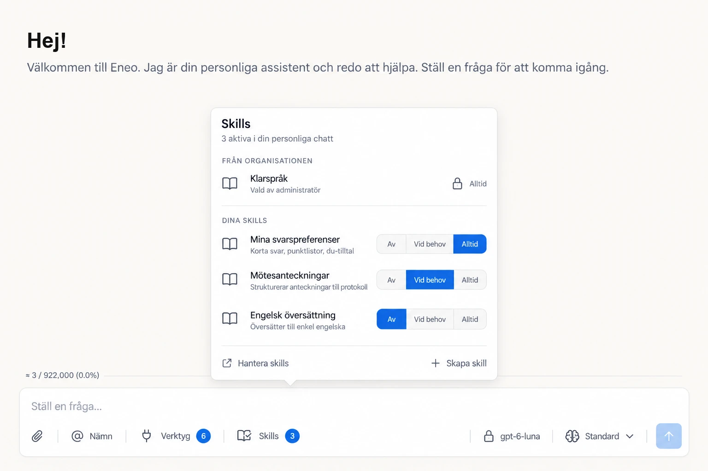
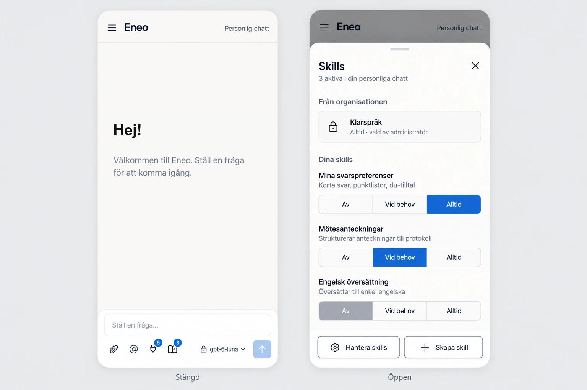

# Personal chat skill layers

- Status: proposed
- Date: 2026-10-21
- Scope: new epic "Users can shape their personal chat with their own Skills" (number assigned on publication)
- Baseline: `d5f0fd369` (`develop`)

## Problem and decision

People want a Skill that applies only to their own personal chat, for example
"answer briefly, in bullet points, in du-form", without building an Assistant.
Today the personal chat runs only the organisation Skills an administrator
pins through the governance policy. Task #548 made that deliberate: "the
personal default Assistant cannot receive direct Skill bindings". A user can
create Skills in their personal space only with `skills` and
`skills_management`, which only the Owner role has, and even then can use them
only through a separate Assistant.

The personal chat gets two Skill layers with separate owners:

| Layer | Owner | Storage | Who changes it |
|---|---|---|---|
| Organisation | Governance policy | `governance_policy_skill_bindings` | Administrators, unchanged |
| Personal | The personal default Assistant | `assistant_skill_bindings` | The user, with `personal_skills` |

The governance policy stays the only owner of organisation Skills in personal
chat. What changes from #548 is that the default Assistant may now hold the
user's own personal-space Skills. No table is added.

## Decisions

### 1. Storage owner: the default Assistant's bindings

`assistant_skill_bindings` already owns exact revision pins, ordering,
activation modes and reference integrity, and the default Assistant cannot be
deleted through the ordinary path (`assistant_service.py:2402`). The model and
the Skills that must fit together then live on one row, so one transaction
validates both.

Rejected: a per-user preference aggregate independent of Assistants. It would
duplicate the binding lifecycle and split model-plus-Skill validation across
two owners, and no requirement needs that independence.

### 2. Sources: own personal-space Skills only

The personal layer accepts only active Skills from the user's own personal
space. The binding boundary enforces this, because the generic resolver also
accepts published organisation references (`skill_service.py:543`). Hiding
them in the picker is not enough.

Organisation Skills in the personal layer are deferred. Allowing them would
need overlap, precedence and revision rules against the governance layer.

### 3. Permission `personal_skills`

A new tenant permission, labelled "Egna skills" / "Own skills".

- **Library.** In the actor's own personal space, `personal_skills` passes the
  SKILL gate for read, create, edit and delete without `skills` or
  `skills_management`. It is an additive route in `tenant_permits` and the
  mutation check (`space_actor.py:718-758`). Space ownership and API-key
  constraints still apply. Shared spaces, organisation spaces and the
  organisation catalogue are unchanged.
- **Personal layer writes** need `personal_chat` and `personal_skills`.
- **Attaching Skills** to Assistants and Apps stays Use Skills (`skills`,
  `SpaceActor.can_use_skills`). Library access through `personal_skills`
  does not open the Skill picker on the person's other Assistants and Apps.
- **Personal chat reads** use the existing personal-default read exception
  (`_authorize_read_assistant`, `assistant_service.py:2107`), not
  `can_read_assistant`. Today `list_assistant_bindings` needs `assistants`
  (`skill_service.py:629`), so a chat-only user would get a 403. Anyone who may
  use the personal chat may see the names and modes of the organisation Skills
  in it. That grants no catalogue access.
- **Upgrade:** granted to the predefined Owner role only. Administrators opt
  in other roles under Admin › Roles. (Product owner, 2026-10-21.)
- **Revocation:** checked on every turn. Without the permission, the personal
  layer is suspended with reason `permission_missing`; the saved choices stay.
  (Product owner, 2026-10-21.)
- **Enforced prompt.** An enforced personal chat prompt does not suspend the
  own layer. Own "always" Skills add the person's instructions after it, as
  the person could in a message. Administrators who want the enforced prompt
  alone leave `personal_skills` off that role.

Rejected: no new permission, with administrators granting `skills` and
`skills_management` to User instead. That also grants Skill authoring in shared
spaces and access to the organisation catalogue. Also rejected: a
governance-policy "allow user Skills" flag. Two switches for one decision.

### 4. Write path: the Assistant update

Assistant update stays the only direct binding-write boundary. The personal
default's field allowlist in `update_assistant`
(`assistant_service.py:1620-1700`) gains `skill_binding_intents` when the user
holds `personal_chat` and `personal_skills`. Authorization uses
`can_edit_default_assistant`. `personal_skills` is required for personal-layer
writes even when the caller holds `assistants`; broad Assistant editing never
bypasses it. `personal_skills` authorizes no other protected Assistant setting. The three guards that forbid default-Assistant bindings
(`skill_service.py:644-649`, `:687-690`, `assistant_service.py:659-664`) narrow
to "own-space Skills only". Audit stays `ASSISTANT_UPDATED` with
`changes.skills`.

### 5. Composition and one layer assessment

Turn plans compose the organisation layer first, then the personal layer, and
renumber positions into one contiguous sequence (`skill-1..n`).
`compose_skill_instructions` rejects duplicate positions (`skill.py:987`).

**The personal layer runs exactly as configured, or not at all.** Running part
of what the user chose would be a different configuration from the one they
see. Organisation Skills are never affected by the personal layer.

A single pure assessment in the Skills domain decides the personal layer's
state. It combines the results of the existing calculators and does not
duplicate them: `SkillTurnPlan.create`, `to_activation_runtime`,
`SkillActivationRuntime.assess_on_demand_candidates` (`skill_activation.py:430`)
and `assert_prompt_and_files_fit_context`. The Assistant orchestration boundary
supplies the authorized references, the model facts, the persistent files and
the runtime policy, and calls the assessment for saves, preflight,
configuration reads and turns.

**Outcomes.** The assessment returns `empty` (no personal bindings), `applied`
or `suspended(reason)`. Checks run in this order, and the first failure is the
reason:

| Reason | Fails when |
|---|---|
| `permission_missing` | The user lacks `personal_skills`. |
| `attachment_limit_exceeded` | Organisation plus personal bindings exceed `max_attached_skills`. |
| `model_context_exceeded` | Baseline instructions plus personal "Alltid" instructions plus persistent files do not fit the model window. |
| `on_demand_unavailable` | A personal "Vid behov" Skill cannot be offered. Carries the existing `SkillActivationFallbackReason`: `model_lacks_tool_calling`, `selective_activation_disabled`, `token_measurement_unavailable` or `catalog_budget_exceeded` (`skill.py:1031`). |
| `personal_skill_does_not_fit` | A personal "Vid behov" Skill's instructions could not be activated. Carries the existing `SkillActivationRejectionReason`. |
| `organisation_skill_crowded_out` | An organisation "Vid behov" Skill that the baseline can activate could no longer be activated with the personal layer added. |

Blocked bindings are included, as `for_full_save_validation` already does, so
releasing a block cannot reveal an invalid combination. The guarantee covers
the persistent configuration: instructions, attachments and Skills. Turn-time
guards for history, uploads and live tool narrowing stay as they are. Nothing
promises that every combination of on-demand Skills fits in one turn.

**Save transitions.** These rules make "Av" and recovery always possible:

| The save… | Accepted when |
|---|---|
| changes nothing in the personal layer (model switch, reasoning effort) | Baseline valid, and the layer was not `applied` before and `suspended` after for a reason other than `permission_missing`. A user cannot break their own working configuration by switching model. If it was already paused, a model switch is allowed. |
| only removes personal bindings (a subset, no mode or revision changes) | Baseline valid, and the user holds `personal_skills`. Always accepted, even if the remainder is still suspended. This is the recovery path after a lowered limit. |
| adds, changes mode or changes revision | Baseline valid, `personal_skills` held, and the result is `applied` or `empty`. |

On top of the pure assessment, saves also run the existing provider-visible
checks for the personal "Vid behov" candidates: messages, tools, files and
reserved context (`assistant_service.py:1009`). A save is therefore at least as
strict as a turn.

**Turn, preflight and configuration read.** `suspended` runs the baseline
alone. Suspended references are kept in the body-free evidence but are absent
from provider instructions, the activation catalogue and active provenance.
Configuration and preflight report the same outcome the turn would use.

**Errors stay errors.** Authorization failures, invalid references and
infrastructure errors are never reinterpreted as a suspension.

**Evidence.** `SkillActivationEvidenceV1` is strict (`skill.py:1102`).
`SkillActivationEvidenceV2` adds `personal_layer {status, reason, detail,
references}`. Readers accept both versions.

**Administrator saves** validate the organisation baseline only, so a user's
personal choices never block an administrator. When an administrator change
makes the personal layer inadmissible, it is suspended until the user adjusts
it.

### 6. Concurrency

Today an ordinary governance save takes the policy row lock but not the tenant
fit token. Assistant saves take the token shared
(`assistant_service.py:1590`). Personal-chat pin confirmation takes the policy
row `NOWAIT`, then the token exclusive (`skill_repo_impl.py:2069`). So an
administrator prompt change and a user model switch can each validate against
the other's old state and commit an unusable baseline. This race predates this
feature; the personal layer widens it.

**Invariant: no transaction waits for the fit token while holding a lock that
a token holder may wait for.** Token holders wait for Assistant rows, Skill
rows and the runtime-policy row, so in practice:

- the policy row comes first, so a governance save and pin confirmation
  exclude each other there;
- the tenant's runtime-policy row exists before anyone requests the token
  (`SkillService.ensure_runtime_policy`). It is otherwise created on first read,
  and the inserted row would be held across the token wait;
- Skill rows are locked `FOR UPDATE` only after the token. Pin confirmation
  took its Skill lock first, which deadlocked with an Assistant save that holds
  the token and then resolves Skills `FOR SHARE`; it now takes the token first.
- Writers that only read a Skill hold it `FOR SHARE`. The Assistant fleet apply
  took it `FOR UPDATE` after locking Assistant rows, so a governance save
  (Skill `FOR SHARE`, waiting for the token), an Assistant save (token, waiting
  for its row) and the apply (that row, waiting for the Skill) formed a cycle of
  three, although every pair was compatible. Publication, withdrawal and
  blocking still exclude the apply, since they take the Skill `FOR UPDATE`.

A governance save keeps its existing policy row lock
(`governance_policy_router.py:199`). It then works like pin confirmation:

1. It captures the `PersonalDefaultsSnapshot` (`skill.py:684`): Assistant
   count, digest of row versions, and runtime-policy version.
2. It validates the fleet without the token, as today, so ordinary Assistant
   saves are not blocked during the walk. It holds only Skill rows
   `FOR SHARE` here, which never conflict with a token holder's locks.
3. It takes the token exclusive and holds the runtime-policy row `FOR SHARE`.
4. It rechecks the snapshot. Only if it moved does it validate again. That
   second validation runs under the token, so no Assistant save can commit
   meanwhile, and it is rare and bounded.

A personal-layer save rewrites the Assistant row, so it moves the digest.

- **Assistant saves** take the shared token, then the Assistant row, then
  Skill rows `FOR SHARE`. They never wait for the policy row.
- **Runtime-policy updates** keep locking only their own row. They take no
  token, so no reverse edge forms.
- **Isolation:** the recheck relies on READ COMMITTED, the PostgreSQL default
  the engine uses; a test pins it.
- **Scope:** the guarantee covers the save paths that take the token. Creating
  a personal default Assistant and repairing its fallback model
  (`space_init_service.py:66`, `:148`) write without it; bringing them into the
  protocol is a follow-up.

Real-transaction tests cover:

- governance save against a model switch, in both orders;
- a tenant without a runtime-policy row (no deadlock);
- governance save in flight against pin confirmation (refused at once);
- pin confirmation against an Assistant binding save (no deadlock);
- governance save, Assistant fleet apply and Assistant save together (no
  deadlock);
- runtime-policy update against pin confirmation (existing).

### 7. Revisions

Personal chat pins the exact revision the user selected. "New version
available" is derived from the pinned revision versus the Skill's current
revision. "Använd senaste versionen" submits the exact revision the user
reviewed. Saving an edit never rewrites bindings
(`skill_repo_impl.py:1800`), and the Skill editor never tries the move on its
own. After saving a Skill that is in the personal chat, the Skill page shows
"Din personliga chatt använder version 3" with the same explicit action. The
action also appears on the composer row; the Skills list only marks the
Skills the chat uses ("Personlig chatt · Alltid"). If the new
revision is not admissible, the edit is kept, the chat stays on the earlier
version, and the action's error says why.

Rejected: auto-follow for one's own Skills. It couples a successful edit to
model-dependent activation and creates a special lifecycle.

### 8. Deactivation, deletion and limits

- A deactivated Skill keeps running at its pinned revision, as for
  Assistants (`skill_router.py:355`). "Av" detaches it.
- Deleting a Skill that is in the personal chat is rejected, as today. The UI
  explains that it must be switched off first. There is no combined
  remove-and-delete: the detach service is organisation-only and admin-only
  (`organization_skill_service.py:1051`).
- Lowering `max_attached_skills` below organisation plus personal suspends the
  personal layer. A baseline that alone exceeds the limit keeps today's
  administrator behaviour.

## Experience

The product owner approved these comps on 2026-10-21. They show direction, not
pixel specifications. Where they differ from the bullets below (for example the
upper-case group labels and the "aktiva" wording), the bullets win.

- **Control:** a dedicated "Skills" control next to "Verktyg" in the personal
  chat composer, with the same icon as the Skills navigation
  (`BookOpenCheck`) and a count badge. Its accessible name states the count in
  words, not a bare number. It appears when the user holds `personal_skills`,
  when the organisation layer is non-empty, or when retained personal bindings
  exist. In the last case, after a revocation, it shows the paused reason
  without any library or editing actions.
- **Desktop popover:**
  - header "Skills", with the scope line "Gäller alla dina personliga
    chattar" and counts per mode ("2 alltid · 1 vid behov") rather than
    "aktiva", which overstates on-demand Skills;
  - "Från organisationen": read-only rows with a lock and the mode;
  - "Dina skills": each row has a name, a one-line description and a
    single-choice control "Av / Vid behov / Alltid", with radio-group
    semantics, all options visible at once, and "Av" neutral when selected;
  - footer: "Hantera skills" and "Skapa skill".
- **Mobile:** below the composer's 40rem breakpoint the toolbar is icon-only,
  as Verktyg is today. The control opens a bottom sheet at about 80% height
  with the same content and full-width 44px segments. A search field appears
  only beyond about seven own Skills.
- **States:**
  - empty, with a create action;
  - saving: optimistic, serialized with the model picker's update queue
    (`SpacesManager.ts:163`), rolled back on error, and a message sent
    immediately afterwards uses the confirmed configuration;
  - paused, with the reason in plain Swedish;
  - new version available, and blocked Skill;
  - no permission, where the organisation rows are read-only.
- **Skills list:** the personal space's Skills list shows each Skill's
  personal chat status, for example "Personlig chatt · Alltid".
- **Copy:** klarspråk; "skill" in lower case mid-sentence; "yta", not "Space".
- **Components:**
  - web-next: Astryx `SegmentedControl` and `BottomSheet`, already used in
    the app;
  - web: shadcn-svelte `popover` and `sheet`, plus a single-choice segmented
    control added through the shadcn-svelte CLI. Its accessibility semantics
    are checked before use.

## Development tasks

1. **Serialize governance saves with personal chat saves.** Backend, M.
   Section 6. Prerequisite for 3, 4 and 5.
2. **`personal_skills` permission and personal Skill library access.**
   Backend and role UI in both apps, M. Section 3, without the personal-chat
   write.
3. **Personal Skill layer in personal chat.** Backend, L. Sections 1, 2, 4, 5,
   7 and 8: guards, write and read, the layer assessment, evidence V2,
   runtime, configuration API. Its first commit freezes the generated API
   contract (configured versus effective state, suspension reason and detail,
   exact revision identity) so that tasks 4 and 5 can start in parallel.
4. **Personal chat Skills control in web-next (React).** Frontend, M.
5. **Personal chat Skills control in web (Svelte).** Frontend, M.

   Tasks 4 and 5 run in parallel on the same backend contract (task 3) and
   the same copy, with the same behaviour and states. Each one covers the
   composer control (desktop popover, mobile sheet), the Skills list status
   and "use the latest version". Task 4 also updates the docs
   (`guides/skills.mdx`).

Follow-ups, not in this epic's first delivery:

- capture binding transitions for audit under the Assistant lock (today the
  router reads "before" outside it);
- organisation Skills in the personal layer;
- an atomic remove-and-delete.

## Validation

- A custom role with only `personal_chat` and `personal_skills` completes the
  flow: create, select, chat, see the paused state. Cross-user, shared-space
  and organisation-catalogue access stay denied. The predefined User role
  would mask the read-authorization gap because it holds `assistants`.
- Rejected personal saves leave bindings, model and audit unchanged.
  Duplicate submissions are idempotent.
- A personal on-demand catalogue never suppresses organisation on-demand
  availability that the baseline alone supports.
- Configuration, preflight, the provider plan, the context usage bar and
  retained evidence agree on the suspended layer.
- Real-transaction ordering tests for section 6.
- Both composers: keyboard operation, screen-reader names, rollback on a
  failed save, an immediate send after a change, Swedish and English at 390,
  1280 and 1920 px.
