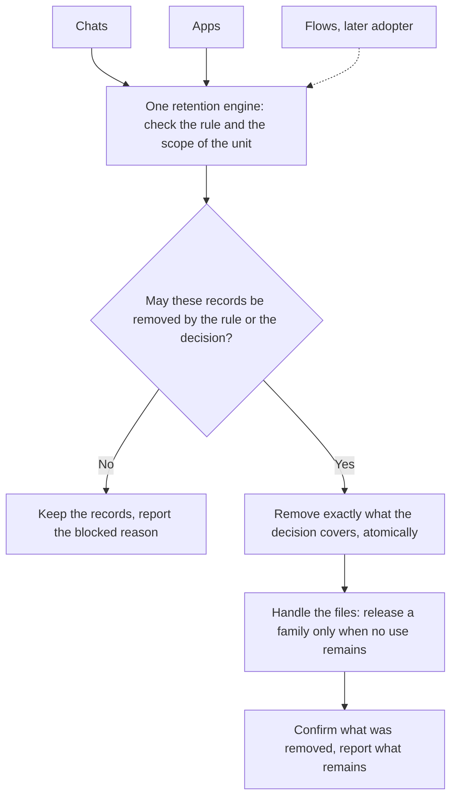
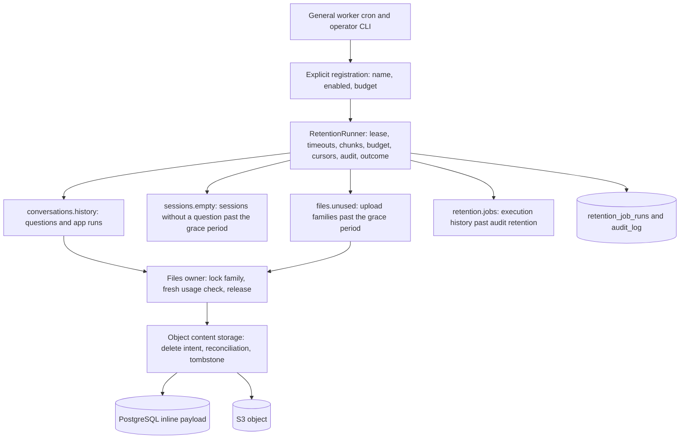
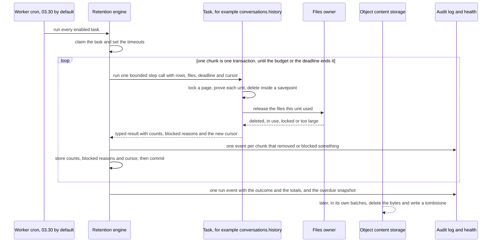
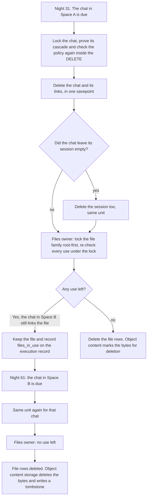
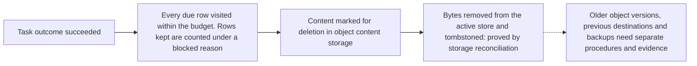

# One retention engine for stored history and content

- **Status:** Proposed; accepted when this record merges to `develop`
- **Date:** 2026-10-11
- **Decision owners:** Product and architecture
- **Scope:** Scheduled deletion of product data: chat and App history, empty
  sessions and uploaded Files with their derived content today; Flow run
  history, step assistants, transcription audio and Builder sessions as later
  adopters. Explicit erasure requests, object-store prerequisites and
  backup/restore handling are separate follow-ups listed at the end.

## Context

In Swedish public administration *gallring* means disposal that is final: the
data is removed, it cannot be recovered through the product, it happens at a
defined time under a defined responsibility, and the act is traceable without
keeping the content. The Swedish data protection authority (IMY) adds to this
in its [fundamental principles](https://www.imy.se/verksamhet/dataskydd/det-har-galler-enligt-gdpr/grundlaggande-principer/),
its [transcription report, section 5.1.3](https://www.imy.se/globalassets/dokument/rapporter/transkribering-inom-socialtjansten.pdf)
and its [report on erasure and backups, page 17](https://www.imy.se/globalassets/dokument/rapporter/imy-nationell-rapport-till-edpb-svenska.pdf):
deletion routines must name when, who and how, cover every storage location
including temporary copies, processors and backups, and must never report an
erasure that has not happened (the [Rebtel decision](https://www.imy.se/globalassets/dokument/beslut/imy-beslut-2021-03-23-dnr-di-2020-10561-rebtel-networks-ab.pdf)
reprimanded exactly that). The lawful purpose and the retention periods are the
controller's decisions; a technical reference in the database is a safety fact,
never a legal basis for keeping data.

Before this record Eneo ran three nightly jobs with their own selection,
transaction and limit rules: `cleanup_old_data`, `delete_unused_files` and
`purge_old_conversations`. The Flows work prepared a fourth. Every new domain
had to solve the same problems again: re-checking eligibility under a lock,
bounding the work, ordering locks, recovering from a crash, writing an audit
trail and pausing. The answers differed per job, history could be deleted
without releasing the uploads it used, and no single place could say what a
"completed" run had proved.

## Decision

1. **One engine.** `eneo.data_retention` owns execution: the per-task lease,
   statement and lock timeouts, bounded chunks, row/file/time budgets, durable
   discovery cursors, the required audit events, outcomes and health. A domain
   adopts it by implementing the `RetentionTask` protocol (a code-identifier
   name, three closed key sets for disposal facts, observations and blocked
   reasons, an ordered list of steps). The engine never imports an adopter; the
   composition root `eneo.main.retention_tasks` lists every task with its
   enable switch and budget, and one cron on the general worker runs that list.
2. **Two different decisions, two names.** *Retention expiry* removes history
   past its effective period together with that history's links, and releases
   a File family only when no use of it remains. *Erasure of a File* is an
   explicit decision about a named File and its derived content, across every
   use; it is a separate feature (`eneo-s55b.36`). Neither is reported as the
   other. Product code uses the English word `retention`; `gallring` is the
   Swedish product term for the outcome.
3. **Atomic unit.** One unit of deletion (a question or App run with its file
   links, a File family) runs inside one database transaction, as a savepoint
   within the chunk: lock, bounded proof of the cascade, a fresh eligibility
   check (inside the deleting statement for a question or App run; under the
   family locks, immediately before the delete, for a File family), delete,
   typed result. When a unit deletes the last question of a session, it
   deletes the session. If another transaction holds the session, the
   empty-session task deletes it in a later pass. Empty sessions are deleted
   by one statement that repeats the check on the locked rows. A unit that
   cannot complete (a lock held on a row the unit locks first, a family larger
   than the cap, insufficient remaining budget, a policy no longer due) rolls
   back whole, is reported under a typed reason, and leaves the rest of the
   chunk free to proceed. A lock wait on a row the unit does not lock first
   (a cascaded child row, an object content row) ends after the lock timeout:
   a question or App run is then kept and reported as `cascade_locked` and
   charged the bound of the statement that waited (its proved cascade for the
   root delete, three rows for the session release, the family cap for a File
   release), the chunk commits and the execution continues. The same chunk
   admits further roots only while its gather window is still open, which at
   default settings (a one-second window, a two-second lock timeout) it is
   not; the refined charge protects the execution's row budget, not the
   chunk. In the unused-files task a File family that waits ends the chunk
   and the execution ends as `partial`. No deletion is ever partial.
4. **One owner per rule.** Policy precedence for chat and App history
   (assistant or App value, then Space, then the organization default) is one
   SQL expression shared by discovery, the fresh re-check and the overdue
   report. The rows a deletion cascades to are derived from the schema
   metadata (every foreign key to the root with `ON DELETE CASCADE`); a key
   without it fails at import. Files owns reference truth: every foreign key
   to `files.id` declares `file_usage(kind)` or `file_usage(None)` in its
   column definition, the collector derives usage from the schema metadata,
   and an undeclared key fails at import. Files also owns the meaning of a
   file outcome: one typed reason per outcome, reported under one key name
   (`files_<reason>`) by every task. A refusal that keeps a conversation is
   blocked under that key; a File that a deleted conversation's release kept
   is an observation under the same key.
   Object content storage owns bytes: deleting a File releases its content
   references, the last release marks the content for deletion, and the
   existing reconciler removes the inline payload or the S3 object and leaves
   a tombstone. Adopters neither compute usage nor delete bytes.
5. **Audit without content.** A task declares three closed vocabularies:
   disposal facts (`count_keys`, for example `questions_deleted`),
   observations (`observation_keys`, for example `sessions_examined` or
   `files_in_use`) and blocked reasons (`blocked_keys`, for example
   `root_locked`). Every chunk that produced a disposal fact or a blocked
   reason writes one audit event per affected tenant (`data_retention_batch`)
   whose text and metadata name the task, the step, those counts and the job
   identifiers. Every execution that finishes writes one `data_retention_run`
   event with its outcome and totals. A task turned off by its setting writes
   `data_retention_skipped`. Observations are progress and stay on the
   execution record, so a night that only examined rows leaves one run event
   per task and no chunk events.
   Events are required (they bypass the audit configuration), their ids are
   derived from the execution and the chunk so a duplicate fails the chunk
   instead of being written twice, and their metadata holds identities and
   numbers only. The log therefore shows that something was disposed of, never
   what it said.
6. **Truthful completion.** `succeeded` means that the execution visited every
   due row within its budget; a row it did not remove is counted under a
   blocked reason. `partial` means the budget ended with due work left. Typed
   counters distinguish rows deleted, Files deleted and Files kept with the
   reason. Deleting a row is not deleting bytes; marking content for deletion
   is not a tombstone; a tombstone says nothing about older object versions,
   previous destinations or backups. Health reads `healthy` only when the
   stored executions contradict nothing: no failed latest execution, no two
   days without a completed one, no running execution with a stale heartbeat
   and no overdue work. Contradicting evidence reads `degraded` or `unknown`;
   a task without evidence reads `initializing` or `unknown`.
7. **Deployment scope.** One tenant per deployment
   ([single-tenant-assumption](single-tenant-assumption.md)); deployment-level
   effects are audited in that tenant.

## How it runs

Seen from a decision: every unit, whichever domain owns it, passes the same
four steps. Automatic expiry needs the period to have passed; a manual request
needs an explicit decision. A blocked unit is kept and its reason reported.

Seen from the code:

A run claims the task. One running row per task is the lease. A later run
takes over an execution whose heartbeat is older than
`RETENTION_LEASE_STALE_SECONDS`; the superseded execution can no longer
commit. The run then calls each step in chunks.

Discovery for chat and App history reads Assistants or Apps in primary-key
pages; each owner read costs one row (`owners_examined`), with or without a
policy. Within a page it reads the due rows in creation order. The cursor
stores the last visited record and its owner, or the last owner once all of
its records were visited. A pass ends when the owner page and the record
window both return less than their limit.

A chunk is one transaction: renew the lease first, run one bounded step call,
check the result against the task's declared keys and its batch allowance,
write the audit events, persist counts, blocked reasons and the step's keyset
cursor. A failure anywhere rolls the chunk back, so a deletion never commits
without its audit and progress. The budget is checked before every call. The
batch carries the execution's deadline, and a step admits no new unit past it
or past the chunk gather window (`RETENTION_CHUNK_GATHER_SECONDS`), so the
rows a chunk locks stay locked for a short time. When rows, files or seconds
are spent the run ends as `partial` and the next execution resumes from the
stored cursors.

Discovery, proof and deletion rows are charged against the budget: a root
costs its discovery row, the child rows its proof examined (one bounded read
per root), its own delete and the file work; a File family costs one lock, one
fresh proof and one delete per member. Bookkeeping reads (the session and file
ids of a root, usage probes, lease and progress writes) and the overdue
snapshot are not charged. A root whose cascade is larger than the unit cap is
examined up to that cap, charged, reported as blocked and skipped, so the rest
of the night's work proceeds. A unit whose remaining allowance cannot fund its
session release at its maximum cost, or that has file links and no file
allowance, is refused before its delete runs; a unit whose file families do
not fit still rolls back whole.

The two conversation streams take turns going first on consecutive days, and a
scan over a standing population (every session older than its grace period) is
its own task with its own budget, so a backlog in one stream cannot starve
another. Such a sweep (empty sessions, unused uploads) examines one row per
member of the population per pass, so a pass takes about population divided
by the task's row budget nights and `partial` is its normal outcome. The
overdue snapshot runs after the budget, once per execution, in discovery-sized
owner pages; it stops at `RETENTION_OVERDUE_MAX_ROWS` overdue rows, or after
reading as many owner rows per stream as the conversation row budget, and
then reports itself incomplete. The execution record keeps
counts, blocked reasons, cursors and the snapshot for operators.

Two clocks are in use, both UTC: chat history and sessions compare their age
with the worker's clock, read once per execution; File age and execution-record
age use the database clock inside the statement.

## How one night of retention runs

## One unit, step by step: a file shared by two spaces

Space A keeps chat history 30 days, Space B 60 days, and the same uploaded file
is attached to a chat in each. What happens on night 31 and on night 61:

What the records say afterwards. On night 31 the audit event holds
`questions_deleted: 1` and `by_space_rule: 1` and no blocked reason; the
execution record holds the observation `questions.files_in_use: 1`. On night
61 the audit event holds `questions_deleted: 1`, `by_space_rule: 1` and
`files_deleted: 1`, and `sessions_deleted: 1` when the chat's session was left
empty. At no point did Space A's shorter period reach into Space B's data.
Erasing the file from both spaces at once is a different, explicit decision
(`eneo-s55b.36`), never a side effect of expiry.

## What "succeeded" means, and does not

## What adopters must and must not do

A new domain task (a Flow run history task, a step-assistant reclaimer, an
audio release) implements `RetentionTask` and:

- declares its name and its closed key sets (disposal facts, observations,
  blocked reasons); the runner refuses an undeclared key, a negative count or
  a charge above the batch, and records such a bug as `contract_violation`;
- charges every discovery, proof and deletion row, so the budget bounds real
  database work, and stops admitting new units once the batch's deadline or
  the chunk gather window has passed;
- does its fresh eligibility check as late as possible (inside the deleting
  statement, or under the locks immediately before it) and wraps each unit in
  a savepoint that rolls back whole;
- captures the ids of linked Files before the cascade removes the link rows,
  then asks the Files owner to release each root family within the unit and
  reports every non-deleted outcome under the Files owner's classification;
- declares every new foreign key to `files.id` with `file_usage(...)`;
- implements `RetentionOverdueReporter` when the domain has deadlines, so
  health can show the backlog; the registration and the runner read that one
  declaration;
- is registered in `eneo.main.retention_tasks` behind an operator setting with
  a documented default, like the existing tasks.

It does not own a cron, open its own transactions, delete object content,
keep its own table list of file references, loop without a cursor, swallow a
typed error, or put content into a log or audit row.

## Glossary

One term per concept in new code, documentation and audit texts. Names that
existed before this record (the `unused_file_cleanup` operator command,
`UnusedFileSweepResult`, `prune_after_audit_retention`) keep their names.

| Term | Meaning | Not a synonym |
| --- | --- | --- |
| retention | the product feature; `gallring` is the Swedish term for the outcome | cleanup, purge, prune, sweep |
| expiry | removal of records whose retention period has passed | erasure |
| erasure | an explicit decision to remove one File from every place (`eneo-s55b.36`) | expiry |
| task | one registered adopter with a name, a switch and a budget, for example `conversations.history` | job |
| step | one record stream of a task: `questions`, `app_runs`, `sessions`, `families`, `history` | task |
| execution | one run of one task; one row in `retention_job_runs` | pass |
| chunk | one transaction of one execution: one bounded step call, its audit events and its progress | execution |
| pass | one complete walk over a step's population; it may span several executions | execution |
| unit | what one savepoint deletes whole: a question or App run with its links, or a File family | record |
| root | the record a unit starts from: a question, an App run or a root File | parent |
| owner | the Assistant or App whose policy a question or App run follows | parent |
| family | a root File and the Files derived from it | - |
| disposal fact | a count of removed records; audited, for example `questions_deleted` | observation |
| observation | a count of examined or kept records; on the execution record only, for example `files_in_use` | blocked reason |
| blocked reason | a count of units kept with a typed cause; audited, for example `root_locked` | observation |
| overdue | due records still stored past `RETENTION_OVERDUE_WINDOW_DAYS` | stale |
| stale | in health: no completed execution for two days; for the lease: a heartbeat older than `RETENTION_LEASE_STALE_SECONDS` | overdue |

## Stable vocabulary

Task and step names are durable keys for leases, cursors and audit events;
count, observation and blocked keys, the `RETENTION_*` settings, the CLI report
and the health payload are operator contracts. Renaming any of them after
release is a migration, not a cosmetic change. The foundation ships
`conversations.history` (steps `questions`, `app_runs`), `sessions.empty`
(step `sessions`), `files.unused` (step `families`) and `retention.jobs` (step
`history`).

## Settings

All limits are operator settings with defaults (`eneo.main.config`), read at
process start: the schedule (`RETENTION_CRON_HOUR`/`MINUTE`), per-task enable
switches, rows, files and seconds per execution, the chunk size and gather
window, the unit and family caps, the two grace periods (unused uploads and
empty sessions, 24 hours each), statement and lock timeouts, the lease
staleness, the overdue window and cap, and the health timeout and cache. The
cross-checks between caps and budgets are validated at start, so a conflicting
configuration stops the process with the reason instead of refusing every unit
at night. A disabled task still records a skipped execution and an audit event,
so a pause is visible. The documentation site lists every setting with its
default and meaning.

## Consequences

- Chat, App, empty-session and upload cleanup share one safety contract and
  one place to read results; the three old jobs and `DataRetentionService` are
  removed.
- Adding a domain means a task of a few hundred lines plus a registration,
  not a scheduler, a lock protocol and an audit design.
- Runs are slower than an unbounded `DELETE` on purpose: work is capped and a
  large backlog is spread over several nights. Oversized units stay until an
  operator raises the applicable limit or resolves the cause; they are visible
  as blocked counts and in health.
- Health reads `initializing` only until the first task has written a row; a
  registered task without a row after that is `unknown`, a running execution
  with a stale heartbeat is `unknown` with the flag `abandoned`, and a failed
  run is `degraded`.
- The engine proves database work. Byte removal is proved by object content
  storage's own reconciliation and health; older object versions, previous
  storage destinations and backups need the operator procedures in the
  storage guide, and the follow-ups below.
- Questions whose Assistant was deleted keep a null owner and follow no
  policy, so they do not expire. This is unchanged from before this record and
  is tracked as a follow-up.

## Follow-ups and related records

- `eneo-s55b.35` typed S3 write prerequisites (unversioned, no Object Lock)
  enforced at the adapter.
- `eneo-s55b.36` explicit File erasure with a Files-owned read and reattach
  fence; an existing hold blocks the whole request and keeps current access
  until resolved.
- `eneo-s55b.37` deletion evidence that survives a database restore.
- Flow adoption (`eneo-s55b.9`, `.15`, `.20`, `.28`): thin tasks on this engine
  after it merges and is synced to the Flows branch.
- `eneo-s55b.38` a read-only retention preview without row locks, and a shared
  dry-run only when a second adopter needs the same semantics.
- `eneo-s55b.39` flatten tenant-keyed effects when the tenant layer is removed.
- `eneo-s55b.40` gate residue and the smaller quality findings: owner
  re-probing per chunk, a File family that survives an object content lock
  wait, questions without an owner, long functions.
- Operator documentation: `docs/audit-logging` and
  `guides/object-content-storage` on the documentation site.
