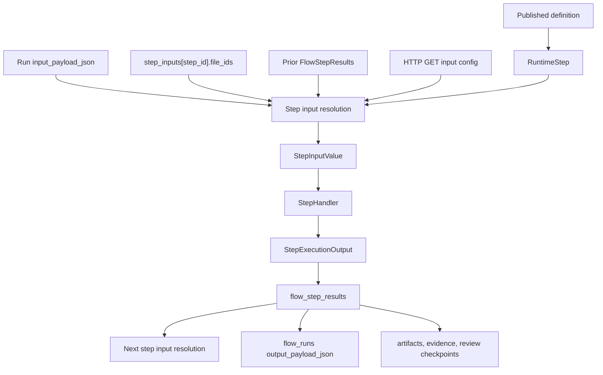

# Flow Developer Quickstart

This page is a developer quickstart for Eneo Flows. Core includes authoring and
the complete runtime. A Flow is authored in the editor or from its authoring
chat; both write the same draft model through the same operations, and neither
adds a separate runtime contract.

It
explains the core data model, the published runtime contract, how step inputs
and outputs move through a run, and where to look before changing the system.
For the deeper maintainer view, read [architecture.md](./architecture.md) and
[package-layout.md](./package-layout.md).

## One-minute model

A Flow is a versioned executable recipe.

- Authoring edits a draft Flow: rows in `flows` and `flow_steps`.
- Publishing freezes the draft into an immutable runtime snapshot:
  `flow_versions.definition_json`.
- Running a Flow creates a version-pinned execution: one `flow_runs` row plus
  per-step runtime records.
- Runtime code should execute the published snapshot, not the mutable draft.
- The authoring chat is an ordinary assistant chat bound to one Flow. Its
  assistant reads and changes that Flow through Eneo's loopback flow tools,
  which save through the same operations as the editor.

The most important invariant is draft/runtime separation: editing a draft after
publish must not change an already-created run or the published version it was
prepared against.

## Core objects

| Object | Storage or contract | Purpose |
| --- | --- | --- |
| Draft Flow | `flows` | Mutable authoring record, metadata, current published version pointer, draft revision. |
| Draft Step | `flow_steps` | Ordered authoring step configuration before publish. |
| Published Flow Version | `flow_versions.definition_json` | Immutable, checksummed runtime snapshot for a published version. |
| Run Contract | `FlowRunContractPublic` | API-facing contract that tells clients which form fields, uploads, review points, and final output to expect. |
| Flow Run | `flow_runs` | One execution of one published Flow version. Stores status, principal identity, input payload, output payload, and errors. |
| Step Result | `flow_step_results` | Current result for one runtime step attempt. Stores resolved input, output, prompt, token usage, and status. |
| Step Attempt | `flow_step_attempts` | Attempt history for retries, recovery, and diagnostic evidence. |
| Runtime Upload | `flow_runtime_uploaded_files` | Pre-run uploaded file accepted for a specific published runtime step. |
| Step Input File | `flow_run_step_input_files` | Run-time binding from uploaded file to the step that consumes it. |
| Step Result File | `flow_run_step_result_files` | Generated or declared artifact emitted by a step. |
| Review Checkpoint | `flow_run_review_checkpoints` | Human review pause, editable payload, state, and revision. |
| Audit/Webhook Outbox | `flow_run_audit_outbox`, `flow_run_webhook_deliveries` | Reliable outbound delivery records for audit and webhooks. |
| Authoring Chat | `flow_authoring_chats` | One user's chat for one Flow: an ordinary conversation and hidden assistant bound to the Flow, with an edit-mode switch. |

## Runtime API shape

External clients should treat the run contract as the source of truth. Do not
guess form fields, upload steps, or final output shape from draft authoring
data.

Recommended consumer path:

1. `GET /api/v1/flows/{id}/published/`
   - Fetch the runtime-safe published projection of the Flow.
2. `GET /api/v1/flows/{id}/run-contract/`
   - Read `published_flow_version`, `form_fields`, step upload requirements,
     review steps, final output delivery, file limits, and template readiness.
3. `POST /api/v1/flows/{id}/steps/{step_id}/runtime-files/`
   - Upload files to the exact step ids from the run contract.
4. `POST /api/v1/flows/{id}/runs/`
   - Send `expected_flow_version`, `input_payload_json`, and
     `step_inputs[step_id].file_ids`.
5. `GET /api/v1/flows/{id}/runs/{run_id}/`
   - Poll run status. For `outbound_http` delivery, inspect
     `webhook_deliveries` for each step attempt's persisted `pending`,
     `delivered`, or `dead_lettered` state and charged `delivery_attempts` count.
6. `GET /api/v1/flows/{id}/runs/{run_id}/steps/`
   - Inspect per-step progress and outputs.
7. If the run reaches `awaiting_review`, use the review checkpoint endpoints.
8. If the run completes with artifacts or evidence, use the artifact and
   evidence endpoints from the published runtime paths.

Create-run payload shape:

```json
{
  "expected_flow_version": 3,
  "input_payload_json": {
    "employee_name": "Alex Example"
  },
  "step_inputs": {
    "00000000-0000-0000-0000-000000000101": {
      "file_ids": ["00000000-0000-0000-0000-000000000701"]
    }
  }
}
```

`input_payload_json` keys should come from `form_fields[].name` in the run
contract. Uploaded file ids belong under the specific consuming step id. Top
level `file_ids` is intentionally rejected.

## Step schema

Each runtime step is parsed from the published definition into a `RuntimeStep`.
The fields below explain most step behavior.

| Field | Meaning |
| --- | --- |
| `step_id` | Stable step id from the published snapshot. Runtime file inputs and results refer to this id. |
| `step_order` | Execution order within the published Flow. |
| `assistant_id` | Assistant/model configuration used by model-backed execution. |
| `user_description` | Authoring prompt or task description for the step. |
| `input_source` | Where the step gets its input: `flow_input`, `previous_step`, `all_previous_steps`, `http_get`, or `tool`. With `tool`, a step takes its input from the answer of one MCP tool: a tool of a general MCP server that the flow's space has activated, switched on and with an approved definition. It is configured in the step editor's Advanced mode or through the API. |
| `input_type` | Expected input kind: `text`, `json`, `image`, `audio`, `document`, `file`, or `any`. |
| `input_bindings` | Structured references to form answers, source refs, or prior structured fields. Prefer this for explicit data flow. |
| `input_config` | Step input configuration, including HTTP or runtime file settings. |
| `output_mode` | Execution behavior: `pass_through`, `compose_text`, `copy_input`, `http_post`, `transcribe_only`, `speaker_mapping`, `template_fill`, or `render_verbatim`. |
| `output_type` | Final type produced by the step: `text`, `json`, `pdf`, or `docx`. |
| `output_contract` | Typed output shape, validation rules, and artifact expectations. |
| `output_config` | Renderer, HTTP delivery, or output-mode-specific configuration. |
| `review_policy` | Optional human review behavior for this step. |
| `plan_step_ref` | Authoring reference from a draft spec (such as a Flow package) that survives materialization into runtime steps. |

`input_source` answers "where does the input come from?" `output_mode` answers
"how should this step execute or render?" `output_type` answers "what kind of
value or artifact does the step produce?"

Flow supports HTTP GET and the answer of one MCP tool (`tool`) as input sources
and durable HTTP POST as a terminal output mode. Flow does not support HTTP POST
input, or MCP servers and tools on a step's assistant, at authoring, publish,
runtime, or package boundaries.
Standalone assistants and conversations keep their separately owned MCP
behavior. A Flow package export is not blocked when its step assistants have
persisted MCP server or tool associations: it omits those associations and
records only the positive distinct-assistant count in strict package provenance.
Ordinary exports record an empty omissions list. Never add MCP identifiers,
configuration, credentials, or content to the Flow package.

Package validation and import planning return that same closed omission value.
The export response also exposes a conditional
`Eneo-Package-Omitted-Mcp-Assistant-Count` header so the SDK and UI can require
acknowledgement before saving and warn again before installation. Knowledge
replacement guidance is bounded metadata: 4,000 characters for summary or
setup notes, 20 entries per recommendation/exclusion list, and 1,000 normalized
characters per entry. It must not contain local knowledge content or
configuration.

An editor lists the tools a step can choose with
`GET /api/v1/flows/{id}/tool-options`: the tools of the MCP servers the flow's
space has activated, each with its approved input schema and a `refusal` that
is `null` when no level of the MCP decision refuses the tool now. Refused tools
are listed with the refusal; the tools of a server that is not a general one
(a capability provider or one of Eneo's own servers) are not.
A personal space has no MCP servers, so its list is empty. It needs the
permission to edit flows in the space. One database statement reads the list
and returns it only up to the first tool past 1,000 tools or past 8 MiB of
the counted text of them (each tool's server name, tool name,
approved description and approved input schema, which the list returns, and its
server's address, which it does not); such a list is refused with 413
`flow_tool_options_too_large`, never listed in part.

### Speaker mapping (`speaker_mapping`)

A `speaker_mapping` step follows a `transcribe_only` step whose transcript has
diarized speaker labels (`[HH:MM:SS - HH:MM:SS] SPEAKER_00: ...`). It requires
`input_source=previous_step`, `input_type=text`, `output_type=json`, a
`review_policy` of `edit` (enforced), and `output_config.speaker_mapping.participants_field`
naming a `text` or `multiselect` form field with the participants. A completion
model proposes which participant each label is; the step output is the mapping
(`structured`, fixed contract) plus the transcript with names applied (`text`),
and the run pauses at the review checkpoint where the reviewer confirms or
corrects the names. Editing re-derives the text from the mapping. The step and
the edit also update `{{transkribering}}` on the run input, but only while it
still holds the inline transcript the step read; otherwise it keeps its text.
`output_config.speaker_mapping.speaker_count_field` may name a `number` form field. A run's
upper bound on speakers is its own `max_speakers`, else that field's value, else the flow's
default (`wizard.transcription_max_speakers`, shown as `transcription.max_speakers.default` in
the run contract), else automatic. Eneo never derives the bound from the participant names. The
bound is sent to the speaker identification service as `max_speakers` and recorded in the
transcription step's metadata. Transcripts from several audio files are
renumbered so labels are unique across the whole transcript.

## How data moves between steps

At run time, step input resolution converts the published step definition plus
the current `RunExecutionState` into a `StepInputValue`. The step handler then
executes the step and persists a `StepExecutionOutput`.



Common input paths:

| Input path | What happens |
| --- | --- |
| `flow_input` | Reads values from `input_payload_json`, usually through form fields or structured bindings. |
| `previous_step` | Reads the immediately previous step output. Invalid for the first step. |
| `all_previous_steps` | Formats all prior step outputs into a deterministic text segment. Invalid for JSON input. |
| `input_bindings.source_refs` | Pulls selected fields or arrays from prior structured outputs and composes deterministic text. |
| Runtime files | Loads, extracts, transcribes, or passes file data according to runtime input config and file policy. |
| `http_get` | Fetches input through the runtime HTTP transport before step execution. |

Publish validates every read a step makes (questions, source references,
prompts and HTTP requests) against the persisted form, runtime names, earlier
steps, and declared output contracts, whichever path wrote the draft:

- `{{ flow_input.<field> }}` accepts a declared form field. A declared field can
  also be bare, such as `{{ case_id }}`, only when the runtime exposes that safe
  alias. Bare `flow_input` and its primary input keys are valid where the run
  supplies them (see the free-text rule below); undeclared names and unknown
  `flow_input` keys are rejected.
- In a valid publish graph, bare `datum`, `indata_text`, and `transkribering`
  keep their runtime meanings. Form fields named `datum` or `indata_text` are
  reached as `flow_input.datum` or `flow_input.indata_text`.
  `transkribering` is a primary runtime input key, not a custom form field.
- Free-text run input (`indata_text`, `indata_json`, `flow_input.text`,
  `flow_input.json`, `flow_input.structured`) is what the run dialog's text box
  supplies, and the box appears only when the run form collects free text. The
  run dialog and the documented run contract supply only a flow's declared form
  fields (and uploads), so publish refuses a question, prompt, output mapping,
  or HTTP step URL and header that reads run text on a flow with form fields or
  uploaded files. A version published earlier that reads it keeps running as
  before.
- A question can use an earlier numeric reference (`step_N`) or the exact
  trimmed earlier display label, for example `{{ Collect intake }}`. A label is
  a complete text value: current, future, unknown, and dotted label paths are
  rejected. `source_refs` accept the same prior numeric refs and exact labels.
- Numeric structured paths such as
  `step_1.output.structured.report_title` publish only when the referenced
  earlier step's `output_contract` proves every segment. Missing contracts,
  unknown fields, and paths through scalar values are rejected before runtime.
- A step's prompt (when the step calls a model) and an HTTP step's request
  configuration are interpolated when the step runs, so publish refuses a read
  there that names nothing the run has: a name the flow does not declare as a
  form field, step name or runtime variable; a path below a form field or a
  step name (a step name reads that step's text); a path a step result does not
  have; or a step without a result yet (the step itself, a later step, an order
  the flow does not have, or the previous step of the first step). A structured
  read of a step that yields text is refused, and when the producer declares an
  `output_contract` the structured path must be in it.
- `source_refs` may not read the same source twice: the run renders each one
  as its own section of the input. A source ref that reads a producer's
  structured output is refused when the producer yields text, and when the
  producer declares a contract its `field_path` must be in it.
- Authoring lowers `plan_step_ref` values to `step_N` before persisting a
  `FlowStep`. `existing_step_ref` identifies an edited step only; neither raw
  identity token is persisted binding syntax, and publish rejects either if it
  survives authoring.

Publish errors identify the precise binding location: question reference and
path errors point to `input_bindings.question`, while source-reference errors
point to the indexed `input_bindings.source_refs[i].step_ref`. Prompt and HTTP
request reads name `prompt` or the configuration path in `context.field`.

Publish also refuses step shapes the run cannot execute. A step that reads each
uploaded file on its own (`runtime_input.execution_mode` `per_source`) must
write one `documents` array whose items declare the source fields the run fills
in (`source_label`, `source_file_id`, `extraction_warnings`). A step that maps
the previous step's items (`input_config.item_map`) needs an `input_contract`
and an `output_contract` that each have exactly one top-level property, an
array of objects. An `audio` step that takes uploads must set
`input_config.runtime_input.input_format` to `audio` (checked on every save),
since the format decides which files the run accepts and whether it transcribes
them.

Prefer explicit bindings over `all_previous_steps` when the Flow needs precise
data flow. `all_previous_steps` is useful for broad summarization, but it hides
which prior field is load-bearing and can waste context.

## Output and final delivery

Step output has two related concepts:

- `output_mode`: the handler behavior.
- `output_type`: the contract and API-visible result type.

Examples:

| Use case | Typical shape |
| --- | --- |
| Plain model step | `output_mode=pass_through`, `output_type=text` or `json`. |
| Deterministic text assembly | `output_mode=compose_text`, usually before document rendering. |
| Audio transcription | `output_mode=transcribe_only`, `output_type=text`. |
| DOCX template fill | `output_mode=template_fill`, `output_type=docx`; targets are Word content controls. |
| PDF or DOCX rendering from final body | `output_mode=render_verbatim`, `output_type=pdf` or `docx`. |
| Outbound API delivery | `output_mode=http_post`, final delivery is `outbound_http`. |

The run contract exposes the terminal delivery mode:

- `payload` for text or JSON results returned as run payload.
- `artifact` for generated PDF or DOCX output.
- `outbound_http` for HTTP delivery.

Outbound HTTP delivery is at least once. The run detail and evidence view/export
expose a secret-free `webhook_deliveries` projection ordered by step and attempt.
It includes lifecycle timestamps and charged attempt counts, but never authored
URLs, headers, request bodies, idempotency keys, claim/lease data, or free-form
transport errors.

Completed payload delivery uses a closed result discriminator. `inline_text`
contains exact complete text. When text exceeds inline storage,
`file_backed_text.preview` is only a bounded, non-authoritative prefix and
`file_backed_text.file` identifies the current-attempt generated output to
download through the authorized artifact endpoint when `file.availability` is
`available`. When it is `content_purged`, the complete text is unavailable and
the artifact endpoint returns `410`; the preview still is not the full result.
Structured results expose authored JSON under `structured.value`.

## Large inputs and source material

Flow authoring should express whether the Flow needs exhaustive reading or
selective retrieval.

- Use per-source mapping when the Flow must process every uploaded document or
  every item in a corpus.
- Use retrieval/RAG only when the Flow should answer selectively from a larger
  corpus.
- Keep file routing step-specific. A file uploaded for one published runtime
  step is not a generic run-wide input.
- Keep context-window risk visible in authoring and validation. Do not hide it
  with broad repair logic at run time.

## Authoring

A Flow is authored in the editor or from its authoring chat. Both are front
ends over one core path, not separate engines.

- The editor route `PATCH /api/v1/flows/{id}/editor/` applies one change in one
  revision: flow settings, sparse step edits, new steps with their managed
  assistants, and `step_order` to move, insert or remove steps. It is fenced on
  `expected_revision` and saves as a whole or not at all.
- The authoring chat (`POST /api/v1/flows/{id}/authoring-chat/`) is an ordinary
  assistant chat bound to one Flow; each user has one chat per Flow, and the
  space's default model must support tool calling. Its assistant reaches the
  Flow only through the loopback flow tools
  (`backend/src/eneo/internal_mcp/flows.py`): `read_flow`,
  `update_flow_settings`, `read_step_assistant`, `update_step`, `add_step`,
  `move_step`, `remove_step`, `publish_flow`, `unpublish_flow`,
  `read_tool_options`, `read_flow_suggestions`, `apply_flow_suggestions`,
  `dismiss_flow_suggestion`, and the run tools `run_flow`, `read_run`,
  `cancel_run`, `read_review` and `review_run`. The chat starts in view mode; tools that
  change the Flow are refused until the user turns on edit mode
  (`PATCH /api/v1/flows/{id}/authoring-chat/{session_id}/`).
- Both save through `flows/application/flow_authoring_operations.py`. The
  editor route and the chat's writing tools use `apply_editor_update`, which
  ends in the same `update_flow` operation as `PATCH /api/v1/flows/{id}/`, on
  top of `FlowService.update_flow`; publish and unpublish go through the same
  module. A change made in the chat is therefore validated, classified and
  audited exactly like one made in the editor.
- When steps move, are inserted or are removed, the `step_N` reads of every
  kept step follow their producers (`flows/application/flow_step_structure.py`).
  A change that removes a step another step reads, or moves it after its
  reader, is refused with `flow_step_read_lost_producer`.
- Flow packages author through `flows/application/flow_authoring_command.py`
  and draft materialization, which lower a `FlowDraftSpecCore` into the same
  draft rows.

Important authoring rules:

- Publish is the gate. Rules about what a step may read live in the publish
  validators (`flows/flow_validators.py`), not in either front end, so every
  authoring path is held to the same contract.
- Prevent invalid topology at the authoring or publish boundary instead of
  adding runtime repair layers. A Flow is built once and may run many times.
- Credentials stay with the editor. The chat's tools refuse step configuration
  that carries a credential, or that changes an HTTP configuration holding one.

## Suggestions

`GET /api/v1/flows/{id}/suggestions/` says what a draft could do cheaper or
simpler: data a step's model receives twice, takes without needing it, or
produces for no one. It needs edit access, never blocks publish, and never
changes the flow by itself.

- **From the draft.** The static rules read the steps through
  `eneo.flows.step_lineage`, which splits each step's reads by the channel that
  carries them to the model (`input`, `prompt`, `config`). These are the reads
  publish and the runtime resolve, so a suggestion states what the definition
  proves: no model judges a prompt. Codes: `duplicate_read`,
  `broad_all_previous_steps`, `whole_structured_read`,
  `unread_contract_fields`, `unread_result`, `relay_step`,
  `per_item_prompt_read`, `repeated_long_material`, `unused_form_field`.
- **From recent runs** (`?runs=1..50`). This also needs the `flows_trace`
  permission. Only runs the caller may see evidence for are counted; the
  others are reported in `runs.left_out`. The read takes numbers only (edge
  sizes and hashes, token counts, call reasons and forwarding facts), never
  content, and writes one `flow_evidence_viewed` audit entry on the flow that
  names the runs it counted; it answers 503 when that entry cannot be
  written. Measured impact adds `tokens_per_run`, `run_count`, `version` and
  `step_changed_since` where the runs support an honest number, and the
  measured codes are `identical_inputs`, `context_headroom`,
  `format_fallback`, `model_relay`, `overlapping_inputs`,
  `deterministic_candidate` and `oversized_reasoning`. `identical_inputs`
  and `context_headroom` fire on what any counted run showed;
  `format_fallback`, the forwarding rules and `oversized_reasoning` need it
  in at least half of the counted runs. The thresholds are named constants
  in `flow_suggestion_measured.py`, `flow_suggestion_forwarding.py` and
  `flow_suggestion_model_fit.py`.
- **Forwarding facts.** After the first model call of each step attempt, the
  worker measures how much of each input recurs in another input of the call
  and how much of the output was copied from each input (8-word shingles after
  NFKC, casefold and whitespace folding). It stores numbers and edge indexes
  in `flow_step_attempt_resolved_inputs.forwarding_facts_jsonb`, never text,
  within a 50 ms budget per attempt; past it the facts say
  `measured: false`. Mapped steps are measured on their first call.
- **The suggestion.** Each one has a `code`, the `steps` it is about,
  `params`, an `impact` (`basis` `definition` or `runs`, a `level`) and a
  `fix.kind`: `patch` (an editor update body the core can apply), `assisted`
  (the chat proposes the change) or `advice`. A patch that would make publish
  refuse the draft is offered as `assisted`. The `fingerprint` comes from the
  code, the step ids and the finding's premise, so it survives renumbering,
  renaming and unrelated edits, and changes when the finding does.
- **Applying.** `POST /api/v1/flows/{id}/suggestions/apply/` with
  `{expected_revision, fingerprints}` recomputes the suggestions and applies
  each patch in order through `apply_editor_update`, in one transaction: one
  draft revision per fix, all or none. A fix an earlier one made unnecessary
  is skipped and listed in `skipped`. A fingerprint that no longer matches is
  `409 flow_suggestion_stale`, a fix that is not a patch
  `409 flow_suggestion_not_patchable`, and a stale revision the editor's own
  conflict. The audit entries carry `origin: "suggestion"`.
- **Dismissals.** `POST /api/v1/flows/{id}/suggestions/{fingerprint}/dismissal/`
  with `{code}` hides a suggestion for every editor of the flow, and `DELETE`
  on the same path shows it again; both need edit access, the `POST` refuses
  service keys (`service_key_cannot_create_resources`), and each writes a
  required audit entry (`flow_suggestion_dismissed`,
  `flow_suggestion_restored`). Rows live in `flow_suggestion_dismissals`,
  one per flow and fingerprint, and go with the flow; packages do not carry
  them. Reads leave dismissed suggestions out and report `dismissed_count`;
  `include_dismissed=true` returns them marked. A dismissal does not change
  `draft_revision`. A static fingerprint must still be among the draft's
  suggestions (`409 flow_suggestion_stale` otherwise); a measured one is
  stored as given, since checking it would read run evidence.
- **The chat.** `read_flow_suggestions` reads them (with `include_runs`, only
  for users with the trace permission), `apply_flow_suggestions` applies
  patches and `dismiss_flow_suggestion` hides one when the user asks, both in
  edit mode. The chat's writing tools report the suggestions their
  change introduced, and the chat's guidance is built from
  `FLOW_SUGGESTION_AUTHORING_RULES`, so a step the chat writes avoids the
  patterns from the start.

To add a rule: a `FlowSuggestionCode`, the rule in a domain module next to
the others (pure, thresholds as named constants), a fingerprint premise built
from step ids (`read_premise`, `producer_key`), a line in
`FLOW_SUGGESTION_AUTHORING_RULES`, and the code's text in web-next's
`features/flows/flow-suggestions.ts` (a code the UI does not know shows a
generic text until then).

## Canonical owners

Before changing Flow behavior, identify the owner and extend that owner instead
of adding a parallel path.

| Concept | Canonical owner |
| --- | --- |
| Published runtime snapshot | `eneo.flows.published_definition` |
| Run contract assembly | `FlowRunContractService` |
| Run creation and lifecycle | `FlowRunService` and runtime dispatch payloads |
| Step input resolution | `eneo.flows.runtime.step_input_resolution` |
| Step execution behavior | runtime executor and `StepHandler` behavior selected by `output_mode` |
| Output validation/rendering | `OutputFormatSpec` and output processing modules |
| Runtime file upload policy | `FlowRuntimeFileService` and runtime upload repository |
| Review checkpoints | run review checkpoint API and runtime services |
| Draft changes from the editor and the authoring chat | `flow_authoring_operations.apply_editor_update` on `FlowService.update_flow` |
| Step move, insert and remove | `flow_step_structure.restructure_steps` |
| Authoring chat binding and edit mode | `flow_authoring_chat` and the loopback `internal_mcp/flows.py` server |
| Publish validation | `flow_validators` |
| A step's reads, by channel | `eneo.flows.step_lineage` |
| Flow suggestions (rules, fingerprints, fixes) | `flow_suggestions` and the `flow_suggestion_*` domain modules, served by `flow_suggestion_service` |
| Applying suggestions | `flow_suggestion_apply` on `apply_editor_update` |
| Forwarding facts | `eneo.flows.runtime.forwarding_facts` and `forwarding_capture` |
| Package and draft-spec authoring | `flow_authoring_command` and draft materialization |
| Flow package layout rules | [package-layout.md](./package-layout.md) |

## Practical editing rules

- Read the run contract first when changing external runtime behavior.
- Keep draft authoring and published runtime behavior separate.
- Prefer typed contracts over raw JSON bags at code boundaries.
- Prefer explicit `input_bindings` and source refs over implicit string
  concatenation.
- Delete dead compatibility paths only with evidence that persisted data and
  tests no longer need them.
- Keep tests behavior-focused: API contract, run lifecycle, step input/output,
  publish snapshot and publish validation, and parity between the editor and
  the authoring chat.

Flow schema revisions are still unreleased and may be consolidated. An existing
Alembic stamp does not replay an amended foundation revision. For a disposable
development database, point configuration at a new empty database and run
`cd backend && uv run alembic upgrade head`; do not reuse a stale branch
snapshot as physical-schema proof. See
[Per-branch database snapshots](../../backend/README.md#per-branch-database-snapshots).

## FAQ

### What is a Flow?

A Flow is a versioned recipe for running one or more AI-backed steps. The draft
is editable. The published version is the frozen recipe used by runs.

### What is a step?

A step is one unit of work in a Flow. It declares where its input comes from,
what kind of input it expects, how it runs, and what kind of output it produces.

### What is the difference between a draft Flow and a published Flow?

The draft lives in `flows` and `flow_steps` and can change during authoring. A
published Flow lives in `flow_versions.definition_json` and does not change.
Runs use the published version they were created against.

### When is a Flow runnable?

A Flow is runnable after it is published and its run contract can be resolved.
Clients should call `GET /api/v1/flows/{id}/run-contract/` before rendering a
form or creating a run.

### Why does the run contract matter?

The run contract is the API source of truth for runtime clients. It tells the
client which fields to ask for, which steps accept files, which version to pin,
whether review can happen, and whether the final result is a payload, artifact,
or outbound delivery.

### How do form values reach a step?

Clients send form values in `input_payload_json`. Step input resolution reads
those values through the published step contract, usually by field name or
explicit input bindings.

### How do files reach a step?

Files are uploaded to a published step id before run creation. The create-run
request then passes the returned ids in `step_inputs[step_id].file_ids`. Files
are step inputs, not generic run inputs.

### How do steps pass data to later steps?

Each completed step writes a step result. Later steps can read the previous
step, all previous steps, or explicit fields from prior structured outputs.
Use explicit bindings when a later step needs specific data.

### When should a step use `previous_step`?

Use `previous_step` when the next step should consume the immediately previous
result as a whole, such as "draft text" followed by "review text".

### When should a step use `all_previous_steps`?

Use `all_previous_steps` only when the step needs broad context from every
earlier step. Avoid it for precise data movement and JSON input.

### What is the difference between `output_mode` and `output_type`?

`output_mode` chooses behavior, such as model pass-through, text composition,
transcription, template filling, rendering, or HTTP posting. `output_type`
chooses the produced shape: text, JSON, PDF, or DOCX.

### Why send `expected_flow_version` when creating a run?

It prevents stale submits. If the Flow was republished after the client loaded
the run contract, the backend can reject the old request instead of running it
against a different contract.

### What is a review checkpoint?

A review checkpoint pauses a run so a human or approved service key can inspect,
edit, approve, reject, or resume a step output before downstream steps continue.

### How is a Flow authored?

In the editor, or from the Flow's authoring chat: an ordinary assistant chat
whose assistant reads and changes this one Flow through Eneo's flow tools. Both
save through the same operations, so a change made in the chat is validated,
classified and audited like one made in the editor, and publishing checks the
whole Flow either way.

### How do DOCX templates and DOCX rendering work?

The shared tool runtime renders and fills every Word and PDF document, the same
engine the chat document tools use. The core prepares what it sends and checks
what comes back: `runtime/document_rendering/service.py` holds a document to
the render limits and turns the block model into Markdown
(`markdown_projection.py`) with its headings numbered from one; skipped heading
levels and outlines deeper than six levels are refused before the runtime is
called. The runtime writes headings, paragraphs, bullet and numbered lists,
tables with a repeating header row, code, bold, italic, code spans and links
with the template's own styles, and a fresh numbering instance per numbered
list. Mixed bullet/number nesting, nesting beyond three levels, nested numbered
lists that do not start at one, and parent-item text after a nested list are
refused with a typed error.

`render_verbatim` renders into the runtime's built-in template: styles,
Swedish language, the document title and page numbering in the footer, no
organisation name or logo. Publishing a flow with a Word or PDF step, or
starting its run, is refused with `flow_document_runtime_required` when no
runtime answers (`runtime/document_runtime_preflight.py`).

`template_fill` writes into Word content controls
(`runtime/docx_template_runtime.py`): the control's tag is the placeholder name
a binding addresses, the title is its label, and the placeholder text is the
authoring hint the step editor shows beside the control. The runtime reads the
controls and reports where each one sits; the core holds them to the flow
profile. Two kinds are
supported: body-level rich text controls (a whole section; Markdown is parsed
and sub-headings are placed relative to the nearest preceding heading) and
inline text controls (one line, or several with `multiLine`). Controls without
a tag, duplicate tags, nested controls, XML-mapped controls, other control
kinds and controls in table cells, headers or footers are refused at
inspection, before a template can be selected. Rich controls must be direct
children of the document body; text controls must be inside body paragraphs.
Templates must contain at least one supported control; `{{...}}` text
placeholders are not fill targets and must be converted to tagged Word content
controls before publication.
Every control must have a binding before publication. Bindings must select text
outputs, scalar fields in declared output contracts, scalar form fields or known
scalar system values. A binding may name an earlier step by its name, which
reads that step's text; a path below a step name is refused. Whole objects,
arrays and unknown value shapes are refused at publication. A binding that
resolves to nothing at runtime is an error; an explicit empty binding removes
the control and keeps the surrounding static content. Source and text size
limits include both inline fields and rich sections.
The finished document's text is read through `docx2python`, which sees control
content.

The example templates (`dokument`, `rapport`, `motesprotokoll`) are built by
`backend/scripts/build_standard_docx_templates.py` and committed under
`backend/src/eneo/flows/runtime/templates/standard/`. They are neutral
developer examples: copy a file from that directory, add branding and edit
controls in Word's Developer tab, then upload it as a DOCX template.

Writer guidance for the model derives from the block model in
`document_rendering/guidance.py` and is the single owner of what the prompts
say about markdown and structure.

### Where should a developer start when changing Flow behavior?

Start with the canonical owner table above. For API-facing runtime changes,
start with the run contract. For data movement changes, start with step input
resolution. For authoring changes, start with `flow_authoring_operations` and
the publish validators in `flow_validators`.

## Quick troubleshooting

| Symptom | First place to inspect |
| --- | --- |
| Client cannot start a run | `GET /run-contract/`, `expected_flow_version`, required form fields, and required `step_inputs`. |
| File upload accepted but run says input missing | Check the uploaded file id is under `step_inputs[step_id].file_ids` for the same step id returned by the contract. |
| First step tries to read previous output | Step validation or input resolution. The first step cannot use `previous_step` or `all_previous_steps`. |
| JSON step receives concatenated text | Check for `all_previous_steps`; JSON input should use explicit bindings or structured previous output. |
| Published run differs from latest draft | Expected behavior. Runs use `flow_versions.definition_json`, not mutable draft rows. |
| Publish refuses a read | The refusal names the step, where it reads (a question, a source ref, the prompt or an HTTP request field) and what it reads. Declare the value or read an earlier step. |
| Moving or removing a step is refused with `flow_step_read_lost_producer` | A kept step reads the step the change removes or moves after it. Change that read first. |
| The authoring chat cannot change the Flow | Edit mode is off or the draft revision is stale: turn on edit mode or reload the current revision. |

## Related docs and source entry points

- [Flow architecture](./architecture.md)
- [Flow package layout](./package-layout.md)
- `backend/src/eneo/database/tables/flow_tables.py`
- `backend/src/eneo/flows/published_definition.py`
- `backend/src/eneo/flows/flow_run_contract_service.py`
- `backend/src/eneo/flows/runtime/step_input_resolution.py`
- `backend/src/eneo/flows/domain/runtime.py`
- `backend/src/eneo/flows/application/flow_authoring_operations.py`
- `backend/src/eneo/flows/application/flow_step_structure.py`
- `backend/src/eneo/flows/application/flow_authoring_chat.py`
- `backend/src/eneo/internal_mcp/flows.py`
- `backend/src/eneo/flows/flow_validators.py`
