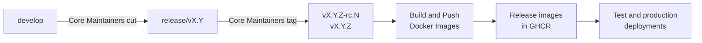

import { Callout } from "nextra/components";

# Governance and Roles

Eneo is open source and built together by public-sector organisations.
Municipalities and agencies run it in production, so everyone who uses it needs
to trust what goes into the platform and what is released.

We achieve that by separating two responsibilities. **Contributing** is open:
partner organisations and anyone else can propose and build improvements.
**Stewardship** sits with one accountable team, which decides what is merged
and released.

This page explains the roles and the protections behind them. For the practical
steps, see [Contributing to Eneo](/contributing). For how these rules fit with
Eneo's other security controls, see [Security at Eneo](/docs/security).

## Two roles

### Core Maintainers: stewards of the platform

Core Maintainers is the Eneo team at Sundsvalls kommun
(`@eneo-ai/core-maintainers`). The team is accountable for everything that
ships. It:

- keeps the codebase in line with the agreed technical roadmap and architecture
- reviews and approves contributions from outside the team
- agrees as a team on its own changes before they are merged
- decides what enters the merge queue, approves each other's release changes
  and publishes releases
- responds to security alerts and vulnerability reports

### Collaborators: building Eneo together

Collaborators are developers from partner municipalities and government
agencies who develop Eneo with us in the open (`@eneo-ai/collaborators`). They:

- build features and fixes and propose them as pull requests
- report, discuss and organise issues
- review each other's work and share what their organisations need

Their work reaches the platform through pull requests that a Core Maintainer
reviews.

### Everyone else

You do not need to be in a team to contribute. Anyone with a GitHub account can
open issues, take part in discussions, review pull requests and submit changes
from a fork, in exactly the same way as Collaborators.

## How a change reaches Eneo

![Six steps in three lanes. Collaborators agree on a change in an issue, build it in a fork and open a pull request. GitHub runs CI, dependency review and label checks. Core Maintainers approve the pull request, merge it through the merge queue into develop, and publish a release from a release branch, where a second Core Maintainer approves each change, with a v tag. GitHub rulesets ensure that only people with write access can merge into develop, and that only Core Maintainers can push to release branches and create v tags.](/diagrams/contribution-governance.svg)

1. **Issue.** The change is described and agreed in an issue.
2. **Fork and pull request.** The contributor builds it in a fork and opens a
   pull request against `develop`.
3. **Checks.** CI, Dependency Review and the PR label check run. For
   contributors outside the `eneo-ai` organisation, CI and Dependency Review
   start once a Core Maintainer approves the workflow run.
4. **Review.** A Core Maintainer reviews and approves it.
5. **Merge.** The Core Maintainer chooses **Merge when ready**. As soon as the
   checks are green, the pull request enters the merge queue, which tests it
   against the latest `develop` and squash-merges it.
6. **Release.** Core Maintainers cut a release branch. Every pull request into
   it needs an approval from a second Core Maintainer, and a Core Maintainer
   publishes a `v*` tag.

Core Maintainers' own pull requests into `develop` skip the formal approval in
step 4. The team works together and agrees on a change before one of them
chooses **Merge when ready**, and the same checks and merge queue apply. They
ask for a written review when a change is large or risky.

Each step is described for contributors in
[Contributing to Eneo](/contributing#contribute-a-change).

## How we protect the platform

The rules are enforced by GitHub team roles and repository rulesets. They do not
depend on anyone remembering them.

- **Least privilege.** Core Maintainers is the only team with write access to
  the repository. Everyone else contributes from forks. Administrator rights
  are limited to a small number of organisation owners, who manage settings
  and are not part of the day-to-day merge flow.
- **Core Maintainers decide what is merged.** Only people with write access can
  add a pull request to the merge queue, and the Core Maintainers do the
  ordinary merges. Their rule is to review and approve every contribution from
  outside the team before queueing it; GitHub enforces who can queue, not who
  approved. If someone without write access pushes new
  commits afterwards, GitHub cancels **Merge when ready** and the change must be
  looked at again.
- **Green checks, no shortcuts.** Nothing reaches `develop` without passing the
  required checks. The ruleset has no bypass, so there is no way to skip CI or
  the merge queue.
- **Two people on every release.** A pull request into a release branch or
  `main` needs an approval from a Core Maintainer other than its author.
  `.github/CODEOWNERS` makes the Core Maintainers the required reviewers, and
  new commits dismiss an earlier approval.
- **Tested before and after merging.** CI runs on the pull request and again in
  the merge queue against the latest `develop`. After the merge, the same
  checks must pass before the `develop` images are promoted.
- **Isolated CI for contributions.** Pull requests from forks run with a
  read-only token and without secrets, and no pull request workflow publishes
  anything. The project-board workflow, which needs a token, runs the base
  branch's code and never the pull request's.
- **Controlled releases.** Only Core Maintainers can create release branches
  and `v*` tags, and only a `v*` tag produces a versioned release. Builds of
  `develop` are published as `develop` images for testing.
- **Protected history.** `develop` and `main` cannot be deleted or
  force-pushed. Release branches and tags can be changed only by Core
  Maintainers.
- **Transparent rules.** Anyone can read the active rules at
  [github.com/eneo-ai/eneo/rules](https://github.com/eneo-ai/eneo/rules).
  Changes to access are recorded in GitHub issues.

The security policy behind these controls is in
[`docs/SECURITY.md`](https://github.com/eneo-ai/eneo/blob/develop/docs/SECURITY.md).

## Roles and permissions

| Role             | Team                        | Access to `eneo`                                        | What the role can do                                                                                                      |
| ---------------- | --------------------------- | ------------------------------------------------------- | ------------------------------------------------------------------------------------------------------------------------- |
| Everyone         | –                           | Public                                                  | Open and comment on issues and discussions, review pull requests, fork the repository and open pull requests from a fork. |
| Collaborators    | `@eneo-ai/collaborators`    | Triage                                                  | Everything above, plus label, assign, close and reopen issues and pull requests.                                          |
| Teknisk kommitté | –                           | Through each member's own role                          | Shape the technical roadmap through issues and discussions.                                                               |
| Core Maintainers | `@eneo-ai/core-maintainers` | Maintain, plus the organisation's Security manager role | Queue pull requests, approve release changes, cut release branches, publish releases and triage security alerts.          |
| Administrators   | Organisation owners         | Admin                                                   | Change rulesets, team access and repository settings.                                                                     |

Organisation members have read access to the organisation's repositories by
default. Any further rights come from the teams above, or from Triage granted
directly to an individual outside collaborator.

## Protected branches and tags

| Ref          | Rules                                                                                                                                                                                            |
| ------------ | ------------------------------------------------------------------------------------------------------------------------------------------------------------------------------------------------ |
| `develop`    | Changes only through pull requests that a Core Maintainer adds to the merge queue. Required checks and resolved conversations. No bypass. Squash merges only. Cannot be deleted or force-pushed. |
| `release/**` | Only Core Maintainers can create, update or delete release branches. Every pull request needs an approval from a Core Maintainer other than its author and must pass the PR label check.         |
| `main`       | Every pull request needs an approval from a Core Maintainer other than its author and must pass the PR label check. Cannot be deleted or force-pushed.                                           |
| `v*` tags    | Only Core Maintainers can create, move or delete version tags.                                                                                                                                   |

## Releases

Only Core Maintainers cut `release/vX.Y` branches and publish releases. A `v*`
tag starts **Build and Push Docker Images**, which builds, tests, scans and
attests the release images that deployments consume. Restricting who can create
those tags is how Eneo controls what is released.

To propose a fix for a released version, open a pull request against the
affected `release/vX.Y` branch. A second Core Maintainer approves it before it
is merged, and a Core Maintainer releases it. The full flow is described in
[DEPLOYMENT_WORKFLOW.md](https://github.com/eneo-ai/eneo/blob/develop/docs/DEPLOYMENT_WORKFLOW.md),
and the release artefacts in [Release SBOMs](/docs/release-sboms).

## Urgent fixes

An urgent fix takes the normal route: open a pull request, choose **Merge when
ready** and let the checks run. There is no bypass that skips CI or the merge
queue. On a release branch, a second Core Maintainer approves the fix as soon
as it is ready.

<Callout type="warning">
  If GitHub itself blocks a critical fix, for example because a required check
  cannot run, an organisation owner can temporarily change the ruleset. GitHub
  records the change in the audit log. Restore the rule straight away and record
  what happened in a GitHub issue.
</Callout>

## Where this fits in Eneo's governance

The roles on this page cover day-to-day work in the repository. Eneo as a whole
is governed by a user association of public-sector organisations:

- The **Styrgrupp** sets the vision and strategy.
- The **Teknisk kommitté** owns the technical roadmap, architecture, release
  planning and security direction.
- The **Tekniskt råd** and the **Användarråd** gather needs from partners and
  users and bring them into the roadmap.

Core Maintainers carry out the technical stewardship in the repository in line
with those decisions. See [Samarbetsforum](https://eneo.ai/samarbetsforum.html)
for the bodies, their members and how to take part.

## FAQ

### Do I need to be in a team to contribute?

No. Anyone with a GitHub account can open issues and submit pull requests from
a fork. The teams give partner organisations extra rights to organise issues,
not a different way to contribute code. Start with
[Contributing to Eneo](/contributing).

### How does my organisation become a Collaborator?

Contact the maintainers at `digitalisering@sundsvall.se`. Developers from
partner municipalities and agencies are added to `@eneo-ai/collaborators`.
Until then, you can contribute in the same way as everyone else.

### Why can't Collaborators push branches or merge, even trusted partners?

Write access to this repository would let a person run GitHub Actions
workflows from their own branches with the repository's token. That token can
publish container images, and deployments consume those images. Keeping write
access with one accountable team protects every organisation that runs Eneo.
Working from a fork gives you the same ability to propose and test changes.

### Can I review other people's pull requests?

Yes, and it is encouraged. Anyone can review and comment. Only a Core
Maintainer can add a pull request to the merge queue, but other reviews often
surface problems early and speed it up.

### Does CI run on my pull request from a fork?

Yes. The same checks run, with a read-only token and without secrets. For
contributors outside the `eneo-ai` organisation, a Core Maintainer approves the
workflow runs before they start.

### Why is the PR label check red on my pull request?

Contributors without Triage access cannot add labels. A maintainer adds the
labels during review and the check turns green. You do not need to do anything.

### Who decides what goes into Eneo?

Needs from partners and users reach the roadmap through the Tekniskt råd and
the Användarråd, and the Teknisk kommitté sets the technical priorities. Core
Maintainers decide on each merge and are accountable for what is released.

### How do I get a fix into a released version?

Open a pull request against the affected `release/vX.Y` branch, or ask in the
issue for a backport. A second Core Maintainer approves it, it is merged and
carried over to `develop`, and a Core Maintainer publishes a patch release.

### Can Core Maintainers merge their own changes without review?

On `develop`, without a formal approval, yes. The team works together and
agrees on each change before one of them chooses **Merge when ready**, so it is
not slowed down waiting for approvals. They ask for a written review when a
change is large or risky, and the required checks and the merge queue always
apply. On release branches and `main`, no: another Core Maintainer approves
every pull request.

### Can a pull request be merged with failing checks?

No. The `develop` ruleset has no bypass, so every pull request must pass the
required checks and go through the merge queue.

### How do I report a security vulnerability?

Privately, through
[**Security → Report a vulnerability**](https://github.com/eneo-ai/eneo/security/advisories/new)
on GitHub, which is the preferred way. If you cannot use GitHub, email
`security@sundsvall.se`. Never report it in a public issue, pull request or
discussion.
