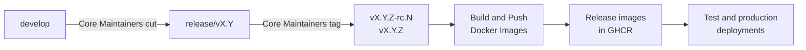

import { Callout } from "nextra/components";

# Governance and Roles

Eneo is open source and built together by public-sector organisations.
Municipalities and agencies run it in production, so everyone who uses it needs
to trust what goes into the platform and what is released.

We achieve that by separating two responsibilities. **Contributing** is open:
partner organisations and anyone else can propose and build improvements.
**Stewardship** sits with one accountable team, which reviews every change and
decides what is merged and released.

This page explains the roles and the protections behind them. For the practical
steps, see [Contributing to Eneo](/contributing).

## Two roles

### Core Maintainers: stewards of the platform

Core Maintainers is the Eneo team at Sundsvalls kommun
(`@eneo-ai/core-maintainers`). The team is accountable for everything that
ships. It:

- keeps the codebase in line with the agreed technical roadmap and architecture
- reviews and approves every change before it is merged
- merges pull requests and publishes releases
- responds to security alerts and vulnerability reports

### Collaborators: building Eneo together

Collaborators are developers from partner municipalities and government
agencies who develop Eneo with us in the open (`@eneo-ai/collaborators`). They:

- build features and fixes and propose them as pull requests
- report, discuss and organise issues
- review each other's work and share what their organisations need

Their work reaches the platform through pull requests that a Core Maintainer
reviews.

### Everyone else

You do not need to be in a team to contribute. Anyone with a GitHub account can
open issues, take part in discussions, review pull requests and submit changes
from a fork, in exactly the same way as Collaborators.

## How a change reaches Eneo

1. **Issue.** The change is described and agreed in an issue.
2. **Fork and pull request.** The contributor builds it in a fork and opens a
   pull request against `develop`.
3. **Checks.** CI, Dependency Review and the PR label check run automatically.
4. **Review.** A Core Maintainer other than the author approves it.
5. **Merge.** A Core Maintainer adds it to the merge queue, which tests it
   against the latest `develop` and squash-merges it.
6. **Release.** Core Maintainers cut a release branch and publish a `v*` tag.

Each step is described for contributors in
[Contributing to Eneo](/contributing#contribute-a-change).

## How we protect the platform

The rules are enforced by GitHub team roles and repository rulesets. They do not
depend on anyone remembering them.

- **Least privilege.** Only Core Maintainers have write access to the
  repository. Everyone else contributes from forks. Administrator rights are
  limited to a small number of organisation owners.
- **Four eyes on every change.** Every pull request into `develop` needs an
  approval from a Core Maintainer other than its author. New commits reset the
  approval.
- **Tested before and after merging.** Required checks run on the pull request,
  again in the merge queue and once more on `develop`.
- **Isolated CI for contributions.** Pull requests from forks cannot read
  secrets or publish anything.
- **Controlled releases.** Only Core Maintainers can create release branches
  and `v*` tags, and a tag is the only way to publish release images.
- **Protected history.** `develop`, `main` and release branches cannot be
  deleted or force-pushed.
- **Transparent rules.** Anyone can read the active rules at
  [github.com/eneo-ai/eneo/rules](https://github.com/eneo-ai/eneo/rules).
  Changes to access are recorded in GitHub issues.

The security policy behind these controls is in
[`docs/SECURITY.md`](https://github.com/eneo-ai/eneo/blob/develop/docs/SECURITY.md).

## Roles and permissions

| Role             | Team                        | Access to `eneo`                                                    | What the role can do                                                                                                                               |
| ---------------- | --------------------------- | ------------------------------------------------------------------- | -------------------------------------------------------------------------------------------------------------------------------------------------- |
| Everyone         | –                           | Public                                                              | Open and comment on issues and discussions, review pull requests, fork the repository and open pull requests from a fork.                          |
| Collaborators    | `@eneo-ai/collaborators`    | Triage                                                              | Everything above, plus label, assign, close and reopen issues and pull requests.                                                                   |
| Teknisk kommitté | `@eneo-ai/teknisk-kommitte` | Triage                                                              | Shape the technical roadmap through issues and discussions, and organise issues.                                                                   |
| Core Maintainers | `@eneo-ai/core-maintainers` | Maintain on every repository, plus Security manager and CI/CD admin | Approve and merge pull requests, cut release branches, publish releases, triage security alerts and manage Actions secrets, variables and runners. |
| Administrators   | Organisation owners         | Admin                                                               | Change rulesets, team access and repository settings.                                                                                              |

Organisation members have read access to the organisation's repositories by
default. Any further rights come from the teams above.

## Protected branches and tags

| Ref          | Rules                                                                                                                                                                                       |
| ------------ | ------------------------------------------------------------------------------------------------------------------------------------------------------------------------------------------- |
| `develop`    | Changes only through pull requests. One approval from Core Maintainers, required checks, resolved conversations and the merge queue. Squash merges only. Cannot be deleted or force-pushed. |
| `release/**` | Only Core Maintainers can create, update, merge into or delete release branches. Cannot be force-pushed. Pull requests must pass the PR label check.                                        |
| `main`       | Cannot be deleted or force-pushed.                                                                                                                                                          |
| `v*` tags    | Only Core Maintainers can create, move or delete version tags.                                                                                                                              |

## Releases

Only Core Maintainers cut `release/vX.Y` branches and publish releases. A `v*`
tag starts **Build and Push Docker Images**, which builds, tests, scans and
attests the release images that deployments consume. Restricting who can create
those tags is how Eneo controls what is released.

To propose a fix for a released version, open a pull request against the
affected `release/vX.Y` branch. A Core Maintainer reviews, merges and releases
it. The full flow is described in
[DEPLOYMENT_WORKFLOW.md](https://github.com/eneo-ai/eneo/blob/develop/docs/DEPLOYMENT_WORKFLOW.md),
and the release artefacts in [Release SBOMs](/docs/release-sboms).

## Exceptional merges

Core Maintainers can bypass the `develop` rules for a single pull request. This
is meant for urgent fixes, or when no second Core Maintainer is available to
review. It is not part of the normal flow.

<Callout type="warning">
  A bypass skips every rule in the ruleset, including the merge queue and the
  required checks. Only bypass when all checks have already passed on the pull
  request. State the reason in the pull request so another Core Maintainer can
  review the change afterwards.
</Callout>

## Where this fits in Eneo's governance

The roles on this page cover day-to-day work in the repository. Eneo as a whole
is governed by a user association of public-sector organisations:

- The **Styrgrupp** sets the vision and strategy.
- The **Teknisk kommitté** owns the technical roadmap, architecture, release
  planning and security direction.
- The **Tekniskt råd** and the **Användarråd** gather needs from partners and
  users and bring them into the roadmap.

Core Maintainers carry out the technical stewardship in the repository in line
with those decisions. See [Samarbetsforum](https://eneo.ai/samarbetsforum.html)
for the bodies, their members and how to take part.

## FAQ

### Do I need to be in a team to contribute?

No. Anyone with a GitHub account can open issues and submit pull requests from
a fork. The teams give partner organisations extra rights to organise issues,
not a different way to contribute code. Start with
[Contributing to Eneo](/contributing).

### How does my organisation become a Collaborator?

Contact the maintainers at `digitalisering@sundsvall.se`. Developers from
partner municipalities and agencies are added to `@eneo-ai/collaborators`.
Until then, you can contribute in the same way as everyone else.

### Why can't Collaborators push branches or merge, even trusted partners?

Write access to this repository would let a person run GitHub Actions
workflows from their own branches with the repository's token. That token can
publish container images, and deployments consume those images. Keeping write
access with one accountable team protects every organisation that runs Eneo.
Working from a fork gives you the same ability to propose and test changes.

### Can I review other people's pull requests?

Yes, and it is encouraged. Anyone can review and comment. Only an approval from
a Core Maintainer unlocks the merge, but other reviews often surface problems
early and speed it up.

### Does CI run on my pull request from a fork?

Yes. The same checks run, with a read-only token and without secrets. If you
are a first-time contributor, a Core Maintainer may need to approve the first
workflow run before it starts.

### Why is the PR label check red on my pull request?

Contributors without Triage access cannot add labels. A maintainer adds the
labels during review and the check turns green. You do not need to do anything.

### Who decides what goes into Eneo?

Needs from partners and users reach the roadmap through the Tekniskt råd and
the Användarråd, and the Teknisk kommitté sets the technical priorities. Core
Maintainers decide on each merge and are accountable for what is released.

### How do I get a fix into a released version?

Open a pull request against the affected `release/vX.Y` branch, or ask in the
issue for a backport. A Core Maintainer merges it, carries it over to `develop`
and publishes a patch release.

### Can Core Maintainers merge their own changes without review?

Not in the normal flow. Another Core Maintainer approves every pull request. A
bypass exists for urgent cases, and its reason is recorded in the pull request.

### How do I report a security vulnerability?

Privately, through
[**Security → Report a vulnerability**](https://github.com/eneo-ai/eneo/security/advisories/new)
or by email to `security@sundsvall.se`. Never report it in a public issue, pull
request or discussion.
