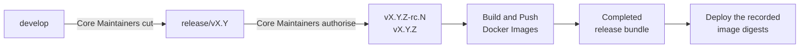

import { Callout } from "nextra/components";

# Governance and Roles

Eneo is open source and built together by public-sector organisations.
Municipalities and agencies run it in production, so everyone who uses it needs
to trust what goes into the platform and what is released.

Eneo keeps two responsibilities apart. **Contributing** is open: partner
organisations and anyone else can propose and build improvements.
**Stewardship** sits with one accountable team, which decides what is merged
and released.

This page explains the roles and the protections behind them. For the practical
steps, see [Contributing to Eneo](/contributing). For how these rules fit with
Eneo's other security controls, see [Security at Eneo](/docs/security).

**In short**

- Anyone with a GitHub account can contribute from a fork. Collaborators from
  partner organisations also get Triage rights. Core Maintainers is the only
  team with write access.
- On `develop`, the Core Maintainers agree on their own changes as a team,
  without a formal approval, and approve every contribution from outside the
  team before queueing it. The required checks and the merge queue always
  apply, and there is no bypass.
- On `release/**` and `main`, a pull request needs an approval from someone
  with write access other than its author, in practice another Core
  Maintainer. A Core Maintainer can bypass that for a single pull request, and
  GitHub records it.
- Core Maintainers authorise every release. They create the release branches
  and the `v*` tags; for a managed final release, the release App creates the
  tag after they approve the preparation pull request. A `v*` tag starts the
  release build.

## Two roles

### Core Maintainers: stewards of the platform

Core Maintainers is the Eneo team at Sundsvalls kommun
(`@eneo-ai/core-maintainers`). The team is accountable for everything that
ships. It:

- keeps the codebase in line with the agreed technical roadmap and architecture
- reviews and approves contributions from outside the team
- agrees as a team on its own changes before they are merged
- decides what enters the merge queue, approves each other's release changes
  and publishes releases
- responds to security alerts and vulnerability reports

### Collaborators: building Eneo together

Collaborators are developers from partner municipalities and government
agencies (`@eneo-ai/collaborators`). They:

- build features and fixes and propose them as pull requests
- report, discuss and organise issues
- review each other's work and share what their organisations need

Collaborators work from a fork like everyone else, and a Core Maintainer
reviews and approves their pull requests. What the role adds is a shorter path
to a reviewable pull request:

- With Triage, they label their own pull requests, so the PR label check
  passes without waiting for a maintainer.
- As members of the `eneo-ai` organisation, their CI and Dependency Review runs
  start without a maintainer approving them first.

### Everyone else

You do not need to be in a team to contribute. Anyone with a GitHub account can
open issues, take part in discussions, review pull requests and submit changes
from a fork, the same way Collaborators do, only without Triage rights.

## How a change reaches Eneo

1. **Issue.** The change is described and agreed in an issue.
2. **Fork and pull request.** The contributor builds it in a fork and opens a
   pull request against `develop`.
3. **Checks.** CI, Dependency Review, the PR label check and the User-facing
   section check run. For contributors outside the `eneo-ai` organisation, the
   checks other than PR labels start once a Core Maintainer approves the
   workflow run.
4. **Review.** A Core Maintainer reviews and approves it.
5. **Merge.** The Core Maintainer chooses **Merge when ready**. As soon as the
   checks are green, the pull request enters the merge queue, which tests it
   against the latest `develop` and squash-merges it.
6. **Release.** Core Maintainers cut a release branch. Every pull request into
   it needs one approval from someone with write access other than its author,
   normally another Core Maintainer, and the release is
   published from a `v*` tag that Core Maintainers authorise.

Core Maintainers' own pull requests into `develop` skip the formal approval in
step 4. The team works together and agrees on a change before one of them
chooses **Merge when ready**, and the same checks and merge queue apply. They
ask for a written review when a change is large or risky.

Each step is described for contributors in
[Contributing to Eneo](/contributing#contribute-a-change).

## How we protect the platform

GitHub team roles and repository rulesets enforce who can merge and release,
and the required checks. Reviewing outside contributions and agreeing on
changes within the team are our own procedures; the list says which is which.

- **Least privilege.** Core Maintainers is the only team with write access to
  the repository. Everyone else contributes from forks. Administrator rights
  are limited to a small number of organisation owners, who manage settings
  and are not part of the day-to-day merge flow.
- **Core Maintainers decide what is merged.** Only people with write access can
  add a pull request to the merge queue, and the Core Maintainers do the
  ordinary merges. Their rule is to review and approve every contribution from
  outside the team before queueing it; GitHub enforces who can queue, not who
  approved. If someone without write access pushes new
  commits afterwards, GitHub cancels **Merge when ready** and the change must be
  looked at again.
- **Green checks, no shortcuts.** The `develop` ruleset requires the checks and
  the merge queue for every pull request and has no bypass. Merging from a
  security advisory's private fork would skip them, so our procedure is not to
  use it.
- **Release changes are approved by someone other than the author.** A pull request into a release
  branch or `main` needs an approval from someone with write access other
  than its author, in practice another Core Maintainer, and new commits
  dismiss an earlier approval. When no second
  maintainer is available, a Core Maintainer can bypass the approval for a
  single pull request and states the reason in it. GitHub records the bypass,
  and direct pushes stay blocked.
- **Tested before and after merging.** Required checks run on the pull request
  and, as the full suite, in the merge queue. Publishing `develop` reuses that
  full run for the exact commit and still runs a fresh security scan and scans
  the published images.
- **Isolated CI for contributions.** CI that runs code from a fork gets a
  read-only token and no repository secrets, and no pull request workflow
  publishes anything. The project-board workflow, which needs a token, runs the base
  branch's code and never the pull request's.
- **Controlled releases.** Only Core Maintainers can create release branches.
  A `v*` tag is created by them or, for a managed final release they have
  approved, by the release App, and only a `v*` tag produces a versioned
  release. Builds of `develop` are published as `develop` images for testing.
- **Protected history.** `develop` and `main` cannot be deleted or
  force-pushed. Release branches and tags can be changed only by Core
  Maintainers.
- **Transparent rules.** Anyone can read the active rules at
  [github.com/eneo-ai/eneo/rules](https://github.com/eneo-ai/eneo/rules).
  Changes to access are recorded in GitHub issues.

The security policy behind these controls is in
[`docs/SECURITY.md`](https://github.com/eneo-ai/eneo/blob/develop/docs/SECURITY.md).

## Roles and permissions

| Role             | Team                        | Access to `eneo`                                                    | What the role can do                                                                                                                                            |
| ---------------- | --------------------------- | ------------------------------------------------------------------- | --------------------------------------------------------------------------------------------------------------------------------------------------------------- |
| Everyone         | –                           | Public                                                              | Open and comment on issues and discussions, review pull requests, fork the repository and open pull requests from a fork.                                       |
| Collaborators    | `@eneo-ai/collaborators`    | Triage                                                              | Everything above, plus label, assign, close and reopen issues and pull requests.                                                                                |
| Teknisk kommitté | –                           | Through each member's own role                                      | Shape the technical roadmap through issues and discussions.                                                                                                     |
| Core Maintainers | `@eneo-ai/core-maintainers` | Maintain on every repository, plus Security manager and CI/CD admin | Queue pull requests, approve release changes, cut release branches, publish releases, triage security alerts and manage Actions secrets, variables and runners. |
| Administrators   | Organisation owners         | Admin                                                               | Change rulesets, team access and repository settings.                                                                                                           |

Organisation members have read access to the organisation's repositories by
default. Any further rights come from the teams above, or from Triage granted
directly to an individual outside collaborator.

## Protected branches and tags

| Ref          | Rules                                                                                                                                                                                                                                    |
| ------------ | ---------------------------------------------------------------------------------------------------------------------------------------------------------------------------------------------------------------------------------------- |
| `develop`    | Changes only through pull requests, which only people with write access can add to the merge queue. Required checks and resolved conversations. No bypass. Squash merges only. Cannot be deleted or force-pushed.                        |
| `release/**` | Only Core Maintainers can create, update or delete release branches. A pull request needs an approval from someone with write access other than its author, or a recorded bypass by a Core Maintainer, and must pass the PR label check. |
| `main`       | A pull request needs an approval from someone with write access other than its author, or a recorded bypass by a Core Maintainer, and must pass the PR label check. Cannot be deleted or force-pushed.                                   |
| `v*` tags    | Core Maintainers control human tag operations. When configured, the release App can create a final tag after the reviewed preparation PR and merged-commit CI; it cannot move or delete tags.                                            |

## Releases

Core Maintainers cut `release/vX.Y` branches and authorise releases. A `v*`
tag starts **Build and Push Docker Images**, which builds, tests, scans and
attests the release images that deployments consume. Restricting who can create
those tags is how Eneo controls what is released.

For managed final releases, Core Maintainers approve and merge the preparation
PR. A dedicated release App then creates the exact verified tag and publishes
the release after the image, smoke-test and SBOM gates succeed. Its creation
permission is separate from tag update/deletion protections; it never merges
PRs or bypasses branch checks. The
[release procedure](https://github.com/eneo-ai/eneo/blob/develop/docs/DEPLOYMENT_WORKFLOW.md#creating-a-production-release)
describes the required App configuration. RCs remain maintainer-tagged.

To propose a fix for a released version, open a pull request against the
affected `release/vX.Y` branch. Someone other than the author approves it before it
is merged, and a Core Maintainer releases it. The full flow is described in
[DEPLOYMENT_WORKFLOW.md](https://github.com/eneo-ai/eneo/blob/develop/docs/DEPLOYMENT_WORKFLOW.md),
and the release artefacts in [Release SBOMs](/docs/release-sboms).

## Urgent fixes

An urgent fix follows the rules for its target branch. On `develop`, it is an
ordinary pull request that must pass the required checks and the merge queue;
there is no bypass. On a release branch, it needs one approval from someone
with write access other than its author, normally another Core Maintainer. If none is available, a Core Maintainer can
bypass the approval for that pull request and states the reason in it.

<Callout type="warning">
  If GitHub itself blocks a critical fix, for example because a required check
  cannot run, an organisation owner can temporarily change the ruleset. GitHub
  records the change in the audit log. Restore the rule straight away and record
  what happened in a GitHub issue.
</Callout>

## Where this fits in Eneo's governance

The roles on this page cover day-to-day work in the repository. Eneo as a whole
is governed by a user association of public-sector organisations:

- The **Styrgrupp** sets the vision and strategy.
- The **Teknisk kommitté** owns the technical roadmap, architecture, release
  planning and security direction.
- The **Tekniskt råd** and the **Användarråd** gather needs from partners and
  users and bring them into the roadmap.

Core Maintainers carry out the technical stewardship in the repository in line
with those decisions. See [Samarbetsforum](https://eneo.ai/samarbetsforum.html)
for the bodies, their members and how to take part.

## FAQ

### Do I need to be in a team to contribute?

No. Anyone with a GitHub account can open issues and submit pull requests from
a fork. The teams give partner organisations extra rights to organise issues,
not a different way to contribute code. Start with
[Contributing to Eneo](/contributing).

### How does my organisation become a Collaborator?

Contact the maintainers at `digitalisering@sundsvall.se`. Developers from
partner municipalities and agencies are added to `@eneo-ai/collaborators`.
Until then, you can contribute in the same way as everyone else.

### Why can't Collaborators push branches or merge, even trusted partners?

Write access to this repository would let a person run GitHub Actions
workflows from their own branches with the repository's token. That token can
publish container images, and deployments consume those images. Keeping write
access with one accountable team protects every organisation that runs Eneo.
Working from a fork gives you the same ability to propose and test changes.

### Can colleagues at our organisation share branches?

Yes. Fork `eneo-ai/eneo` once into your organisation's GitHub account and give
your developers write access to that fork. You share branches there and open
pull requests into `eneo-ai/eneo` as usual, and a Core Maintainer reviews and
merges them. Maintainers cannot push fixes to branches in an organisation's
fork, so they suggest changes in the review instead. The steps are in
[Working as a team at a partner organisation](https://github.com/eneo-ai/eneo/blob/develop/docs/CONTRIBUTING.md#working-as-a-team-at-a-partner-organisation).

### Why is my push to `eneo-ai/eneo` refused with 403?

GitHub refuses a push to `eneo-ai/eneo` from everyone without write access.
That includes Collaborators, also if you could push branches here before. You are still a member of the organisation
and of your team.

Push your branch to a fork and open the pull request from there. In a clone of
`eneo-ai/eneo`, `gh repo fork --remote` creates a fork in your personal
account, makes it `origin` and keeps this repository as `upstream`. If your
organisation shares a fork, make that fork `origin` instead. The steps are in
[Fork and set up](https://github.com/eneo-ai/eneo/blob/develop/docs/CONTRIBUTING.md#2-fork-and-set-up-the-development-environment).

### Can I review other people's pull requests?

Yes, and it is encouraged. Anyone can review and comment. Core Maintainers add
approved contributions to the merge queue, and other reviews often surface
problems early and speed that up.

### Does CI run on my pull request from a fork?

Yes. The same checks run. Jobs that run your code get a read-only token and no
repository secrets. For contributors outside the `eneo-ai` organisation, a
Core Maintainer approves the CI, Dependency Review and User-facing runs before
they start; PR labels runs straight away.

### Why is the PR label check red on my pull request?

Contributors without Triage access cannot add labels. A maintainer adds the
labels during review and the check turns green. You do not need to do anything.

### Who decides what goes into Eneo?

Needs from partners and users reach the roadmap through the Tekniskt råd and
the Användarråd, and the Teknisk kommitté sets the technical priorities. Core
Maintainers decide on each merge and are accountable for what is released.

### How do I get a fix into a released version?

Open a pull request against the affected `release/vX.Y` branch, or ask in the
issue for a backport. Someone other than the author approves it, it is merged,
and a Core Maintainer publishes a patch release. A fix that originated on the
release branch is also carried to `develop`; a fix backported from `develop`
is already there.

### Can Core Maintainers merge their own changes without review?

On `develop`, without a formal approval, yes. The team works together and
agrees on each change before one of them chooses **Merge when ready**, so it is
not slowed down waiting for approvals. They ask for a written review when a
change is large or risky, and the required checks and the merge queue always
apply. On release branches and `main`, someone with write access other than
the author approves the pull request, normally another Core Maintainer. When none is available, a Core Maintainer can bypass that
approval for a single pull request, and GitHub records it.

### Can a pull request be merged with failing checks?

No. The `develop` ruleset has no bypass, so every pull request must pass the
required checks and go through the merge queue.

### How do I report a security vulnerability?

Privately, through
[**Security → Report a vulnerability**](https://github.com/eneo-ai/eneo/security/advisories/new)
on GitHub, which is the preferred way. If you cannot use GitHub, email
`security@sundsvall.se`. Never report it in a public issue, pull request or
discussion.
