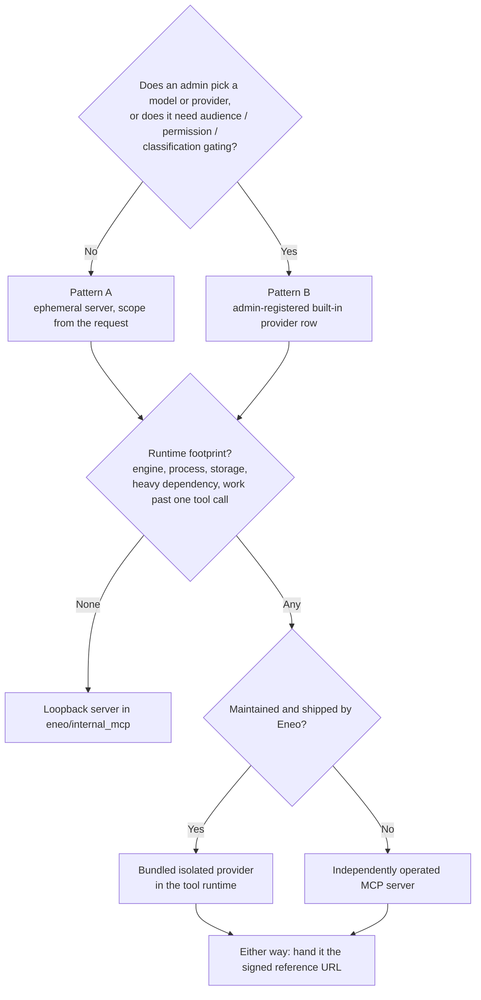

# Built-in Tool Servers

Eneo hosts a small set of Model Context Protocol (MCP) servers inside its own
backend, reached over a loopback HTTP route during a completion. This page
records what exists, the two ways such a server is attached to a completion,
the contract every built-in tool honours, and the standpoint on **what belongs
inside Eneo as a loopback tool and what belongs outside the backend**.

The loopback servers are one of three execution tiers. The other two, the
bundled tool runtime and independently operated servers, run outside the
backend and use the same MCP-facing mechanisms; neither moves into the
loopback process merely because Eneo maintains it. [Tools and MCP
Architecture](/docs/tool-architecture) compares the tiers and explains why the
split exists.

import { Callout } from "nextra/components";

<Callout type="info">
  For how loopback routing, scoped tokens and the shared proxy work, see
  [Knowledge Retrieval and MCP Interoperability](/docs/knowledge-retrieval-and-mcp).
  For the runtime's isolation layers, see
  [Tool Runtime Security](/docs/tool-runtime-security).
  For the administrator view of the functions, see
  [Functions](/guides/capabilities).
</Callout>

## What exists today

All loopback servers live in `backend/src/eneo/internal_mcp/`, one module per
server plus shared scaffolding:

| Module | Role |
| --- | --- |
| `foundation.py` | Hosting and auth. Each server is a stateless FastMCP app mounted at `/internal-mcp/<name>/mcp`; the ask path connects back over HTTP through `INTERNAL_MCP_BASE_URL`. Scope never travels in tool arguments: a 15-minute JWT minted per completion carries `assistant_id` and, for built-in providers, `mcp_server_id`. `internal_tool_context` opens a DB transaction, authenticates the token as the user, and hands the tool a user-bound DI container so every load passes normal permission checks. |
| `registry.py` | The only hosting wiring. One tuple entry per server drives both the FastAPI mounts and the lifespan that runs each session manager. |
| `constants.py` | Server names. Per-call user approval is decided by `MCPServer.is_internal`, never by name. |
| `file_references.py` | The single resolver for signed attachment URLs. A URL is a capability handle: the token is verified locally and bytes come from the content store, never from an HTTP fetch. |
| `builtin_tools.py` | Swaps a persisted tool snapshot for the running server's live catalog so the model always sees the deployed definitions. |
| `availability.py` | The runtime gates for the ephemeral servers, in one place. |

Three servers are registered:

```text
/internal-mcp/knowledge/mcp          four tools
/internal-mcp/files/mcp              one tool  (read_file)
/internal-mcp/image_generation/mcp   one tool  (generate_image)
```

Web search has no loopback server. File analysis, file creation, compute,
charts and forecast run in the bundled tool runtime (see
[below](#bundled-isolated-providers)), never in the backend.

## Two attachment patterns

### Pattern A: ephemeral, per completion

Used by **knowledge** and **files**. No database row, no admin surface, no
permission.

- The ask path checks `resolve_internal_mcp_availability`, calls
  `build_<x>_mcp_server` with a fresh token, and passes the entity into
  `Assistant.ask`, which prepends it so its tools lead the tool array and win
  name collisions.
- Tool calls skip per-call user approval: the entity is built with
  `is_internal=True`.
- The tool description gets a per-completion suffix (source labels, attachment
  presence), but the docstring always leads.

This is the right shape for read-only helpers whose scope is fully derivable
from the request.

### Pattern B: admin-registered built-in provider

Used by **image generation**. An ordinary `mcp_servers` row with
`http_auth_type = "internal"`, a capability purpose, and an `image_model_id`
foreign key.

- It goes through the full capability machinery in `capability_resolver.py`:
  audiences and priority, role permission, space classification floor,
  backing-model health, and per-user resolution at ask time.
- The tool reads its configuration from the row named in the token, so the
  caller cannot choose it.
- Calls skip per-call user approval like the ephemeral servers: a built-in
  provider row is `is_internal`. Access is governed by the checks above.
- It has its own tool-call timeout in the proxy.

This is the shape for anything an admin must choose a provider or model for,
or that spends money.



## The shared contract

These invariants hold for both patterns and should be treated as the contract
for any new built-in tool:

- Tools return MCP content types: `TextContent`, `EmbeddedResource`,
  `ImageContent`, or a `CallToolResult` whose `_meta` uses OpenTelemetry GenAI
  attribute names. The proxy turns `image` blocks into generated files for any
  server, internal or external, and binary embedded resources into generated
  files for sources of a file-delivering function (see
  [Generated files](/guides/capabilities#generated-files)).
- Output is self-capped through `default_page_cap` with an `offset` parameter.
  The proxy cuts an oversized result at the text budget and appends a
  truncation notice, so a tool that relies on it loses its tail; paging keeps
  every result complete and continuable.
- Model-facing error strings are constants, and *not found* is
  indistinguishable from *out of scope*.
- External provider calls run after the DB transaction closes.
- Everything completes inside one tool call. No worker, no queue, no persistent
  state beyond what the ask path already persists.

## Standpoint: what should be a loopback tool

<Callout type="warning">
  **Rule.** A loopback tool is a pure function of the request, the tenant
  database, and at most one outbound provider call, finishing within a
  tool-call timeout, with no new process, storage, or heavyweight dependency.
  Use Pattern A when scope comes from the request and nothing needs
  configuring. Use Pattern B when an admin picks a backing model or provider,
  or when the feature needs audience, permission, or classification gating.
  Everything with a runtime footprint goes to an MCP server outside the
  backend: the bundled tool runtime when Eneo maintains it, otherwise an
  independently operated server.
</Callout>

Why the line sits there:

- The loopback route exists so internal and external tools share one
  execution boundary, not so Eneo becomes a host for arbitrary compute. The
  backend process is the chat API; a tool that needs memory proportional to a
  file or its own sandbox competes with every other request.
- An external server gets the same integration surface a built-in tool would:
  the signed file reference URL. Anything that can be expressed as "fetch this
  reference, do work, return MCP content" loses nothing by living outside.
- Built-in tools are deployed with Eneo, so their upgrade cadence, dependency
  set and security review are Eneo's. Keeping them thin keeps that surface
  small.

### Worked example: tabular querying

Tabular querying belongs **outside** the backend. It needs an engine (DuckDB),
memory proportional to the file, and execution sandboxing, because the model
writes the SQL. Eneo ships it as a bundled isolated provider: the tool runtime
receives the signed reference URL, revalidates it against the signed download
endpoint on every call (downloading the bytes only when they are new or
changed), and runs each query in a separate sandbox process with a locked-down DuckDB. An independently operated tabular server
plugs into the same `file_analysis` function the same way: `read_file`
already tells the model to prefer "tabular or spreadsheet analysis tools" and
to pass them the same URL. See [How attachment references interoperate with
external
MCP](/docs/knowledge-retrieval-and-mcp#how-attachment-references-interoperate-with-external-mcp).

### Worked example: image generation

Image generation stays **inside** as Pattern B: one outbound call to a provider
the admin already configured under model providers, credentials already
managed, output already handled by the proxy's image path. The only new
concept it needed was a purpose marker and a foreign key to the image model.
Image edits with reference images fit the same rule: the bytes come from the
content store through `file_references.py`, and the call is still one provider
request.

## Bundled isolated providers

The tool runtime is a separate Bun service in `tool-runtime/`, released as its
own image (`ghcr.io/eneo-ai/eneo-tool-runtime`) in the same verified bundle
as the backend and frontend, and included in the standard Compose stack.

| Endpoint | Tools | Registered as |
|---|---|---|
| `/mcp/compute` | `run_javascript` | `compute` source (**Compute** function, built into Eneo) |
| `/mcp/charts` | `create_chart` | `charts` source (**Charts** function, built into Eneo) |
| `/mcp/forecast` | `create_forecast` | `forecast` source (**Forecast** function, built into Eneo) |
| `/mcp/file-analysis` | `inspect_table`, `query_table`, `assert_table` | `file_analysis` source (**Ask a file** function, built into Eneo) |
| `/mcp/file-creation` | `create_document`, `edit_document`, `fill_template`, `create_spreadsheet` | `file_creation` source (**Create a file** function, built into Eneo) |

What makes a bundled row different from a loopback server and from an
independently operated one, in the backend's data:

- A bundled row is an ordinary `mcp_servers` row with
  `http_auth_type = "bundled"`, created only by the
  `POST /api/v1/mcp-servers/bundled/{tool}/` preset; the generic create and
  update API cannot set or change that type. The last URL segment names the
  endpoint, which fixes the row's purpose and whether it forwards identity
  (`BUNDLED_TOOLS` in `mcp_servers/domain/entities/mcp_server.py`).
- Its address comes from `TOOL_RUNTIME_URL` and its bearer from
  `TOOL_RUNTIME_TOKEN` at connect time; the client refuses to connect to any
  other endpoint, so no credential is stored and the connection fields are
  read-only. Bundled calls carry `X-Eneo-File-Origin`, `X-Eneo-Tool-Views` and
  opaque user and tenant IDs.
- Tool definitions and views follow the running runtime: the backend caches
  the live catalog per process (`BUNDLED_CATALOG_TTL_SECONDS`), stores a
  changed catalog without review while keeping the administrator's per-tool
  enablement and display names, and writes an audit entry as the system
  (`mcp_servers/application/bundled_tools.py`). Per-call user approval still
  follows the conversation setting: bundled rows are not `is_internal`.
- **Admin > Tools** reports connectivity, version, confinement and file-origin
  diagnostics from the runtime's `/diagnostics` endpoint
  (`mcp_servers/application/runtime_status.py`), advisory only and never on
  the execution path. Version mismatches warn without blocking calls. An
  endpoint the runtime lists as `unavailable` (`forecast` while its model is
  missing) is offered as unavailable with reason `model_missing` instead of a
  warning; runtime failure does not change backend readiness or ordinary chat.

Why this work runs outside the backend, and what the runtime does to contain
it, are covered in [Tools and MCP Architecture](/docs/tool-architecture#why-heavy-and-untrusted-work-runs-in-a-separate-runtime)
and [Tool Runtime Security](/docs/tool-runtime-security). Operators deploy,
upgrade and diagnose it with the
[operator guide](https://github.com/eneo-ai/eneo/blob/develop/docs/deployment/TOOL_RUNTIME.md).

The runtime is not a plugin host. New endpoints belong there only when they
need platform-owned isolation and Eneo maintains them; domain integrations
(statistics APIs, open-data portals) stay independently operated servers.

## Adding a new built-in server

The hosting side is one entry in `registry.py`. The rest depends on the
pattern:

| Step | Pattern A | Pattern B |
| --- | --- | --- |
| Module in `internal_mcp/` with a FastMCP app and `@mcp.tool` functions | Yes | Yes |
| Name in `constants.py` | Yes; the entity is built with `is_internal=True`, which auto-approves its calls | Yes; a row with internal auth is `is_internal`, so its calls are auto-approved too |
| Availability gate | Extend `availability.py` and `build_<x>_mcp_server` | Capability purpose in `CAPABILITY_PURPOSES`, role permission, frontend descriptor (see the *Extending the capability set* section of `docs/CAPABILITIES.md` in the repo) |
| Token claims | `assistant_id`, plus `table_tools` when a file-analysis provider is attached | `assistant_id` and `mcp_server_id` |
| Tests | `tests/unit/internal_mcp/` | `tests/unit/internal_mcp/` |

Things a new built-in server would hit that are not yet generic:

- The table check constraint ties internal auth to a non-null `image_model_id`,
  and the service validation is image-specific. A built-in provider without an
  image model needs that relaxed into a general backing-model concept; the
  `MCPServerBackingModel` projection is the generalisable half.
- The per-server timeout in the proxy is keyed on the image generation
  purpose.
- Test placement is inconsistent: the newest server tests sit in
  `tests/unit/internal_mcp/`, the knowledge and files tests sit at
  `tests/unit/test_*_mcp_server.py`. New servers should use the former.

## Native document export contract

A file-creation provider can participate in ordinary tool calls without supporting
the document workspace's Export menu. Native export currently requires an enabled,
approved, model-visible tool named `create_document` whose input schema is an
object declaring string properties `title`, `content`, `filename` and `format`.
The `format` property must declare an explicit enum containing `docx`, `pdf`,
or both. Other optional properties are allowed, but no additional required inputs
may be demanded.

The native profile does not resolve schema references and does not accept
top-level conditional/composed schemas. The exact saved document and arguments
must validate against the declared schema. Eneo evaluates each output format
separately against the acting user's effective catalogue, including identity-scoped
discovery. Compatibility does not prove live rendering will succeed.

The renderer returns a standard MCP embedded file resource in the requested
format. Existing generated-file type and content validation still applies.
Export does not ask the model to rewrite the text and does not create another
saved conversation revision.

`GET /api/v1/conversations/{session_id}/documents/{file_id}/export/` returns
`docx` and `pdf` objects with `available` and an optional `reason`:
`provider_unavailable`, `tool_unavailable`, `incompatible_tool`,
`format_unsupported`, or `document_unsupported`. The response is private to
the acting user and is not cached. The POST operation rechecks the same contract.

Document revision navigation retains its existing convention: a producing tool
takes `revises: {url, filename}` referring to an earlier generated file, and Eneo
associates files recorded on that call with the earlier version when their formats
match. A provider using unrelated argument names does not automatically participate
in native version navigation. This is distinct from the native export contract.
