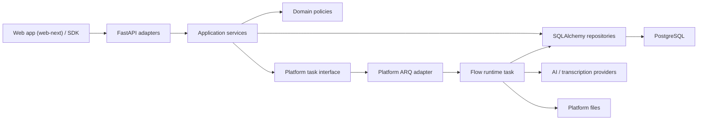

# How Flows is built

Flows is a versioned application feature on top of shared Eneo identity, files,
models, audit, task, and retention primitives. It does not deploy a separate
application stack.

## Request and execution path

The HTTP transaction creates and commits a queued run. Dispatch then uses the
platform task interface. The worker opens a fresh database session and claims
the run through compare-and-swap before executing its immutable published
definition.

## Backend layers

| Package | Owns |
| --- | --- |
| `eneo.flows.api` | HTTP parsing, response models, public errors, auth dependencies |
| `eneo.flows.application` | use cases, authorization decisions, lifecycle orchestration |
| `eneo.flows.domain` | policies, typed contracts, invariants, lifecycle exceptions |
| `eneo.flows.infrastructure` | tenant-scoped repositories, locking, SQL projections |
| `eneo.flows.runtime` | task entry points, executor, step handlers, tracing, delivery loops |
| `eneo.flow_packages` | portable archive mechanics and Flow package adapter |
| `eneo.worker.platform_tasks` | current ARQ registration, queue capacity, schedules, health |

The domain layer may not import API, infrastructure, or runtime packages.
Transport-specific ARQ imports stay in the platform worker package, outside
Flow domain/application code.

## Frontend layers

Flows are built, run and administered in the new web app
(`frontend/apps/web-next`); the SvelteKit app has no flow screens. Its API
types are generated from the OpenAPI schema (`src/lib/api/schema.d.ts`).
`src/features/flows` owns Flow state/presentation helpers and components, and
`src/features/admin/flow-settings` the organization's flow settings. The
routes under `src/app/(app)/spaces/[spaceId]/flows` and `src/app/(app)/admin`
assemble them for manual authoring, run/review views and administration.

Conversational authoring is an ordinary assistant chat bound to one flow. Its
loopback flow tools call the same authoring operations as the editor update
(`flows/application/flow_authoring_operations.py`), so validation, permissions,
classification and audit stay one path. Package installation materializes
drafts through `FlowAuthoringCommandService`.

## Persistence boundaries

- Mutable drafts live in `flows` and `flow_steps`.
- Immutable executable snapshots live in `flow_versions`.
- Runtime lifecycle and evidence live in run/result/attempt/provider-call rows.
- Files remain platform Files; Flow tables record binding and provenance.
- Review, audit, and webhook effects have their own relational lifecycle rows.
- JSONB payloads are parsed by typed models in the modules that read or write
  them; some older payload columns are stored as plain dictionaries.

See [The data schema](/docs/flows-for-developers/data-schema) for aggregate
ownership and the authoritative ORM and Alembic lineage.

## Process model

Flows adds zero private processes. The deployment's platform execution worker
runs long Flow tasks, while the platform maintenance worker schedules recovery
and delivery jobs. Both use the existing ARQ/Redis platform runtime. Execution
saturation cannot consume maintenance capacity.

## Source guards

Import contracts in `backend/.importlinter` keep engine and package modules
independent of each other. Runtime ownership guards keep webhook delivery out of
the executor. These checks protect dependencies and behavior, rather than a
historical branch split or generated developer prose.

## Related

- [The run lifecycle](/docs/flows-for-developers/run-lifecycle)
- [Key decisions](/docs/flows-for-developers/key-decisions)
- [Reviewing Flows code](/docs/flows-for-developers/reviewing-flows-code)
- [Flow package layout](https://github.com/eneo-ai/eneo/blob/develop/docs/flows/package-layout.md)
