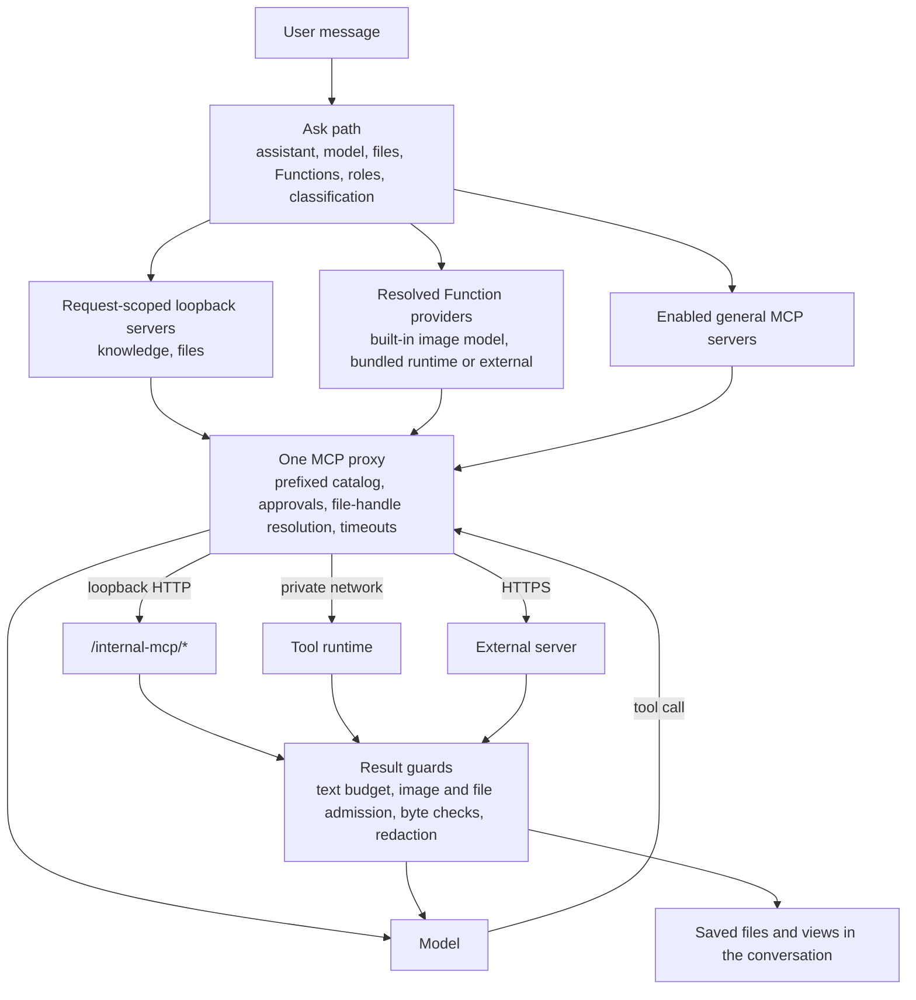

import { Callout } from "nextra/components";

# Tools and MCP Architecture

Everything a model can call in Eneo is a Model Context Protocol (MCP) tool.
Eneo is the MCP host: it decides which tools a completion may see, connects to
the servers that implement them, runs every call through one proxy, and checks
whatever comes back before it reaches the model, the conversation or the user.
The servers themselves run in three different places, chosen by what the tool
needs rather than by who wrote it.

This page is the map. It names the three execution tiers, explains why the
design is split along those lines, and points to the pages that own each
part.

<Callout type="info">
  Related pages: [Knowledge Retrieval and MCP
  Interoperability](/docs/knowledge-retrieval-and-mcp) owns the proxy pipeline,
  the two kinds of approval, file references and failure behaviour. [Built-in
  Tool Servers](/docs/builtin-tool-servers) owns the loopback servers and the
  placement rule for new built-in tools. [Tool Runtime
  Security](/docs/tool-runtime-security) owns the isolated runtime's design
  assumptions and controls. Administrators work through [MCP
  Servers](/guides/mcp-servers) and [Functions](/guides/capabilities).
</Callout>

## One protocol, one proxy, three places to run

|                                    | Loopback servers                                                    | Bundled tool runtime                                                                               | Independently operated servers                                                                                                           |
| ---------------------------------- | ------------------------------------------------------------------- | -------------------------------------------------------------------------------------------------- | ---------------------------------------------------------------------------------------------------------------------------------------- |
| Runs in                            | The backend process, mounted at `/internal-mcp/<name>/mcp`          | A separate container in the release bundle (`tool-runtime/`, image `eneo-tool-runtime`)            | Any Streamable HTTP MCP server an administrator registers                                                                                |
| Maintained by                      | Eneo                                                                | Eneo                                                                                               | The operator or a third party                                                                                                            |
| Serves                             | Knowledge search, attachment reading, image generation              | Compute, charts, tabular file analysis, document and spreadsheet creation                          | Domain integrations, web search, and alternative providers for any Function                                                              |
| Tool definitions                   | Taken from the deployed code on every completion; nothing to review | Taken from the running runtime's catalog, stored and refreshed without review, with an audit entry | Synced, stored and approved by an administrator before the model sees them                                                               |
| Credentials                        | A 15-minute token Eneo mints for itself per completion              | A shared bearer read from the deployment environment at connect time; nothing stored               | Public, a stored encrypted bearer or API-key header sent only over https (plain http only to a loopback host); optional identity headers |
| Access to Eneo data                | Full, through the acting user's normal permission checks            | None: no database, no signing key, only the signed links a call carries                            | None beyond the signed links a call carries                                                                                              |
| Per-call user approval             | Skipped: scope is fixed by Eneo's code and the completion token     | Follows the conversation's setting                                                                 | Follows the conversation's setting                                                                                                       |
| Isolation from other tenants' data | The backend's own authorization                                     | One confined child process per job, locked engines, hardened container                             | Whatever the operator provides                                                                                                           |
| Failure                            | Request-local; nothing accumulates                                  | Tool call fails; chat continues                                                                    | Circuit breaker per server; chat continues                                                                                               |

## What every tier shares

The tiers differ in where code runs and who vouches for it. They do not
differ in how a completion uses them:

- **One client and one proxy.** The backend connects to all three with its
  ordinary Streamable HTTP MCP client, lazily, when the model first calls a
  tool on that server, and reuses the connection for the rest of the
  completion. Prefixing (`server__tool`), parallel calls, output limits,
  retries, reference capture and cleanup are implemented once. Each
  connection runs on a task of its own, so the proxy can open it from any
  tool call and close it from wherever the answer ends: when the model
  finishes, when the provider fails, and when the reader closes the tab
  mid-answer. The turn then releases its pending tool approvals, its
  connections and the provider stream, and the request waits up to ten
  seconds in all for that. Provider-stream cleanup shares that deadline,
  including providers that shield their own cleanup from cancellation. A
  connection still closing after the deadline is cancelled rather than
  waited for.
- **One way to attach.** A tool reaches a completion either because a
  **Function** the assistant enabled resolved to a provider for this user, or
  because a **general MCP server** is enabled for the space and assistant, or
  because the request itself needs a built-in helper (knowledge in tool mode,
  attached files). The same gates apply regardless of tier: the user's role,
  the space, the assistant, the security classification, and a model that
  supports tool calling.
- **One file transport.** The model holds credential-free handles
  (`eneo-file:…`). Eneo resolves them against the request's authorised files
  into short-lived signed URLs just before dispatch, so every provider,
  internal or external, receives an ordinary URL and needs no knowledge of
  Eneo's handles. Links to any other file stop the call.
- **One result pipeline.** Text is budgeted, images and embedded files are
  admitted by count, size and the purpose the server serves, generated
  documents are checked byte by byte, tokens are redacted before anything is
  stored or replayed, and results that carry an interactive view are shown
  through the MCP Apps host.

## Two ways a tool is configured

|                              | Function                                                                                                                       | General MCP server                                                     |
| ---------------------------- | ------------------------------------------------------------------------------------------------------------------------------ | ---------------------------------------------------------------------- |
| What is saved                | A purpose (`web_search`, `image_generation`, `file_analysis`, `file_creation`, `charts`, `compute`) on the space and assistant | The server and its tools on the space and assistant                    |
| Who serves it                | Resolved at ask time: a group provider or the tenant default, from any tier                                                    | The one server that was selected                                       |
| Replacing the implementation | Activate another provider; saved intent is untouched                                                                           | Edit each space and assistant                                          |
| Typical use                  | Capabilities with interchangeable providers, including the ones Eneo ships                                                     | Domain tools that are what they are: a ticketing system, a records API |

Functions exist so that "this assistant can analyse files" is not the same
statement as "this assistant talks to server X". An administrator can move a
Function from the bundled runtime to an external provider, or the reverse,
without touching a single assistant. See [Functions](/guides/capabilities).

## Why the architecture is split this way

### Why Eneo's own tools speak MCP

Eneo could have called its knowledge search, file reader or image model as
plain Python functions inside the completion loop. It routes them through MCP
instead, as loopback servers the backend hosts and then connects to, because
that gives internal and external tools one integration boundary. The
completion adapter has no separate code path for "RAG tools" and "MCP tools";
anything that works for one works for the other. It also keeps Eneo honest
about replaceability: a bundled provider and an external one receive the same
signed URL and return the same MCP content, so an operator can swap either
for the other.

The route is a network path, not a trust shortcut. Every loopback call carries
a per-completion token that fixes the assistant (and, for a built-in provider,
the provider row) in a claim the model cannot change, and each tool
reconstructs the acting user's normal service container before it reads
anything.

### Why some tools stay inside the backend

A loopback tool is a pure function of the request, the tenant database and at
most one outbound provider call, finishing inside a tool-call timeout. It
needs no process of its own, no storage and no heavyweight dependency. For
that shape the backend is the cheapest and safest place to be: the data is
already authorised, the code ships with the release, and there is nothing to
review or operate. Knowledge search, attachment reading and image generation
fit; the placement rule and its two attachment patterns are spelled out in
[Built-in Tool Servers](/docs/builtin-tool-servers).

### Why heavy and untrusted work runs in a separate runtime

Compute, tabular analysis, charts and file creation have four properties that
knowledge search does not:

1. **The input is not Eneo's own.** The model writes the JavaScript and the
   SQL. Users supply the CSV, XLSX and DOCX files. None of it can be reviewed
   before it runs, so it has to be contained instead.
2. **They need engines.** DuckDB, QuickJS, an OOXML renderer, HTML-to-PDF
   layout and SVG rasterising are large native or WebAssembly dependencies
   with their own vulnerability history.
3. **Their memory is proportional to the file**, not to the request.
4. **They need a sandbox.** Code the model wrote must not be able to read
   another conversation's files, reach Eneo's credentials or the network, or
   run forever.

The backend process is the chat API for every tenant. Running such work there
would mean one query competing with every other request for memory, one
engine failure affecting chat, and the engines sharing a process with the
database connection and the signing keys. So the work moved to a runtime
that:

- runs each job in a fresh child process with a stripped environment, a
  private directory and Linux Landlock confinement, so an engine sees only
  the files that one job was given;
- holds no credentials and no data, has no database, no signing key and, in
  the reference deployment, no route to PostgreSQL, Redis or the internet, so
  there is nothing to take;
- keeps its dependency set out of the backend image, so the backend's
  vulnerability surface and release cadence stay its own;
- has its own CPU, memory and process limits and a fair scheduler, so one
  tenant's load degrades its own tools and not the chat API.

[Tool Runtime Security](/docs/tool-runtime-security) describes each of these
layers and what they do and do not cover.

### Why "bundled" rather than "just another external server"

The runtime is an MCP server like any other at the protocol level, and that is
deliberate. What makes it bundled is operational:

- It is built and published with the backend and frontend from the same
  source revision, as one verified release bundle, so there is no version
  skew to manage and **Admin > Tools** can warn when one appears.
- Its address and bearer come from the deployment environment
  (`TOOL_RUNTIME_URL`, `TOOL_RUNTIME_TOKEN`), read at connect time. Nothing is
  stored in the database, and the connection form is read-only.
- Its tool definitions and views are Eneo's own code, so the backend takes
  the running runtime's catalog without an administrator's review, keeps the
  administrator's per-tool enablement and display names, and records each
  change in the audit log. A new image is in force as soon as it runs.
- It is registered through the ordinary **Admin > Tools** page as a
  **Built into Eneo** provider for each Function, and an external provider
  can replace it at any time.

The runtime is not a plugin host. New endpoints belong there only when they
need platform-owned isolation and Eneo maintains them. Domain integrations
(statistics APIs, open-data portals, case systems) stay independently
operated servers.

### Why files, not shared storage, connect tools

A query export feeds a chart, a chart image goes into a report, a spreadsheet
is built from a query result. These chains never pass large data through the
model and never require two providers to share storage:

1. A tool returns its output inside the MCP result (an embedded resource or an
   image block). The runtime keeps no copy and serves no download links.
2. Eneo admits the file only if the producing server serves a Function that
   delivers that type, checks the bytes, and saves it in the conversation
   with its exact original and extracted text.
3. The model receives a stable handle for the new file in the same answer
   (in a streaming chat) and passes it to the next tool, where Eneo resolves
   it to a fresh signed URL.

Eneo owns every file; providers hold only short-lived links. The runtime's
cache of original bytes and parsed sheets is a performance detail keyed by
tenant, user and content hash, and it can never stand in for the access
check, because every call redeems its own link first.

### Why presentation is split between native views and MCP Apps

A saved file is shown by Eneo's own previews and document workspace: drafts,
revisions, version navigation and export are Eneo features, not tool
features, and they work without any app feature flag. Tool-specific
interaction (sorting a query result, zooming a chart, re-running a
calculation with edited inputs) is an MCP App: one self-contained HTML page
the server attaches to its tool, shown in a sandboxed frame on a separate
origin through the official MCP Apps SDK.

The trust split follows the tiers. An external server's view is part of its
tool definition and is approved, pinned by content hash and served only while
the approval holds. The bundled runtime's views are Eneo's code and follow
the release like its tools. In both cases the view cannot read or change
anything in Eneo, and a tool call made from a view is rate-limited, rechecked
against the current approval on every request, limited to the files its
originating call used, and audited. Such calls are not added to the
conversation and the model does not see them; a message a view offers goes
into the composer for the user to send. See
[Interactive tool views](/guides/mcp-servers#interactive-tool-views) and the
[MCP Apps deployment guide](https://github.com/eneo-ai/eneo/blob/develop/docs/deployment/MCP_APPS.md).

## Trust decisions, boundary by boundary

| Boundary   | Decision                               | Loopback                                                                      | Bundled                                               | External                                                                   |
| ---------- | -------------------------------------- | ----------------------------------------------------------------------------- | ----------------------------------------------------- | -------------------------------------------------------------------------- |
| Catalog    | What the model may be told a tool does | Deployed code                                                                 | Running runtime, audited                              | Administrator approval; changed definitions wait at the previous version   |
| Attachment | Whether this completion gets the tool  | Request needs it (knowledge mode, files present) or a Function resolved to it | Function resolved to it                               | Function or space and assistant selection                                  |
| Dispatch   | Whether this call may go out           | Role, space, classification; token fixes scope                                | Same, plus foreign-link refusal and handle resolution | Same, plus the conversation's per-call approval                            |
| Transport  | What the server learns about the user  | Full identity in the scoped token                                             | Opaque user and tenant IDs                            | Identity headers only when the administrator opted in                      |
| Result     | What comes back into Eneo              | Text budget, reference capture                                                | Text budget, file admission by purpose, byte checks   | The same guards; files only for servers serving a file-delivering Function |
| Storage    | What is kept                           | Tool trace with tokens redacted                                               | Saved generated files, redacted trace                 | The same                                                                   |

The central invariant: the three tiers converge at the proxy only **after**
each has applied its own availability, authorization and trust decisions.
Sharing the execution plumbing does not merge their security boundaries.

## Skills, Functions, tools and views

These features separate instructions, access, execution and presentation. A
Function can use the bundled runtime, but the two are not interchangeable.

| Part                                       | Owns                                                                                                       | Does not supply                                                         |
| ------------------------------------------ | ---------------------------------------------------------------------------------------------------------- | ----------------------------------------------------------------------- |
| **Skill**                                  | Reusable Markdown instructions pinned to an exact revision                                                 | Executable scripts, tool installation or permission grants              |
| **Function**                               | Saved purpose such as `file_analysis` or `charts`; provider selection under organisation and user controls | A particular implementation or a guarantee of every native UI operation |
| **General MCP integration**                | Approved domain tools attached through Space and Assistant configuration                                   | A new Function merely because it uses MCP                               |
| **Loopback server**                        | Backend-owned knowledge, attachment reading or image-model calls                                           | A host for heavy file processing or arbitrary compute                   |
| **Bundled tool runtime**                   | Eneo-maintained isolated calculations, tabular analysis, charts and file creation                          | A plugin host or durable document store                                 |
| **MCP App**                                | A tool's interactive result view, such as a query table or chart                                           | An editable saved document or unrestricted access to Eneo               |
| **Native document workspace and previews** | File display, streaming drafts, assistant-driven revisions, version navigation and export controls         | Direct rich-text or spreadsheet cell editing                            |

**Eneo Apps** that builders configure in Spaces are separate from **MCP
Apps**. The former are application resources that can bind Skills; the latter
are interactive HTML views attached to MCP tools.

- **Instruction reuse is independent of authority.** Loading a Skill changes
  the model's context. Existing role, Space, Assistant, classification and
  tool-approval checks still decide what it may call. A Skill can describe how
  to use an available compute tool without carrying executable code itself.
- **Saved intent survives provider changes.** Assistants store Function
  purposes, and Eneo resolves an eligible group provider or tenant default at
  request time. Native operations may require a narrower tool contract:
  exporting a Markdown document uses `create_document`, so generic
  file-creation capability alone is insufficient.

### Saved state and failure boundaries

| State or operation                                 | Behaviour                                                                                                                                       |
| -------------------------------------------------- | ----------------------------------------------------------------------------------------------------------------------------------------------- |
| Skill revision and Function selection              | Saved configuration; provider changes do not update a Skill pin or erase Function intent                                                        |
| Generated document revision                        | A new saved file; conversation tool calls link revisions through `revises` and generated file IDs                                               |
| Streaming document draft                           | A preview of in-progress tool arguments; successful file delivery establishes the saved result                                                  |
| App filters, loaded rows and chart zoom            | Preserved when moving the same frame between inline and expanded display; not guaranteed across reloads                                         |
| Markdown export to Word/PDF                        | Renders the selected saved text through a compatible current provider without another model response; download bytes are not saved as a version |
| Runtime unavailable                                | Its tool calls can fail; ordinary chat and already-saved native previews do not depend on runtime readiness                                     |
| MCP Apps disabled                                  | Native previews still work; bundled table tools return data and charts fall back to PNG                                                         |
| View approval revoked or originating tool disabled | An already-open app loses tool access when the host rechecks its next request                                                                   |

## Where to read next

- How a completion builds its tool catalog, the two kinds of approval, file
  references and degradation: [Knowledge Retrieval and MCP
  Interoperability](/docs/knowledge-retrieval-and-mcp).
- The loopback servers, the placement rule and how to add one: [Built-in Tool
  Servers](/docs/builtin-tool-servers).
- The runtime's design assumptions, its layers and the operator checklist: [Tool
  Runtime Security](/docs/tool-runtime-security).
- Registering external servers, catalog approval, identity forwarding and
  interactive views: [MCP Servers](/guides/mcp-servers).
- Functions, their providers, permissions and what users see:
  [Functions](/guides/capabilities).
- Deploying, upgrading and diagnosing the runtime:
  [operator guide](https://github.com/eneo-ai/eneo/blob/develop/docs/deployment/TOOL_RUNTIME.md).
