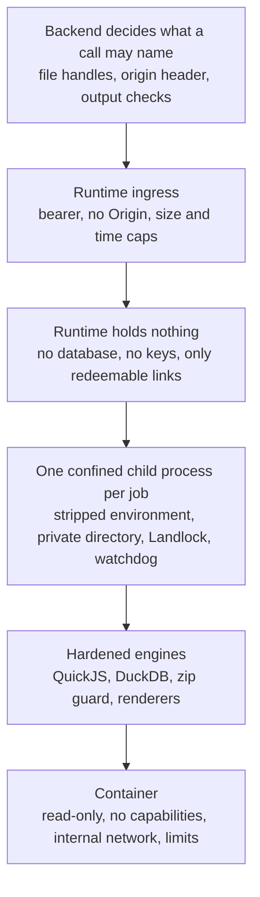

import { Callout } from "nextra/components";

# Tool Runtime Security

The bundled tool runtime is the one place in Eneo where code the model wrote
runs, where SQL the model wrote is executed, and where files users uploaded
are parsed and rendered. It is also one container shared by every tenant and
every conversation of a deployment. This page describes the assumptions the
runtime is built on, the layers that keep jobs, tenants and the deployment
apart, where each layer is enforced, and what remains for the operator to
provide.

<Callout type="info">
  [Tools and MCP Architecture](/docs/tool-architecture) explains why this work
  runs outside the backend at all. Operators configure, upgrade and diagnose the
  runtime with the [operator
  guide](https://github.com/eneo-ai/eneo/blob/develop/docs/deployment/TOOL_RUNTIME.md)
  in the repository; this page is the rationale behind its settings.
</Callout>

## Design assumptions

The runtime treats everything it is given as data to be contained, not as
instructions to be trusted:

| Input                                                | Comes from                      | Handled as                                                                             |
| ---------------------------------------------------- | ------------------------------- | -------------------------------------------------------------------------------------- |
| JavaScript for `run_javascript`                      | The model                       | A program with a fixed budget of memory, time and output, and no I/O                   |
| SQL for `query_table` and `assert_table`             | The model                       | One read-only statement over the loaded sheets, in an engine with nothing else enabled |
| CSV, XLSX, JSON and DOCX files                       | Users, or tools acting for them | Bounded packages parsed in a separate process, with saved values only                  |
| Document content, templates and chart specifications | The model and users             | Validated specifications rendered by engines that are kept out of the backend          |

The separation it maintains:

- **One conversation's files from another.** The runtime processes files for
  every tenant, so a job can only see the files it was given, never the
  attachments, parsed sheets or outputs of another job.
- **Eneo's credentials and data.** The runtime has no path to the database,
  Redis, the signing key, the model providers or the internet.
- **The host and the rest of the deployment.** One job's resource use stays
  within the runtime's own limits and cannot affect the backend or other
  containers.
- **The user who receives the output.** A file the runtime produced is safe
  to open: no macros, scripts or externally loaded content.

The runtime's own code and the engines it bundles are part of the Eneo release
and are kept current through its normal dependency process. The layers below
are about what those engines are fed, not about the release itself.

## The layers, from the outside in

Each layer is independent. A failure in one still leaves the others standing,
and the runtime is useful on hosts that cannot provide all of them.



### Layer 0: the backend decides what a call may name

Before the runtime is contacted, the Eneo backend has already decided which
files the call may use.

- The model never holds a download link. It holds a credential-free handle
  (`eneo-file:…`) for each attachment and generated file of the conversation.
  Just before dispatch the backend resolves every handle in the arguments,
  including nested ones, against the files the request is allowed to use and
  replaces it with a short-lived signed URL. An unknown or unavailable handle
  fails the call before anything is sent.
- A tool call may only carry links to the files of its own conversation. A
  signed link to any other file in the arguments, even a valid one pasted in by
  a user or returned by another tool, stops the call.
- The backend tells the runtime which origin file links come from
  (`X-Eneo-File-Origin`, taken from `FILE_REFERENCE_BASE_URL`), so the model
  cannot steer a download elsewhere by writing a different URL.
- Every result passes the same guards as any MCP server's: a text budget,
  image and file count and size caps, admission of embedded files only for the
  purpose the server serves, and a byte-level check of each accepted document
  (see [Output validation](#output-validation-back-in-eneo)).

The same rules apply to an external provider. The runtime is not trusted more
than one because it ships with Eneo; it simply has less it could do with that
trust.

### Layer 1: ingress

The runtime answers only to the backend and worker, and even then only in a
narrow shape (`src/server.ts`):

- Every tool endpoint requires `Authorization: Bearer <TOOL_RUNTIME_TOKEN>`.
  The token must be at least 32 characters, is compared in constant time, and
  is removed from the runtime's environment once read so no job can inherit
  it.
- A request carrying an `Origin` header is refused with 403 before
  authentication, so a browser can never speak to the runtime even on a
  misconfigured network.
- MCP requests must be `POST` with `application/json`. The body is read with a
  byte counter and refused above a cap (256 KiB, raised in step with
  `DOCUMENT_MAX_CONTENT_CHARS` for document content), and above 10 seconds of
  transfer.
- Results are capped at 512 KiB of structured content and 20 MiB of files and
  images, whichever tool produced them.
- Intake is bounded: more in-flight calls than the scheduler can hold receive
  HTTP 429 with a `Retry-After`; discovery and control requests share a small
  separate budget.
- Identity headers (`X-Eneo-Tenant-Id`, `X-Eneo-User-Id`) are accepted only
  as UUIDs and are used for cache scoping and fair scheduling, never for
  authorization. The file-analysis endpoint refuses calls without them.
- Only the health endpoints are unauthenticated. They report liveness and
  nothing else.

### Layer 2: the runtime holds nothing worth taking

- It has no database, no console, no operator mutation API and no registration
  sync. Eneo registers it through **Admin > Tools** like any other MCP server.
- It stores no credential. Its only secret is the shared bearer, which the
  backend reads from its own settings at connect time, so it is never written
  to the database.
- It holds no signing key. The only way it can obtain file bytes is to redeem
  a signed link the backend put in a call, and the backend checks the token,
  tenant, file and content accessibility on every redemption and writes an
  audit entry for it.
- In the reference deployment it has no route to PostgreSQL, Redis or the
  internet, so there is nothing on its network for a job to connect to.

The disposable cache of original bytes and parsed sheets does not weaken this.
Every call downloads through its own signed URL; a cache hit only replaces the
bytes after the backend has answered `304 Not Modified` to that call's link.
Entries are keyed by tenant, user and content hash, pinned while a job uses
them, bounded by a shared budget (256 MiB, 1024 entries, 30 minutes idle by
default) and wiped when the runtime starts.

### Layer 3: one confined process per job

Every job (a script, a query, a sheet ingest, a render, a chart) runs in a
fresh child process (`src/sandbox.ts`, `src/child.ts`):

- The child's environment is only `TMPDIR` (its private directory), `PATH`
  and, when set, `PDF_PYTHON`. The bearer token and the server's settings are
  not in it.
- The private directory is created with mode 0700 and deleted when the job
  ends. Child stderr is discarded; stdout is capped at 600 KiB.
- A deadline per job kind (10 s for compute with the default script timeout,
  20 to 25 s for queries, ingests and renders) is enforced twice: an in-process
  timer that kills the whole process group, and an external `timeout --signal=KILL`
  wrapper for the case where the parent itself is stuck. Cancelling the call
  kills the group too.
- When [landrun](https://github.com/zouuup/landrun) is present (the image
  builds it in), the child is started inside a Linux Landlock domain that
  allows read-only access to the runtime's code and system libraries, read
  access to exactly the input files that one job was given, and write access
  to its private directory and the output location for that job. It cannot
  open another job's files, other users' cache entries, or the server
  process's environment. On a kernel with Landlock network rules (6.7 or
  later) it cannot open a TCP socket at all.

Each child tests its own confinement before it works: it must be unable to
list the directory above its private one, and (where supported) unable to bind
a loopback port. The start-up line reports the result:

```json
{"event":"listening", "port":3010, "endpoints":[…], "confinement":{"files":true,"tcp":true}}
```

On a host that cannot confine children (Landlock needs Linux 5.13 or later,
and must not be filtered by a seccomp profile), the runtime still works with
the other layers. Where sensitive or classified files are handled, set
`TOOL_RUNTIME_REQUIRE_CONFINEMENT=true`: the runtime then refuses to start,
and every child refuses to run, unless files are confined.

### Layer 4: hardened engines

Each engine is configured with only what its job needs and nothing it does
not.

**JavaScript (`run_javascript`)** runs in QuickJS compiled to WebAssembly, so
it is interpreted inside the child rather than by the host JavaScript engine.
Each call gets a fresh runtime with a memory limit (64 MB by default, at most 256) and a deadline (5 s by default, at most 30). The script sees `input`,
`console` and the preinstalled `Decimal` and `fmt` helpers, and nothing else:
no timers, filesystem, network, imports, host APIs or environment. A promise
left pending at the end fails the job rather than being awaited. Limits:
20,000 characters of code, 64 KiB of input, 256 KiB of result, 100 log lines.
An exported table is written as CSV with mode 0600 and is capped at 200,000
rows and 20 MiB.

**SQL (`query_table`, `assert_table`)** runs in a new in-memory DuckDB per
query. The parsed sheets are loaded first; then, before any model SQL is
prepared, external access is switched off, extension loading and auto-install
are disabled, memory (256 MB), spill space (256 MB) and threads (1) are set,
and the configuration is locked so the query cannot change any of it. DuckDB's
own parser must see exactly one statement of type `SELECT`; anything else is
refused. The query is wrapped in a row limit (500, or the export limit of
200,000) and interrupted at its deadline (10 s). The rows returned to the
model are bounded as well: a cell is cut at 4,000 characters and the rows stop
at 256 KB, reported as truncation; an export file keeps every cell whole. The
engine's diagnosis of the
model's SQL (an unknown column, a syntax error, a failed cast) is returned so
the model can correct it; other engine errors are reported generically.

**File parsing** happens in the same confined children. CSV and JSON must be
UTF-8 without NUL bytes. JSON is read as text by DuckDB's JSON reader, with no
type inference, in an instance of its own whose memory limit is the query
limit or 32 times the file size, whichever is larger (640 MB at the 20 MB
upload cap). A JSON Lines file becomes one sheet CSV of its records (200
columns, within the same 64 MiB); a JSON document is never turned into sheets,
and `query_json` binds the model's path as a string literal and returns at
most 16,000 characters of structure or value. XLSX and DOCX packages pass a zip guard that reads only the
central directory: at most 10,000 entries, no ZIP64, and a declared expansion
bounded at 64 MiB or 100 times the packed size. A workbook is converted to at
most 20 sheets and 64 MiB of CSV; formulas are read as their saved values and
external references are ignored. Column types are read from the whole file so
a stray value cannot drop rows silently.

**Rendering** (`create_document`, `fill_template`, `create_spreadsheet`) writes
at most 10 MiB per output, with mode 0600. Word templates are refused if their
content-types part declares macros or a VBA project. Spreadsheet cells are
always written as text, so a value starting with `=` is never a formula. PDF
output goes through WeasyPrint in a Python sidecar that the child spawns, so it
runs under the same Landlock domain, with its own minimal environment, an
interpreter started in isolated mode, a fetcher that only accepts `file:` URLs
inside the render directory for PNG, JPEG, CSS and HTML, and a 20 s kill. All
text is HTML-escaped before layout; external images in templates are dropped
and only `http(s)` hyperlinks are kept.

Template font names are serialized as CSS strings, and theme colors must be
six-digit RGB values. Template logos and body pictures pass the same PNG/JPEG
header and dimension checks as document images before entering the render
directory: at most 16 megapixels and 12,000 pixels per side. A file extension
alone does not admit a resource. Unsupported or oversized bitmap data fails
the render; recognized PNG/JPEG bytes retain their printed template size.

**Charts** are drawn from a validated specification, never from ECharts
options or HTML written by the model: at most 8 series, 12 pie slices, 2,000
points by default, bounded label and title lengths. Tooltips use the
rich-text renderer so no label becomes HTML. A PNG is rendered to SVG without
a browser and rasterised by resvg in the child; interactive chart data is
capped at 200 KiB.

### Layer 5: the container

The reference Compose stack bounds the container itself, independently of
the per-job confinement:

| Control      | Setting                                                                                                           |
| ------------ | ----------------------------------------------------------------------------------------------------------------- |
| Network      | `tool_runtime_net`, `internal: true`; only the backend and worker join it; port 3010 exposed to that network only |
| Filesystem   | `read_only: true`; `/tmp` is a 512 MiB tmpfs mounted `noexec,nosuid,nodev`                                        |
| Privileges   | `cap_drop: ALL`, `no-new-privileges: true`, process runs as the unprivileged `bun` user                           |
| Resources    | `mem_limit: 2g`, `cpus: 2`, `pids_limit: 256`                                                                     |
| Supply chain | landrun built from a pinned release; Python packages installed with `--require-hashes`                            |

Deployments that do not use the reference stack (another orchestrator, the
development container) must provide this layer themselves: no egress, a
read-only root filesystem, no capabilities and resource limits.

## Fair scheduling and denial of service

A shared runtime must also survive one tenant's load:

- At most `MAX_CONCURRENCY` calls (16) run at once, with `MAX_QUEUE` (32)
  waiting and at most `MAX_QUEUE_PER_GROUP` (8) per caller group. A group is
  the hash of the tenant ID. Groups are served round-robin, so one busy tenant
  cannot starve another; idle capacity is borrowed. A full queue returns a
  `BUSY` tool result rather than blocking.
- Engines that use native memory (DuckDB, the Office renderers, resvg) share a
  smaller pool, `TABULAR_CONCURRENCY` (2). PDF renders have their own,
  `DOCUMENT_PDF_CONCURRENCY` (2), because each one is a Python process.
- Queue time counts toward the call's deadline. Cancellation removes waiting
  jobs, aborts downloads and kills active process groups before cleanup.
- Health and discovery requests do not wait for job slots.

## File downloads

When a call names a file, the runtime fetches it under a fixed policy
(`src/tools/files/reference.ts`, `src/tools/tabular/download.ts`):

- Only two URL shapes are accepted: `/api/v1/files/<id>/original/download/`
  and `/api/v1/document-templates/<id>/original/download/`, each with a signed
  token, at the exact origin the backend sent in `X-Eneo-File-Origin`.
  `TOOL_RUNTIME_FILE_ORIGINS` additionally pins the origins the runtime will
  accept at all; the reference stack sets it to the file-reference base URL.
- The origin is resolved and every address checked. Private and loopback
  addresses are allowed because the backend normally lives there; link-local,
  reserved and multicast ranges are refused. Redirects are followed at most
  three hops and must stay on the same origin.
- Downloads are capped at 20 MiB and 15 seconds, must be uncompressed, and an
  empty body is an error. A link whose token was redacted for storage is
  refused as stale so the model asks for a fresh reference instead of retrying.
- Revalidation uses `If-None-Match`; a cached entry is only trusted when its
  ETag is the SHA-256 of the bytes. Any download error invalidates the entry.

## Output validation back in Eneo

A document the runtime renders comes back inside the tool result as an MCP
embedded resource. The runtime keeps no copy and serves no download links.
The backend then applies the same admission rules it applies to every server:

1. A binary resource becomes a generated file only when the producing server
   serves a function that delivers that type (`file_creation`: Markdown, text,
   DOCX, PDF, XLSX; `file_analysis` and `compute`: CSV). Any other blob is
   stripped and the model sees a placeholder.
2. The bytes are checked against the declared type: OOXML packages must be
   well-formed and bounded, with no macros, embedded objects, unsafe paths or
   non-hyperlink external relationships; PDFs must be complete and contain no
   JavaScript, launch actions, embedded files, rich media or XFA; text must be
   UTF-8. A file that fails is logged and skipped; the answer continues.
3. Accepted files are stored like uploads, with their exact original and
   extracted text, linked to the question and the tool call, and deleted with
   the conversation. Limits: `MCP_TOOL_FILE_MAX_BYTES` (20 MiB) and
   `MCP_TOOL_FILE_MAX_COUNT` (4) per result.

## Logging and secrets

Structured events (`tool_completed`, `tool_failed`, `file_cache`,
`cleanup_failed`) carry the request ID, tool name, error code, queue and
execution time, cache revalidation and transferred bytes. They omit tokens,
signed URLs, file contents and model arguments. Model-facing download errors
name the host but never the signed URL. The cache index holds hashes, never
URLs or tokens.

## What this does not cover

- **The host kernel itself.** Landlock is a kernel feature, and the reference
  stack runs the container on the host kernel with Docker's default runtime.
  Sandboxed container runtimes such as gVisor or Kata Containers exist for
  that layer, but Eneo has not run the tool runtime under one and makes no
  claim about compatibility; a deployment that tries it is on its own.
- **Residency of original bytes and parsed sheets.** They stay in the
  memory-backed `/tmp` for follow-up questions, 30 minutes idle by default.
  `TOOL_RUNTIME_TABULAR_CACHE_TTL_SECONDS` shortens that, down to 60 seconds.
  With confinement only the server process and the jobs that query the same
  file can read them.
- **A host without Landlock.** Layers 0, 1, 2, 4 and 5 remain, and
  `TOOL_RUNTIME_REQUIRE_CONFINEMENT` turns the missing layer into a refusal.
- **Deployments outside the reference stack**, which must supply layer 5.
- **The bundled engines themselves.** They are part of the release and are
  kept current through Eneo's normal dependency process; see
  [Security for Contributors](/contributing/security).

## Checklist before raising a classification

Setting a security classification on the built-in server under
**Admin > Tools** is the administrator's statement that this deployment may
handle files of that level. Before raising it:

1. Read the start-up line and confirm `"confinement":{"files":true,...}`, or
   set `TOOL_RUNTIME_REQUIRE_CONFINEMENT=true` so the runtime refuses to run
   without it.
2. Confirm the runtime is on an internal network with no egress, and that the
   container is read-only with no capabilities. **Admin > Tools** reports
   connectivity, version, confinement and file-origin state.
3. Confirm `FILE_REFERENCE_BASE_URL` points at an address only the runtime and
   trusted servers can reach, and that `TOOL_RUNTIME_FILE_ORIGINS` pins it.
4. Decide on the cache lifetime for the data involved.

## Security-relevant settings

Runtime settings are read by the container; the reference stack maps them from
`TOOL_RUNTIME_*` names in the deployment `.env`.

| Setting (runtime)                                     | Default                     | Controls                                                      |
| ----------------------------------------------------- | --------------------------- | ------------------------------------------------------------- |
| `TOOL_RUNTIME_TOKEN`                                  | required                    | Shared bearer, at least 32 characters                         |
| `TOOL_RUNTIME_FILE_ORIGINS`                           | the file-reference base URL | Origins the runtime will download from                        |
| `TOOL_RUNTIME_REQUIRE_CONFINEMENT`                    | `false`                     | Refuse to start or run jobs without Landlock file confinement |
| `MAX_CONCURRENCY`, `MAX_QUEUE`, `MAX_QUEUE_PER_GROUP` | 16, 32, 8                   | Active calls, waiting calls, waiting calls per tenant         |
| `TABULAR_CONCURRENCY`                                 | 2                           | Native-engine jobs at once                                    |
| `DOCUMENT_PDF_CONCURRENCY`                            | 2                           | PDF sidecars at once                                          |
| `COMPUTE_TIMEOUT_MS`, `COMPUTE_MEMORY_MB`             | 5000, 64                    | Script deadline and memory                                    |
| `TABULAR_MAX_UPLOAD_MB`                               | 20                          | Largest file downloaded                                       |
| `TABULAR_CACHE_MB`, `TABULAR_CACHE_TTL_SECONDS`       | 256, 1800                   | Cache budget and idle lifetime                                |
| `DOCUMENT_MAX_CONTENT_CHARS`                          | 50000                       | Document size, and with it the request body cap               |

Backend settings that complete the picture are `FILE_REFERENCE_BASE_URL`,
`FILE_REFERENCE_URL_EXPIRY_SECONDS`, `MCP_TOOL_FILE_MAX_BYTES`,
`MCP_TOOL_FILE_MAX_COUNT` and `MCP_TOOL_OUTPUT_MAX_CHARS`; see
[Functions](/guides/capabilities#configuration-reference) and the
[deployment guide](/guides/deployment#signed-file-references).
