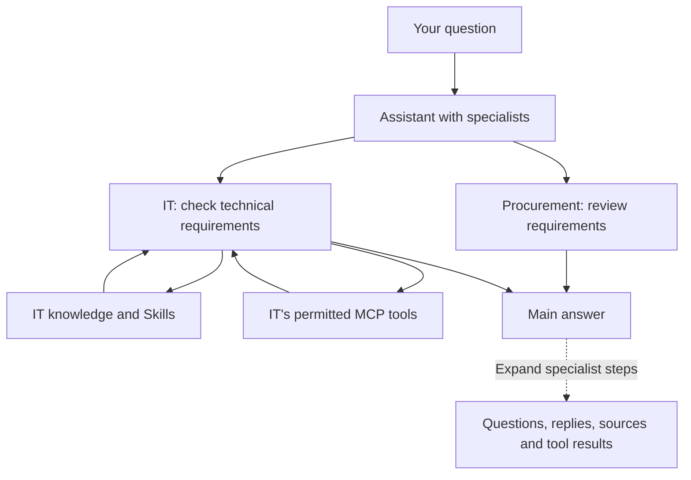

# Assistants with specialists

An assistant can consult other assistants in its Space before it answers. The
asking assistant is the orchestrator: it decides which specialists to ask, can
ask a follow-up, and writes the answer shown in the conversation. Each
specialist uses its own instructions, model, Skills, knowledge and permitted
tools.

## Configure specialists

Open the assistant's settings and add **Specialists** under Tools. Only
assistants in the same Space can be chosen, and an assistant cannot be its own
specialist. Describe what each specialist should be consulted for; an empty
description falls back to the specialist's own description. Give the
orchestrating assistant instructions for the kind of final answer you want.

Consulting specialists needs a model that supports tool calling. If the
assistant's model cannot call tools, the settings say so and the assistant
answers on its own; its specialists stay configured for when the model changes.

Specialists are consulted without their own specialists: a specialist that has
specialists of its own answers as a single assistant when it is consulted.
Deleting a specialist removes it from every assistant that consulted it. Moving
an assistant to another Space clears its specialist links in both directions.

Changing a specialist's availability, model, classification or tool
configuration during a turn can stop that turn; ask again after the
configuration has been corrected.

## Read the answer and its steps

The main answer is the orchestrating assistant's synthesis. Expand **View
steps** to see each question sent to a specialist, its actual answer, its
sources and the tools it used. Repeated questions to the same specialist appear
as separate steps. Opening a saved conversation restores these recorded steps
without running the assistants again.

Specialists run one at a time. A specialist can make several tool calls, but it
cannot consult another assistant. The orchestrating assistant can ask it another
question when the first answer is incomplete.

In the chat's tool menu, turn off automatic tool execution if you want to approve
external tools before they run. This preference also applies to specialist tool
calls. Approval requests remain visible outside the collapsed specialist steps.
Denying a tool call prevents its execution and lets the assistant explain the
missing evidence. Eneo's existing rules for internal knowledge and file tools
continue to apply.

## Access and limits

All assistants stay within the Space. Being a specialist grants no extra
permissions: Eneo checks the caller's access, available models, Space
classification and effective tool settings before execution and before every
later handoff. A specialist's answer does not lower the information's
classification.

A specialist the asking user may not use, for example an unpublished assistant
for a viewer, is left out of that user's question. So is a specialist whose
model is not enabled in the Space. The orchestrating assistant is told that some
configured expertise is unavailable, without the assistant's name, and must say
so when that expertise is needed. A question whose specialists are all
unavailable is refused before anything is saved.

One question shares a bounded execution budget across the orchestrating
assistant and its specialists. The limits cover work Eneo dispatches, including
the loopback request; they do not separately count provider work inside MCP
servers, including Eneo's HTTP loopback tools. Those tools retain their own
request limits, so the effective bound on their model work is the tool-dispatch
limit. Part of the budget is reserved for the final answer: a specialist cannot
start or continue on that reserve, and a consultation refused for that reason is
reported to the orchestrating assistant, which then answers with the evidence it
has and names the unresolved questions. Time spent waiting for a user's tool
approval, and time spent by the client reading the answer, does not count toward
the deadlines.

| Setting                                      | Default | Meaning                                                                  |
| -------------------------------------------- | ------- | ------------------------------------------------------------------------ |
| `ORCHESTRATION_MAX_CONSULTATIONS`            | 6       | Specialist consultations per question, follow-ups included.              |
| `ORCHESTRATION_MAX_MODEL_REQUESTS`           | 24      | Model requests per question, including query embeddings and reranking.   |
| `ORCHESTRATION_MAX_TOOL_CALLS`               | 48      | Local tool dispatches per question (consultations, Skills, MCP calls).   |
| `ORCHESTRATION_MAX_REQUEST_BYTES`            | 4 MiB   | Largest single model request. Requests are not summed over the question. |
| `ORCHESTRATION_MAX_OUTPUT_CHARACTERS`        | 100 000 | Generated characters per question, specialists included.                 |
| `ORCHESTRATION_TIMEOUT_SECONDS`              | 180     | Execution time per question, excluding approval waits.                   |
| `ORCHESTRATION_CONSULTATION_TIMEOUT_SECONDS` | 60      | Execution time per consultation, excluding approval waits.               |
| `ORCHESTRATION_RESERVED_MODEL_REQUESTS`      | 2       | Model requests kept for the final answer.                                |
| `ORCHESTRATION_RESERVED_OUTPUT_CHARACTERS`   | 8 000   | Output kept for the final answer.                                        |
| `ORCHESTRATION_RESERVED_SECONDS`             | 20      | Time kept for the final answer.                                          |

Each reserve must be smaller than its limit; the backend refuses to start
otherwise.

Stopping the question stops local specialist work and closes its pending streams
and approvals. Completed actions in an external system remain completed. A
stopped, timed-out or denied step is shown as such; it is not presented as a
successful answer. The orchestrating assistant may use available partial results
and must identify missing evidence.

This version is available through interactive user sessions. An API key asking
an assistant that has specialists receives `400` with
`code: "orchestration_requires_session"`.

## Former group chats

Group chats no longer exist as a separate kind of application. Every group chat
became an assistant with the same id, in the same Space, with the same owner,
name, icon, publication and insight setting, and its members became that
assistant's specialists with their routing descriptions. Conversations, insights
and links kept working because the id did not change.

The migrated assistant uses the Space's first enabled model that supports tool
calling; where the Space had none, it has no model until an editor chooses one.
It has no instructions, so review each former group: give it a prompt that says
what the combined answer should look like, and check the specialists and their
descriptions. Mentions (`@assistant`) and the "show response labels" setting are
gone; the steps under the answer show who said what. Calls to the old
`/api/v1/group-chats/` endpoints answer `410` with `code: "group_chats_retired"`.
