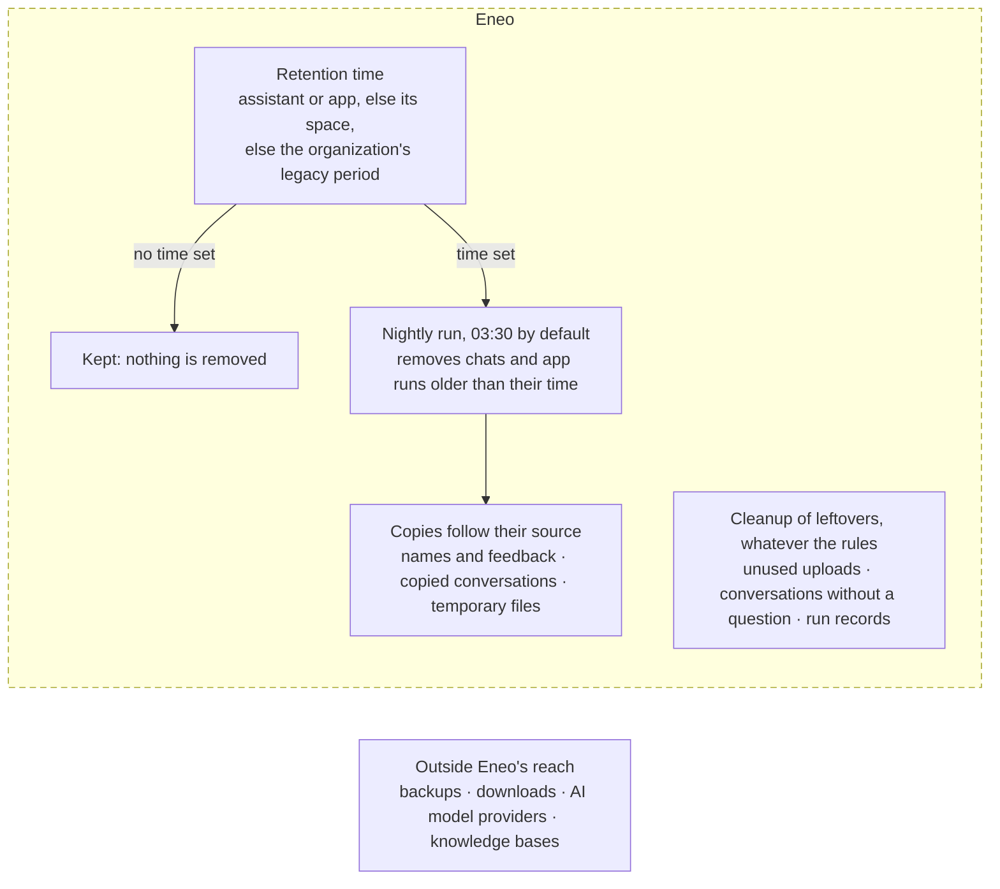
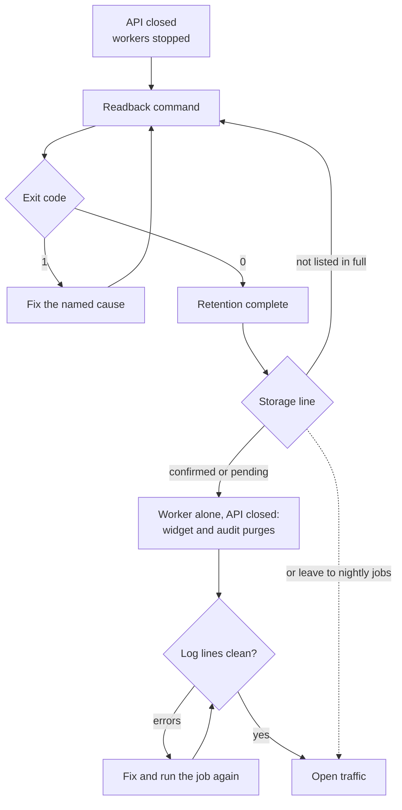

# Data retention



Retention ("gallring" in Swedish) removes stored content once the time chosen
for it has passed. No rule, no removal: chats and app runs are removed only
where someone has chosen a time; a new web widget starts with 30 days.
Retention by a rule is separate from cleanup of leftovers, which runs whatever
rules are set. Copies follow their source: when a turn is removed, the copies
Eneo keeps of it go too.

Limits, counts, health fields and audit events are on the technical page,
[Retention](/docs/audit-logging#retention).

## For the administrator [#for-the-administrator]

### No rule, no removal [#no-rule-no-removal]

Where nobody has chosen a time on a space, an assistant or an app, retention
removes nothing. Cleanup of leftovers still removes what nothing uses any
more, such as an upload never attached to a chat, and records with a period of
their own, such as the audit log; see [Cleanup of leftovers](#cleanup-of-leftovers).

### How the levels combine [#how-the-levels-combine]

A chat turn follows the time of the assistant that answered it. An app run
follows its app. The nearest level that has a time decides, from the nearest
outwards:

1. the assistant or app;
2. its space;
3. the organization: a legacy period, `conversation_retention_days`, that
   counts only while its switch `conversation_retention_enabled` is on, in
   `audit_retention_policies`. No screen or API in this version sets or shows
   them.

When no level has a time, nothing is removed.

The nearest level decides **even when its time is longer** than a level outside
it: the space's time is a default, not a maximum.

- **Group chats:** each turn follows the assistant that answered it, so an
  earlier turn can stay while a later one is removed. A turn whose assistant
  was deleted follows no time and is not removed.
- **Deleting an assistant** deletes its chats. A question not asked to an
  assistant, such as a service run, is kept until its service or the
  organization is deleted.
- **Help assistants**, such as the Prompt Guide, sit in the organization space,
  which no screen gives a time. Give the help assistant its own time if its
  chats should be removed.
- **Web widgets** follow only the widget's own time, held to the organization's
  widget policy as it stands on the night of each run. A widget set to `0`
  keeps no conversation after the answer, even when the minimum is higher. The whole conversation
  goes at once, counted from when it started.
- **The audit log** has one period for the organization, independent of every
  conversation time.

| Change of a time | Effect at the next run |
| --- | --- |
| Shorter | Older conversations become due and are removed |
| Longer | Conversations no longer due are kept |
| Removed | The level follows the next level outwards, which can be shorter, longer or none |
| First time | Conversations older than it are removed |

A removed conversation never comes back.

### Set the time [#change-the-rules]

Every time is a whole number of days.

**A space** (someone who may edit the space; the organization space has no
retention setting):

- **Svelte app:** **Spaces**, the space, **Settings**, **Security & Privacy**,
  **Conversation History Retention**. Switch on **Override policy**, enter the
  days (1 to 2555), **Save changes**.
- **React app (beta):** **Spaces**, the space, **Settings**, **Security and
  privacy**, **Conversation History Retention**. Empty means **No limit**. It
  saves when you leave the field.
- **API:** `PATCH /api/v1/spaces/{space_id}/` with
  `{"data_retention_days": 30}`; `null` removes the time, leaving it out keeps it.

**An assistant or an app** (in a shared or organization space, someone who may
edit the space; in a personal space, its owner; permission to edit an assistant
or app does not by itself include its retention time):

- **Svelte app:** the space, **Assistants** (or **Apps**), the row's
  **Actions** menu, **Edit**, **Security & Privacy**, **Conversation History
  Retention**. Switch on **Override policy**, enter the days, **Save changes**.
- **React app (beta):** the space, **Assistants** (or **Apps**), **Edit**,
  **Security and privacy**, **Conversation History Retention**. Empty follows
  the space.
- **API:** `POST /api/v1/assistants/{assistant_id}/` or
  `PATCH /api/v1/apps/{app_id}/` with `data_retention_days`; `null` follows the
  space.

Help assistants: **Admin → Help assistants → Open settings**, the same way.

**Web widgets:** the range is under **Admin → Web widgets → Policy**
(**Minimum days**, **Maximum days**, each 0 to 3650; 0 to 365 until a policy
is saved). A widget's own time is under **Web widget → Open widget settings →
Rules → Privacy → Retention in days**. `0` keeps no conversation after the
answer. See
[Embed an Assistant](/guides/embed-widget#conversation-retention).

**The audit log** (1 to 2555 days): in the Svelte app, **Admin → Audit Logs**,
give the reason for access, then on the **Logs** tab open **Retention Policy**
and click **Edit**; **Admin → Settings → Retention Policy → Change** in the
React app (beta); or `PUT /api/v1/audit/retention-policy` with
`{"retention_days": 365}`.

A removal cannot be undone, so check a shorter time before you save it.

### What is removed [#what-removal-means]

Removing a turn deletes it from Eneo's database with the copies Eneo keeps,
and object content storage deletes the file bytes. Eneo cannot then show it or
bring it back. Removal covers:

- the question and its answer;
- files that only this turn used, such as uploads, audio recordings and their
  transcriptions, and files derived from them;
- with extended logging, the turn's stored log and the content of every later
  log in the conversation;
- the conversation itself, once its last question is gone.

The turn stops being shown when its removal commits. File bytes are deleted
afterwards, in the background, so a removed file can be unreachable while its
bytes still wait. See
[What happens when a File is deleted?](/guides/object-content-storage#what-happens-when-a-file-is-deleted)

### Copies that follow their source [#copies-that-follow-their-source]

| Copy | How it follows |
| --- | --- |
| A conversation's name (its first question, a generated title or a name someone chose) and its feedback text | Once the time it was written is older than the conversation's period, the name is emptied (both apps show Untitled) and the feedback text removed, even while questions remain. The thumbs up or down stays. A group chat follows the shortest period among its assistants |
| A conversation copied from another one | Unreadable as soon as a question it was copied from is removed, and then removed itself. See [Copies of removed conversations](/docs/audit-logging#copies-of-removed-conversations) |
| Temporary files of an upload, a transcription, a crawl or a SharePoint import | Removed when the process stops; after a crash, by the next process on the same volume. See [Temporary files](/guides/deployment#temporary-files) |
| The record of a failed job | Keeps a failure code, never the error text. Jobs recorded before the upgrade keep their text |

### Copies outside Eneo's reach [#copies-outside-eneos-reach]

Retention never removes backups and their snapshots (see
[After a restore](#after-a-restore)), downloaded documents and exports, content
sent to an AI model provider or another external service, or text added to a
knowledge base. An Insights answer is stored for 24 hours after its last update,
also when the conversations behind it are gone. A copy of the database volume
can still contain deleted rows; a `pg_dump` backup holds only existing rows.

### Flow run history [#flow-run-history]

Retention does not remove Flow run and step history in this version. Flow run
history has its own policy, separate from the conversation times above. An
organization administrator sets it on the organization, a space or a single
Flow, and the most specific complete policy wins: a child either inherits its
parent's policy or replaces both its mode and its days.

| Scope | Policy | Result |
| --- | --- | --- |
| Organization | Manual purge eligibility after 30 days | The default for Flows without a more specific policy |
| Procurement space | Review before purge after 60 days | Every Flow in the space uses 60 days unless it has its own policy |
| Supplier assessment Flow | Manual purge eligibility after 90 days | This Flow alone uses 90 days |

- **Manual purge eligibility (`preserve`):** after the age threshold, an
  administrator may include the history in a separately requested purge.
- **Review before purge (`review_required`):** after the threshold, the run
  appears in the read-only retention review queue, and a purge needs explicit
  human approval.

Neither mode schedules or performs a removal. Without a policy at any level,
Flow run history has no age threshold and is kept. Saving or clearing a policy
writes the audit event `flow_run_retention_policy_changed` with the policy, not
run content, and removes, redacts or approves nothing. Flow runtime uploads and
Flow debug evidence have no scheduled removal either: the cleanup of unused
uploads keeps a file that a Flow runtime upload refers to. A chat that edits a
Flow is an ordinary conversation and follows the conversation times above.

[Flow run-history retention](/guides/flows/retention-policy) has the screens,
the API and the review queue.

### When removal happens [#when-removal-happens]

Content becomes **due** when it is older than its time, counted from when it
was created. The next scheduled run removes it.

#### Retention by a rule [#retention-by-a-rule]

| What | Time set on | Without a choice | Runs |
| --- | --- | --- | --- |
| Chats, group chats and help assistant chats | The assistant, otherwise its space | Kept | Nightly, 03:30 by default (`RETENTION_CRON_HOUR`, `RETENTION_CRON_MINUTE`) |
| App runs | The app, otherwise its space | Kept | Nightly, with chats |
| Files of a turn or app run | They follow it; a file still used elsewhere stays | Kept | With the turn or run |
| Names and feedback text | The conversation's period | Kept | Nightly, with chats |
| Web widget conversations | The widget, within the widget policy | 30 days | Nightly, 03:30 |

#### Cleanup of leftovers [#cleanup-of-leftovers]

On by default. An operator can switch off the cleanup of unused uploads,
conversations without a question and retention run records; see
[Settings](#settings).

| What | Removed | Runs |
| --- | --- | --- |
| Uploads that nothing uses | 24 hours after upload | Nightly, with chats |
| Conversations without a question | 24 hours after they started | Nightly, with chats |
| Temporary files of a process | When it stops; after a crash, when the next process starts on the same volume | The process |
| Staged files of a knowledge import | When the import finishes; after 1 hour if the import no longer exists | A worker cleanup job |
| Audit log | After 365 days or the organization's period | Daily, 02:00 |
| Audit log exports | Download for 24 hours; the file at the next daily cleanup (`export_max_age_hours`) | Daily, 03:00 |
| Retention run records | After the audit log's period | Nightly, with chats |

Times are in the worker's time zone: UTC unless you set `TZ` for the worker.
File bytes in object content storage are deleted in the background, every
minute, after the file is deleted.
A turn normally goes within a day after its time. It stays longer when a night
has more due work than allowed (the next night continues), when a row is held
or a conversation exceeds the run's limits (it is kept and reported; see
[For operators](#for-operators)), or when the worker is stopped (the next
scheduled run catches up).

To run it at once:

```bash
docker compose --env-file .env --env-file release.env exec worker run-cron run_retention
```

It only queues the run and returns before it has run, so follow the worker log.

## For operators [#for-operators]

### Health [#health]

`GET /api/healthz` reports each retention task as `healthy`, `degraded`,
`unknown`, `initializing` or `disabled`. A task is `degraded` when its latest
finished run failed, when no run has completed for two days, or when the latest run
found content due for more than a day (`RETENTION_OVERDUE_WINDOW_DAYS`). A failed
run keeps the task `degraded` until a rerun has finished. A task that is not
`degraded` reads `unknown` with `overdue_not_measured` when its latest finished run could not measure what
is overdue, until a later run measures it. `limiting_settings`
names the setting whose limit kept due content. Retention problems never make
an otherwise ready API unavailable. See [Health](/docs/audit-logging#health)
and [Scheduled execution and limits](/docs/audit-logging#scheduled-execution-and-limits).

The audit log purge writes `retention_policy_applied` only for an organization
where it deleted at least one event, so a missing event does not mean the
purge failed.

### Settings [#settings]

The schedule, per-task switches and limits are worker environment settings;
see [Settings](/docs/audit-logging#settings). A task switched off keeps what
it would have removed. The switches are an emergency brake, not a way to keep
content: a task turned off also fails the readback after a restore.

### Object storage [#object-storage]

Use a bucket that has never had versioning or Object Lock; with either, a
deleted file stays readable as an old version, so Eneo does not start with such
a bucket. See
[Choose Content Storage](/guides/object-content-storage).

## After a restore [#after-a-restore]

Retention does not reach backups. Restoring a backup brings back what was
removed after it was taken. This is what Eneo does about it, and where it
stops.

### Retention catches up before traffic opens [#retention-catches-up]



With the API closed, every worker stopped and every retention task on (each
`RETENTION_*_ENABLED` at `true`, the default), run the readback command:

```bash
docker compose --env-file .env --env-file release.env run --rm backend run-cron --until-complete run_retention
```

Add your installation's Compose files and profiles between `docker compose`
and `run`. With the bundled store that is
`--profile object-content -f docker-compose.yml -f docker-compose.object-content.yml`
(see [Review network changes](/guides/deployment#review-network-changes)).

It removes, round after round, what the rules in the restored database make
due, so that content is removed again before anyone can reach it; what falls
due while it runs is left to the nightly run. Exit code 0 means
retention is complete and storage is confirmed or pending. Exit code 1 names
each task and the cause, such as a task turned off
(`conversations.history: skipped (disabled_by_deployment_setting)`), a worker
still running or `still removing after 10000 rounds`; resolve it and run the
command again.

The last line reports storage, because rows gone from the database do not mean
the store has deleted the bytes. `storage: confirmed` needs nothing.
`storage: pending N (held H, retrying R, waiting W)` means retention is
complete and traffic may open, but the store has not confirmed every removal.
The worker continues the removals once it runs; `held` waits for its hold or
minimum retention. To see `confirmed`, rerun with traffic closed and the
workers stopped, after the grace period (`OBJECT_CONTENT_ORPHAN_GRACE_SECONDS`,
one hour by default). After `store not listed in full`, run the command again;
it continues the listing. Every line is explained in
[Read back after a restore](/docs/audit-logging#read-back-after-a-restore).

The command does not cover web widget conversations or the audit log. To
remove what those make due before traffic opens, start only the worker, with
the API still closed:

```bash
docker compose --env-file .env --env-file release.env up -d --no-deps worker
docker compose --env-file .env --env-file release.env exec worker run-cron purge_widget_sessions
docker compose --env-file .env --env-file release.env exec worker run-cron purge_old_audit_logs
```

Add the same Compose files and profiles between `docker compose` and `up` or
`exec`. Without `--no-deps`, Compose also starts the backend, which opens the
API. Each `exec` only queues its job: it prints `Enqueued` and returns before
the job has run. In the worker log, wait for `Widget retention purge completed`
with `errors` at 0 and no `Widget retention purge failed` line, and for
`Audit log retention purge completed successfully`. The error count shows only
in JSON logs (`JSON_LOGS=true`, the default); without them, the absence of
failed lines is the check. If a job reports errors, resolve them and run it
again. If you skip this step, their nightly jobs remove it.

### What can come back [#what-can-come-back]

The command knows only the rules in the restored database. These can return
until the people responsible put their changes back:

- content removed by hand after the backup, such as a conversation, file,
  assistant or app;
- content removed under a rule set or shortened after the backup.

Keep a record of such changes outside the backup, and repeat them before
traffic opens.

### Backups are yours [#backups-are-yours]

Eneo never removes backup copies. A successful run, or `storage: confirmed`, is
not proof that every copy is gone: backups and snapshots keep what they hold
for as long as you keep them. Set how long backups live, and who may read them,
to match your retention decisions. See
[Back up and restore](/guides/object-content-storage#back-up-and-restore).

### Known limit [#restore-known-limit]

The command expects Eneo's prefix in the bucket (`v1/<deployment id>/`) to
hold only what Eneo wrote. A foreign object or unfinished multipart upload
there stops it with exit code 1, before the storage line, and scheduled
reconciliation fails the same way. Remove the object or abort the upload, then
run the command again.
