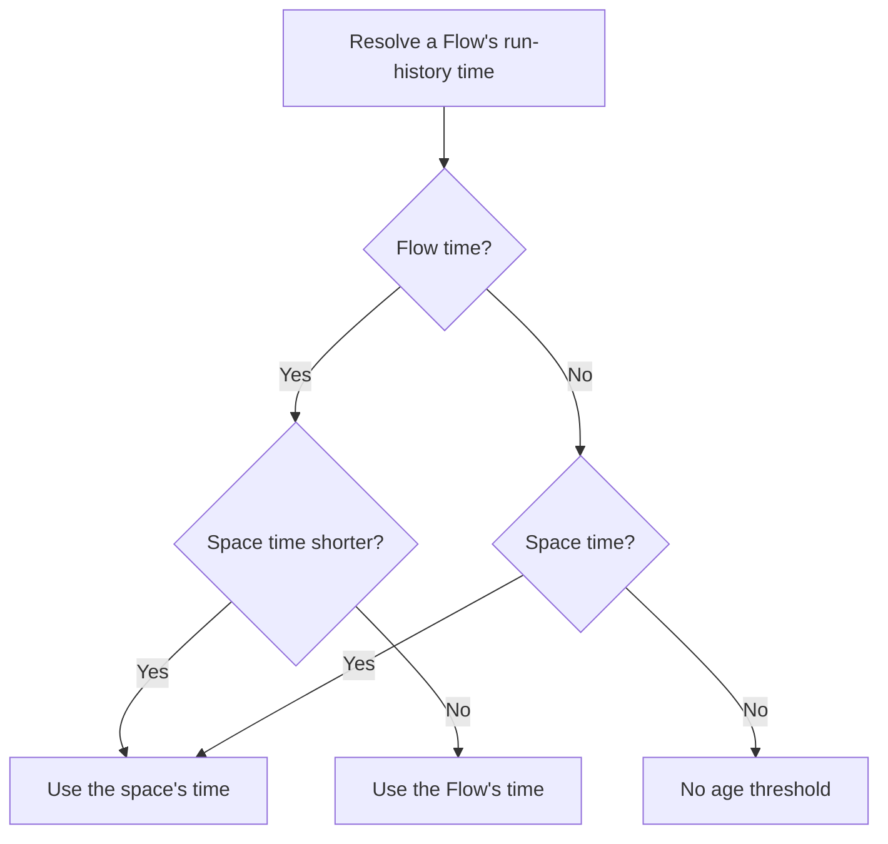

import { Callout } from "nextra/components";

# Flow run-history retention

This page explains how the time for Flow runs, steps and their run-owned history is set, how runs are removed when it has passed, and how they are put on legal hold. It covers the one rule, the cap a space sets, automatic removal, legal holds, and who may do what.

<Callout type="warning">

**A space's time removes runs, and they cannot be restored.**

A Flow run that starts while its space has a time is due once it is older than the time, and is then removed automatically with its steps, transcripts and files. A task checks every five minutes; a legal hold, a pending delivery or a lock can delay the removal. Runs that started while the space had no time are never removed automatically. A legal hold keeps the runs it covers. See [Automatic removal](#automatic-removal).

</Callout>

## The rule in one minute

- A space's time (`data_retention_days`, the same time its conversations use) caps every Flow in the space.
- A Flow may choose a shorter time of its own, never a longer one. A longer one is refused with code 9086.
- A Flow without its own time uses the space's. A space without a time sets no cap and removes nothing automatically; a Flow's own time there counts only for the explicit purge.
- No time means no age threshold: no run history becomes due. The explicit purge still deletes expired live transcripts that no run uses (see [Administrator purge of due run history](/guides/flows-api-guide#administrator-purge-of-due-run-history)).
- The organisation sets no time for Flows.
- Changing a shared space's time and a Flow's own time, and purging, need `retention_manage`; the two times also need the person's role in the space: its admin, or for a Flow in a personal space its owner if they may edit Flows; placing, reviewing and releasing holds need `retention_holds` (see [Who may change or stop retention](#who-may-change-or-stop-retention)).
- A Flow's time can be changed after the Flow is published.

Two database revisions bring this. Revision `202611231030` cleared every Flow's own time without an audit row, along with every organisation's run-history time and every retention mode, so the space's time applies to its Flows. Revision `202611241000` brings automatic removal and only adds a record, on each run, of whether its space had a time when the run started. The upgraded service writes that record when it starts a run, so a space that already has a time starts removing the runs the upgraded service starts; an administrator should check the spaces' times before upgrading. Runs that started before the upgrade are never removed automatically. During a rolling upgrade, a replica of the old version can still start runs after `202611241000`: they are recorded as started without a space time, are never removed automatically, and only [the explicit purge](#the-explicit-purge) removes them.

### Before upgrading past `202611231030`: list the runs that become due or stop being due

Revision `202611231030` clears every Flow's and every organisation's run-history time and every retention mode; from then on the space's `data_retention_days` alone decides. On an installation that already runs it, the old columns are gone and the query below cannot run; there is nothing left to list. The live settings no longer contain the old values afterwards. Run this read-only query on the old version, before upgrading, and keep its output. It lists every finished run that becomes due under the policy (`becomes purgeable`, for example one a review mode kept out of the purge) or stops being due (`no longer purgeable`, for example one that only the organisation's time made due), with `held` showing a legal hold, which protects the run before and after. It judges at the moment it runs (`now()`), and it pastes into `psql` as it stands. Run it in the same `TimeZone` as the application, and check that with `SHOW TimeZone`: days are added in calendar time, so another zone can move a deadline by an hour around a daylight-saving change.

These runs all started before `202611241000`, so automatic removal never takes them. Only an administrator's explicit purge removes them.

```sql
-- Run on the old version, before upgrading, in the application's TimeZone.
-- Read-only: lists the runs the upgrade makes due or no longer due for the
-- explicit purge, judged at now().
WITH runs AS (
  SELECT r.id AS run_id, r.tenant_id, f.space_id, r.flow_id,
         coalesce(r.finished_at, r.created_at) AS anchor,
         coalesce(f.flow_run_history_retention_mode,
                  s.flow_run_history_retention_mode,
                  t.flow_run_history_retention_mode) AS old_mode,
         coalesce(f.flow_run_history_retention_days,
                  s.flow_run_history_retention_days,
                  t.flow_run_history_retention_days) AS old_days,
         s.data_retention_days AS new_days,
         EXISTS (
           SELECT 1 FROM flow_retention_holds h
           WHERE h.released_at IS NULL
             AND (h.ends_at IS NULL OR h.ends_at > now())
             AND ((h.flow_run_id IS NULL AND h.flow_id = r.flow_id)
                  OR h.flow_run_id = r.id)
         ) AS held
  FROM flow_runs r
  JOIN flows f ON f.id = r.flow_id AND f.tenant_id = r.tenant_id
  JOIN spaces s ON s.id = f.space_id AND s.tenant_id = f.tenant_id
  JOIN tenants t ON t.id = r.tenant_id
  WHERE r.status IN ('completed', 'failed', 'cancelled')
), judged AS (
  SELECT *,
         coalesce(old_mode = 'preserve'
                  AND anchor <= now() - make_interval(days => old_days),
                  false) AS due_before,
         coalesce(anchor + make_interval(days => new_days) <= now(),
                  false) AS due_after
  FROM runs
)
SELECT run_id, tenant_id, space_id, flow_id, anchor, old_mode, old_days,
       new_days, held,
       CASE WHEN due_after THEN 'becomes purgeable'
            ELSE 'no longer purgeable' END AS change
FROM judged
WHERE due_before <> due_after
ORDER BY tenant_id, space_id, flow_id, anchor;
```

A run's delivery blockers (an undelivered audit row or an unresolved webhook) keep it out of the purge before and after, so the query does not repeat them. After the upgrade, a purge with `dry_run` (the default) counts what the new rule selects.



## Why a Flow cannot keep history longer than its space

The space's administrator decides how long the space keeps its content, for conversations and Flows alike. A Flow can only be stricter:

| Scope                 | Time                      | Which Flows use it                    |
| --------------------- | ------------------------- | ------------------------------------- |
| Legal space           | 60 days                   | Flows in Legal without their own time |
| Intake Flow in Legal  | 30 days                   | This Flow only                        |
| Archive Flow in Legal | 90 days asked, 60 applies | Refused when saved; 60 days applies   |

A time stored before the space's time was lowered stays stored; the shorter space time applies, and the Flow's settings show both. Saving it again is refused until it fits.

Once the time has passed, the run is due. A run that started while its space had a time is then removed automatically (see [Automatic removal](#automatic-removal)); any due run can also be removed by the explicit purge. The threshold is measured from `finished_at`. If a terminal run has no finish time, it is measured from `created_at`. A run is due when its anchor plus the days in calendar time, in the database session's `TimeZone`, has passed.

## Automatic removal [#automatic-removal]

### Which runs it removes

- **A shared space's time turns it on.** When a run starts, Eneo records whether its space had a time at that moment. Only those runs are removed automatically, by the space's time or the Flow's shorter one.
- **Runs that started without a time stay.** A run that started while its space had no time, or before the upgrade to this version, is never removed automatically, also when a time is set later. The explicit purge can still remove it once it is due.
- **Removing the space's time pauses it.** While the space has no time, nothing in it is removed automatically, also when a Flow keeps a time of its own. When a time is set again, removal resumes, by the new time, for the runs that started while the space had a time.
- **Personal spaces are not covered** in this version, also when a time is stored on the space.
- **Only finished runs** (completed, failed or cancelled) are removed. A run that never finishes, for example one waiting for review, stays.

### When

The retention task `flows.run_history` checks every five minutes and removes the runs that are due. Locks, queued work and the storage reconciliation can make it take longer, so a run is not guaranteed to be gone at a given minute. The operator can switch the task off with `RETENTION_FLOW_RUN_HISTORY_ENABLED` (on by default); see [Settings](/docs/audit-logging#settings).

### What is removed and what stays

A removed run cannot be restored. Removal takes:

- the run, its steps and their results, its transcripts and their corrections;
- its files: uploaded and recorded audio, PDFs and the files derived from them, generated documents, and live text bound to the run. Object content storage then deletes the bytes in the background, and a link to a removed file answers 404.

These stay:

- a run under a legal hold, until the hold ends;
- a run whose audit row is not yet delivered or whose webhook delivery is still pending, until the delivery is done;
- a file that another remaining run still uses. A rerun, or a new run from a reviewed transcription, shares its source run's audio file. Each run counts from its own time, and the file goes with the last of them. A run that started while the space had no time is never removed automatically, so it keeps the shared file, and it has its own copy of the transcript;
- audit rows, which can name a removed run's files. They follow the audit log's own retention.

The space's time does not reach content that never became part of a run. The upload window under **Admin > Flow retention** sets when live text that is never bound to a run expires (fixed when the text is created), and the explicit purge removes such expired live text. Audio uploaded for a run that was never started, and debug evidence, are not removed in this version.

Create-run idempotency is tied to the run row. Once a run is removed, a request with the same `Idempotency-Key` creates a new run; if the upload it names has been removed too, that request can be refused when its input is checked.

Eneo records each pass with the retention engine's audit events (`data_retention_batch` and `data_retention_run`), with counts and without run content. No event is written per run.

### A run that cannot be removed

A run that exceeds the task's limits, whose removal fails, or that someone else has locked is kept whole and tried again on every pass; the rest are removed. Health reports it: `GET /api/healthz` shows `flows.run_history` with `blocked_reasons` such as `runs.unit_exceeds_budget`, `runs.run_failed` or `runs.run_locked`, and reads `degraded` once such a run has been due for more than an hour. `limiting_settings` names the settings whose limits kept a run, for example `retention_max_family_rows` and `retention_max_files_per_run`. The health response never names the run. The log names a run whose removal fails, with the error type, and a run too large for the limits; a locked run is not logged, since the next pass tries it again. Runs under a legal hold or waiting for a delivery are not due, so they leave health green. See [Health](/docs/audit-logging#health).

### The explicit purge

The administrator's explicit purge stays. It removes due runs whatever their start, also runs due only by a Flow's own time in a space without a time, and it skips the same holds and deliveries.

### After a restore

Whether a run started under a time is restored with the run, so a restored, due run is removed again. The readback after a restore (see [After a restore](/guides/data-retention#after-a-restore)) includes this task. It uses the times and holds in the restored database, and a run kept because it exceeds the limits, fails or is locked fails the readback until it is resolved. The readback can be complete while object content storage is still deleting the bytes.

### Copies outside Eneo's reach

Removal does not reach what a Flow's HTTP POST step or result delivery has sent to another system, text a browser has kept, recordings kept on a device, what a speaker identification service keeps (Vemsa deletes the audio when its job ends and keeps the result for 72 hours by default), or database backups until they expire. See [Copies outside Eneo's reach](/guides/data-retention#copies-outside-eneos-reach).

## Configure it

In the new web app, a space's time is set in the space's settings, and a Flow's own time in the Flow's settings under **Run history retention**. Legal holds are set through the [endpoints below](#api-contract). Flows themselves are built, run and administered in the new web app.

The target endpoints use an Organization-wide administrative catalog. They include non-personal Spaces and active Flows even when the person is not a member of the target Space; ordinary Space and Flow authoring lists remain membership-scoped.

A deleted Flow that still has run history stays in the Flow targets, marked `retired`. Deleting a Flow retires it: it can no longer run, but its runs, results, reviews and evidence stay readable with each reader's current permissions and follow the Flow's retention rule. Runs that were still queued, running or waiting for review are cancelled by a maintenance sweep that runs every minute by default, so they become finished history too. Its Flow time and purge keep working. A deleted Flow without runs is not listed.

1. Set the space's time, or leave it empty when the space keeps its content. A time removes the runs that start from then on once they are older than it. In the new web app a time on a space without one, or a shorter time, asks for a confirmation first.
2. Set a Flow time only when the Flow needs a shorter one. The Flow's settings warn before a shorter time is saved.
3. Check `effective` in the response. It shows the resolved number of days and the level it comes from.
4. The audit event names the scope and the old and new time.

A Flow whose time is cleared (`"policy": null`) stores no time and uses the space's. If the space's time later changes, the Flow follows it. A shorter time also applies to runs that started earlier under a time: those already older than it are due and are removed at a coming check.

## API contract

The reference prefix is `/api/v1`. A deployment can configure another API prefix, so use its `/openapi.json` as the live source of truth.

### Time endpoints

| Scope | Read                                                      | Replace or clear                                          |
| ----- | --------------------------------------------------------- | --------------------------------------------------------- |
| Space | `GET /spaces/{id}/` (`data_retention_days`)               | `PATCH /spaces/{id}/` (`data_retention_days`)             |
| Flow  | `GET /settings/flow-run-retention-policy/flows/{flow_id}` | `PUT /settings/flow-run-retention-policy/flows/{flow_id}` |

### Administrative target discovery

Retention administration does not weaken the ordinary membership-scoped Space and Flow APIs. People with a retention permission use metadata-only, tenant-scoped target endpoints:

| Target | Endpoint                                                                  |
| ------ | ------------------------------------------------------------------------- |
| Spaces | `GET /settings/flow-run-retention-policy/targets/spaces`                  |
| Flows  | `GET /settings/flow-run-retention-policy/targets/spaces/{space_id}/flows` |

Both responses are bounded to 200 rows per page and return identifiers and current names, not Flow definitions or run content. Each Flow row also carries `retired`, which is `true` for a deleted Flow listed because it still has run history.
Page through large Organizations rather than reading every Space and Flow at
once. Personal Spaces are outside this catalog,
including direct Flow-target requests for a personal Space identifier.

Set a Flow's own time:

```json
{
  "policy": {
    "days": 30
  }
}
```

Clear it and use the space's time:

```json
{
  "policy": null
}
```

`days` accepts whole numbers from 1 through 2555. A request that sends any other field, such as the removed `mode`, is rejected with 422. A time longer than the space's is refused with 400, `eneo_error_code` 9086 and `code` `retention_exceeds_space`; `context` names the cap:

```json
{
  "code": "retention_exceeds_space",
  "eneo_error_code": 9086,
  "context": { "cap_days": 7, "cap_origin": "space" }
}
```

A time change can carry the times it replaces. On the space's `PATCH` that is `expected_data_retention_days` (the space's time as read, or `null`). On the Flow's `PUT` it is `expected_effective_days` (`effective.effective_days` as read, or `null` when none applied) and `expected_inherited_days` (`inherited_policy.days` as read, or `null` when the space had none). Each field sent is compared under the lock the change takes. When the space's stored time, the time that applies to the Flow now, or the Flow's space time now differs from the field, nothing is saved and the answer is 409, `eneo_error_code` 9087 and `code` `retention_time_changed`, with the time that applies now:

```json
{
  "code": "retention_time_changed",
  "eneo_error_code": 9087,
  "context": { "current_days": 60 }
}
```

A Flow time longer than the space's is still refused with 400 and 9086 (`retention_exceeds_space`, the cap in `context.cap_days`) first, before the fields are compared. A field left out is not compared; without them a save works as before. A request that leaves the time unchanged is not refused. After a change of the space's time, a Flow's save that carries the old space time is always refused, also when the time that applies is the same: giving a shared space a time can start the automatic removal. The new web app sends these fields with every change of either time, so a page read before another administrator's change asks again instead of saving.

The Flow's retention `GET` and `PUT` return `scope`, `scope_id` and these three fields:

- `local_policy`: the time stored on the Flow, or `null`;
- `inherited_policy`: the space's time, or `null`;
- `effective`: the resolved result, including its source and both contributors.

The ordinary Flow response has only `run_history_retention`, with the space's and the Flow's times under `contributors`.

## Legal holds

A legal hold ("rättslig spärr"), for example while a disclosure request is
pending, keeps the run history it covers. It overrides every space and Flow time until the hold is released or its end date passes: automatic removal
and the explicit purge skip held runs, and a Space that
contains an active hold cannot be deleted (`space_contains_legal_hold`, 409).
Deleting the whole Organization still deletes everything. A time is a policy,
not a hold. Every stop is a recorded decision: who placed it, why, when,
when it is reviewed and until when.

- **Flow hold:** covers every run of the Flow, including runs created after the
  hold. A deleted Flow that still has history can be held.
- **Run hold:** covers only the named runs (1-100 per request, one hold each).
- **Overlap:** a run stays held while any active hold covers it. Releasing one
  hold ends only that hold's coverage.
- **Reason:** required to place, to move the review date and to release
  (1-512 characters).
- **Review date:** required. It must be in the future and at most
  the review limit ahead (default 365 days; see below). Passing it does **not** end the hold: the hold stays active, is
  marked **review overdue**, and Flow runtime health reports
  `GALLRING_HOLD_REVIEW_OVERDUE` until someone moves the review date later (with
  a reason) or releases the hold.
- **End date:** optional. The hold stops by itself when it passes; nothing has
  to run for that. An ended or released hold stays listed as part of the record.

The holds list returns the active holds, or all holds including released and
ended ones (`status=all`), with who placed each, the reason, when, the review
date, the end date and who released it and why. Placing a hold names the Flow,
optionally specific run IDs, a reason, a review date and an optional end date.
Extending the review moves the review date later; releasing asks for a reason. A
purge preview counts held runs as `legal_hold`, apart from runs with another
blocker.

The review limit (`GET`/`PUT /settings/flow-run-retention-policy/hold-review-limit`,
1-2555 days or `null` for the default) is changed by `retention_manage` and read by
either permission; the holds list also returns it as `review_limit_days`. A
change writes `flow_run_retention_policy_changed` with the old and new value.

| Method | Path                                                     | Result                                                  |
| ------ | -------------------------------------------------------- | ------------------------------------------------------- |
| GET    | `/settings/flow-retention-holds`                         | Active holds (`status=all` includes released and ended) |
| POST   | `/settings/flow-retention-holds`                         | `201` with the created holds                            |
| POST   | `/settings/flow-retention-holds/{hold_id}/extend-review` | `200` with the hold and its later review date           |
| POST   | `/settings/flow-retention-holds/{hold_id}/release`       | `200` with the released hold                            |

Typed refusals: `flow_retention_hold_run_not_in_flow` (400, a named run is not a
run of the Flow), `flow_retention_hold_end_not_in_future` (400),
`flow_retention_hold_review_out_of_range` (400, review date not in the future or
too far ahead), `flow_retention_hold_review_not_later` (400),
`flow_retention_hold_not_active` (409, extending a released or ended hold),
`flow_retention_hold_already_released` (409), and `flow_retention_lock_busy`
(409, another deletion or retention change held the retention lock for more than
5 seconds; nothing changed, retry). Placing, moving the review and releasing
write the required audit actions `flow_retention_hold_placed`,
`flow_retention_hold_review_extended` and `flow_retention_hold_released` in the
same transaction, with the reason, the dates and who acted.

### Hold history

The audit log is the lasting history of every hold: the place, review and
release events (with who, why and the dates) stay under the audit retention.
Hold rows stay listed (with `status=all`) while their Flow and
Space exist. A Space cannot be deleted while it contains an active hold; after
its holds are released, deleting the Space also removes their released hold
rows, and the audit events remain.

Holds, time changes and deletions are serialized: a purge waits for a hold or
time change that is being saved, and a hold or time change waits for an
open purge batch or a removal pass in progress. Automatic removal waits only
briefly for a hold or time change being saved: its pass then ends early, and
the next pass continues. Deleting a space waits the same way as a purge. Both
recheck holds right before they delete.

## Who may change or stop retention

Two role permissions, granted per role, separate the duties:

| Permission         | Label                    | Allows                                                                      |
| ------------------ | ------------------------ | --------------------------------------------------------------------------- |
| `retention_manage` | Retention – manage rules | A shared space's time, a Flow's own time and the explicit purge             |
| `retention_holds`  | Retention – legal holds  | Placing, reviewing and releasing legal holds                                |

Either permission can read the shared views (Flow targets, effective times,
holds). One person may hold both. Neither is implied by `admin`, and no role
receives them automatically: not on upgrade, not in a new organization, and not
the predefined Owner role. An administrator grants them to a role in
**Admin > Roles**, for example a role such as "Arkivansvarig" with only these,
or to the Owner role. Until an administrator does, nobody can change a shared
space's time, for conversations too, a Flow's time or legal holds, so grant them
right after upgrading. Changing a shared space's time also needs the right to edit
the space; a personal space's time cannot be changed through Eneo, so its Flows
normally use only their own time. A time stored on a personal space by other
means still caps its Flows, but removes nothing automatically. Changing a Flow's own time also needs the admin role in the
Flow's space, or, in a personal space, being its owner with the right to edit Flows; anyone else,
a space editor too, is refused with `forbidden_action` (403) and the time is
unchanged. Resetting a role to
its template removes them again.
When Flows are on, an administrator sees **Admin > Flow retention** with its
upload and debug windows.
Only signed-in people decide: a request made with any API key is refused
(`retention_person_required`, 403) whatever its permissions; a missing
permission is refused with `retention_permission_required` (403).

A role with `retention_manage` or `retention_holds` but without `admin` works
through the endpoints above: times with `retention_manage`, legal holds with
`retention_holds`. It does not open the admin area. The server checks every
request.

**Operator note (downgrade):** a downgrade past this version removes both
values from every role, because the previous release cannot read a role that
holds them. Upgrading again does not give them back; an administrator grants
them again. Servers still on the previous release do not know these values and
reject a role that holds them, so grant them only after the rollout has
completed.

## Audit and authorization

Every time change requires `retention_manage` (see above). Space and Flow lookups remain scoped to the caller's Organization. A successful change writes the required audit action `flow_run_retention_policy_changed` in the same transaction as the update. A change of a space's time also queues the ordinary space update event (`space_updated`), but that event is best effort and follows the Organization's audit settings; the required record is `flow_run_retention_policy_changed`.

The audit metadata records the scope, scope identifier, and the old and new time; for a Flow also the resulting effective time and source. It does not copy Flow run content into the audit log. Saving the same value again is a no-op and does not create a misleading change event.

## What this policy does not govern

Flow run-history retention is separate from:

- never-attached runtime uploads;
- debug evidence eligibility;
- conversation and App history, including flow authoring chats;
- audit-log retention;
- backups, external exports, and object-storage lifecycle rules.

Some of those data classes have automatic cleanup when their own policy is configured. See [Data retention and deletion](/guides/data-retention) before making a production claim about the whole workflow.

Next: [Data retention and deletion](/guides/data-retention).
