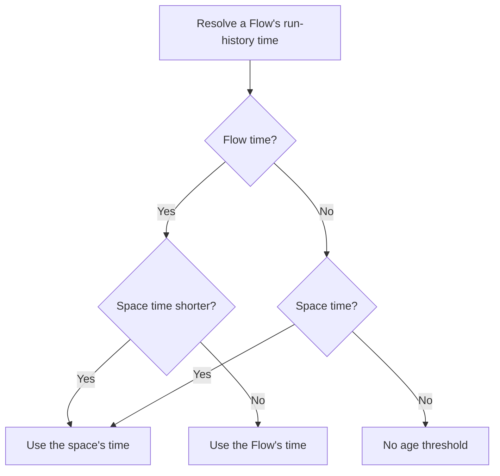

import { Callout } from "nextra/components";

# Flow run-history retention

This page explains how retention eligibility for Flow runs, steps, and their run-owned history is set, purged and put on legal hold. It covers the one rule, the cap a space sets, legal holds, and who may do what.

<Callout type="warning">

**Setting a time does not delete data.**

There is no automatic Flow run-history deletion. History is deleted only by the explicit purge (an API call that needs `retention_manage`), and the purge skips every run under a legal hold. No screen offers a purge.

</Callout>

## The rule in one minute

- A space's time (`data_retention_days`, the same time its conversations use) caps every Flow in the space.
- A Flow may choose a shorter time of its own, never a longer one. A longer one is refused with code 9086.
- A Flow without its own time uses the space's. A space without a time sets no cap, and its Flows' runs become eligible only through a time of their own.
- No time means no age threshold: nothing is eligible for a purge.
- The organisation sets no time for Flows.
- Changing a shared space's time and a Flow's own time, and purging, need `retention_manage`; placing, reviewing and releasing holds need `retention_holds` (see [Who may change or stop retention](#who-may-change-or-stop-retention)).
- A Flow's time can be changed after the Flow is published.



## Why a Flow cannot keep history longer than its space

The space's administrator decides how long the space keeps its content, for conversations and Flows alike. A Flow can only be stricter:

| Scope                 | Time                      | Which Flows use it                    |
| --------------------- | ------------------------- | ------------------------------------- |
| Legal space           | 60 days                   | Flows in Legal without their own time |
| Intake Flow in Legal  | 30 days                   | This Flow only                        |
| Archive Flow in Legal | 90 days asked, 60 applies | Refused when saved; 60 days applies   |

A time stored before the space's time was lowered stays stored; the shorter space time applies, and the Flow's settings show both. Saving it again is refused until it fits.

Once the time has passed, the history is eligible for a separately requested explicit purge. Nothing else happens. The threshold is measured from `finished_at`. If a terminal run has no finish time, it is measured from `created_at`. A run is eligible when its anchor plus the days in calendar time has passed.

## Configure it

In the new web app, a space's time is set in the space's settings, and a Flow's own time in the Flow's settings under **Run history retention**. Legal holds are set through the [endpoints below](#api-contract). Flows themselves are built, run and administered in the new web app.

The target endpoints use an Organization-wide administrative catalog. They include non-personal Spaces and active Flows even when the person is not a member of the target Space; ordinary Space and Flow authoring lists remain membership-scoped.

A deleted Flow that still has run history stays in the Flow targets, marked `retired`. Deleting a Flow retires it: it can no longer run, but its runs, results, reviews and evidence stay readable with each reader's current permissions and follow the Flow's retention rule. Runs that were still queued, running or waiting for review are cancelled by a maintenance sweep that runs every minute by default, so they become finished history too. Its Flow time and purge keep working. A deleted Flow without runs is not listed.

1. Set the space's time, or leave it empty when the space keeps its content.
2. Set a Flow time only when the Flow needs a shorter one.
3. Check `effective` in the response. It shows the resolved number of days and the level it comes from.
4. The audit event names the scope and the old and new time.

A Flow whose time is cleared (`"policy": null`) stores no time and uses the space's. If the space's time later changes, the Flow follows it.

## API contract

The reference prefix is `/api/v1`. A deployment can configure another API prefix, so use its `/openapi.json` as the live source of truth.

### Time endpoints

| Scope | Read                                                      | Replace or clear                                          |
| ----- | --------------------------------------------------------- | --------------------------------------------------------- |
| Space | `GET /spaces/{id}/` (`data_retention_days`)               | `PATCH /spaces/{id}/` (`data_retention_days`)             |
| Flow  | `GET /settings/flow-run-retention-policy/flows/{flow_id}` | `PUT /settings/flow-run-retention-policy/flows/{flow_id}` |

### Administrative target discovery

Retention administration does not weaken the ordinary membership-scoped Space and Flow APIs. People with a retention permission use metadata-only, tenant-scoped target endpoints:

| Target | Endpoint                                                                  |
| ------ | ------------------------------------------------------------------------- |
| Spaces | `GET /settings/flow-run-retention-policy/targets/spaces`                  |
| Flows  | `GET /settings/flow-run-retention-policy/targets/spaces/{space_id}/flows` |

Both responses are bounded to 200 rows per page and return identifiers and current names, not Flow definitions or run content. Each Flow row also carries `retired`, which is `true` for a deleted Flow listed because it still has run history.
Page through large Organizations rather than reading every Space and Flow at
once. Personal Spaces are outside this catalog,
including direct Flow-target requests for a personal Space identifier.

Set a Flow's own time:

```json
{
  "policy": {
    "days": 30
  }
}
```

Clear it and use the space's time:

```json
{
  "policy": null
}
```

`days` accepts whole numbers from 1 through 2555. A request that sends any other field, such as the removed `mode`, is rejected with 422. A time longer than the space's is refused with 400, `eneo_error_code` 9086 and `code` `retention_exceeds_space`; `context` names the cap:

```json
{
  "code": "retention_exceeds_space",
  "eneo_error_code": 9086,
  "context": { "cap_days": 7, "cap_origin": "space" }
}
```

The Flow's retention `GET` and `PUT` return `scope`, `scope_id` and these three fields:

- `local_policy`: the time stored on the Flow, or `null`;
- `inherited_policy`: the space's time, or `null`;
- `effective`: the resolved result, including its source and both contributors.

The ordinary Flow response has only `run_history_retention`, with the space's and the Flow's times under `contributors`.

## Legal holds

A legal hold ("rättslig spärr"), for example while a disclosure request is
pending, keeps the run history it covers. It overrides every space and Flow time until the hold is released or its end date passes: the explicit
purge skips held runs, the debug-evidence redaction skips them, and a Space that
contains an active hold cannot be deleted (`space_contains_legal_hold`, 409).
Deleting the whole Organization still deletes everything. A time is a policy,
not a hold. Every stop is a recorded decision: who placed it, why, when,
when it is reviewed and until when.

- **Flow hold:** covers every run of the Flow, including runs created after the
  hold. A deleted Flow that still has history can be held.
- **Run hold:** covers only the named runs (1-100 per request, one hold each).
- **Overlap:** a run stays held while any active hold covers it. Releasing one
  hold ends only that hold's coverage.
- **Reason:** required to place, to move the review date and to release
  (1-512 characters).
- **Review date:** required. It must be in the future and at most
  the review limit ahead (default 365 days; see below). Passing it does **not** end the hold: the hold stays active, is
  marked **review overdue**, and Flow runtime health reports
  `GALLRING_HOLD_REVIEW_OVERDUE` until someone moves the review date later (with
  a reason) or releases the hold.
- **End date:** optional. The hold stops by itself when it passes; nothing has
  to run for that. An ended or released hold stays listed as part of the record.

The holds list returns the active holds, or all holds including released and
ended ones (`status=all`), with who placed each, the reason, when, the review
date, the end date and who released it and why. Placing a hold names the Flow,
optionally specific run IDs, a reason, a review date and an optional end date.
Extending the review moves the review date later; releasing asks for a reason. A
purge preview counts held runs as `legal_hold`, apart from runs with another
blocker.

The review limit (`GET`/`PUT /settings/flow-run-retention-policy/hold-review-limit`,
1-2555 days or `null` for the default) is changed by `retention_manage` and read by
either permission; the holds list also returns it as `review_limit_days`. A
change writes `flow_run_retention_policy_changed` with the old and new value.

| Method | Path                                                     | Result                                                  |
| ------ | -------------------------------------------------------- | ------------------------------------------------------- |
| GET    | `/settings/flow-retention-holds`                         | Active holds (`status=all` includes released and ended) |
| POST   | `/settings/flow-retention-holds`                         | `201` with the created holds                            |
| POST   | `/settings/flow-retention-holds/{hold_id}/extend-review` | `200` with the hold and its later review date           |
| POST   | `/settings/flow-retention-holds/{hold_id}/release`       | `200` with the released hold                            |

Typed refusals: `flow_retention_hold_run_not_in_flow` (400, a named run is not a
run of the Flow), `flow_retention_hold_end_not_in_future` (400),
`flow_retention_hold_review_out_of_range` (400, review date not in the future or
too far ahead), `flow_retention_hold_review_not_later` (400),
`flow_retention_hold_not_active` (409, extending a released or ended hold),
`flow_retention_hold_already_released` (409), and `flow_retention_lock_busy`
(409, another deletion or retention change held the retention lock for more than
5 seconds; nothing changed, retry). Placing, moving the review and releasing
write the required audit actions `flow_retention_hold_placed`,
`flow_retention_hold_review_extended` and `flow_retention_hold_released` in the
same transaction, with the reason, the dates and who acted.

### Hold history

The audit log is the lasting history of every hold: the place, review and
release events (with who, why and the dates) stay under the audit retention.
Hold rows stay listed (with `status=all`) while their Flow and
Space exist. A Space cannot be deleted while it contains an active hold; after
its holds are released, deleting the Space also removes their released hold
rows, and the audit events remain.

Holds, time changes and deletions are serialized: a purge waits for a hold or
time change that is being saved, and a hold or time change waits for an
open purge batch. Deleting a space waits the same way. A purge also rechecks holds right before it deletes.

## Who may change or stop retention

Two role permissions, granted per role, separate the duties:

| Permission         | Label                    | Allows                                                                      |
| ------------------ | ------------------------ | --------------------------------------------------------------------------- |
| `retention_manage` | Retention – manage rules | A shared space's time, a Flow's own time and the explicit purge             |
| `retention_holds`  | Retention – legal holds  | Placing, reviewing and releasing legal holds                                |

Either permission can read the shared views (Flow targets, effective times,
holds). One person may hold both. Neither is implied by `admin`, and no role
receives them automatically: not on upgrade, not in a new organization, and not
the predefined Owner role. An administrator grants them to a role in
**Admin > Roles**, for example a role such as "Arkivansvarig" with only these,
or to the Owner role. Until an administrator does, nobody can change a shared
space's time, for conversations too, a Flow's time or legal holds, so grant them
right after upgrading. Changing a shared space's time also needs the right to edit
the space; a personal space's time cannot be changed, so its Flows use only
their own time. Resetting a role to
its template removes them again.
When Flows are on, an administrator sees **Admin > Flow retention** with its
upload and debug windows.
Only signed-in people decide: a request made with any API key is refused
(`retention_person_required`, 403) whatever its permissions; a missing
permission is refused with `retention_permission_required` (403).

A role with `retention_manage` or `retention_holds` but without `admin` works
through the endpoints above: times with `retention_manage`, legal holds with
`retention_holds`. It does not open the admin area. The server checks every
request.

**Operator note (downgrade):** a downgrade past this version removes both
values from every role, because the previous release cannot read a role that
holds them. Upgrading again does not give them back; an administrator grants
them again. Servers still on the previous release do not know these values and
reject a role that holds them, so grant them only after the rollout has
completed.

## Audit and authorization

Every time change requires `retention_manage` (see above). Space and Flow lookups remain scoped to the caller's Organization. A successful change writes the required audit action `flow_run_retention_policy_changed` in the same transaction as the update; a change of a space's time also writes the ordinary space update event.

The audit metadata records the scope, scope identifier, and the old and new time; for a Flow also the resulting effective time and source. It does not copy Flow run content into the audit log. Saving the same value again is a no-op and does not create a misleading change event.

## What this policy does not govern

Flow run-history retention is separate from:

- never-attached runtime uploads;
- debug evidence eligibility;
- conversation and App history, including flow authoring chats;
- audit-log retention;
- backups, external exports, and object-storage lifecycle rules.

Some of those data classes have automatic cleanup when their own policy is configured. See [Data retention and deletion](/guides/data-retention) before making a production claim about the whole workflow.

Next: [Data retention and deletion](/guides/data-retention).
