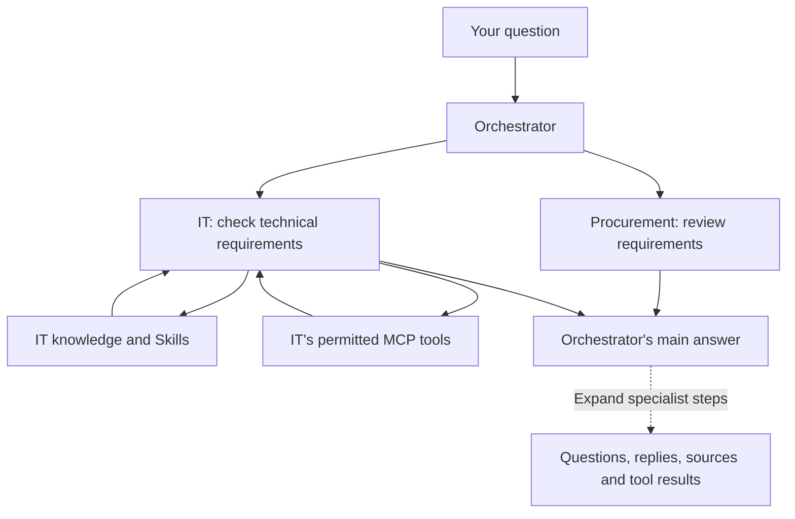

# Group chats with an orchestrator

An orchestrated group chat lets several assistants contribute to one answer. The
orchestrator chooses which specialists to ask, can ask a follow-up, and writes the
answer shown in the conversation. Each specialist uses its own instructions,
model, Skills, knowledge and permitted tools.

## Configure the group

In the group's Space, open the group chat's settings. Add the specialists and
select a separate assistant as **Orchestrator**. That assistant must belong to the
same Space and use a model that supports tool calling. Describe each specialist's
purpose so the orchestrator can choose between them. Give the orchestrator
instructions for the kind of final answer you want.

Existing groups keep their current routing until an editor selects an
orchestrator. Clearing that selection restores their previous routing. When
mentions are enabled, explicitly mentioning a specialist still asks that
assistant directly.

A configured orchestrator must be replaced or deselected before moving or deleting
that assistant. Changing its Space, model availability, classification or tool
configuration during a turn can stop that turn; start a new question after the
configuration has been corrected.

## Read the answer and its steps

The main answer is the orchestrator's synthesis. Expand **View steps** to
see each question sent to a specialist, its actual answer, its sources and the
tools it used. Repeated questions to IT appear as separate steps. Opening a saved
conversation restores these recorded steps without running the assistants again.

Specialists run one at a time. A specialist can make several tool calls, but it
cannot delegate to another assistant in this first version. The orchestrator can
ask it another question when the first answer is incomplete.

In the chat's tool menu, turn off automatic tool execution if you want to approve
external tools before they run. This preference also applies to specialist tool
calls. Approval requests remain visible outside the collapsed specialist steps.
Denying a tool call prevents its execution and lets the assistant explain the
missing evidence. Eneo's existing rules for internal knowledge and file tools
continue to apply.

## Access and limits

All assistants stay within the group's tenant and Space. Group membership does
not grant extra permissions: Eneo checks the caller's access, available models,
Space classification and effective tool settings before execution and later
handoffs. A specialist's answer does not lower the information's classification.

A specialist the asking user may not use, for example an unpublished assistant
for a viewer, is left out of that user's question. The orchestrator is told that
some configured expertise is unavailable, without the assistant's name, and must
say so when that expertise is needed. A question whose specialists are all
unavailable is refused before anything is saved.

One question shares a bounded execution budget across the orchestrator and its
specialists. The limits cover work Eneo dispatches, including the loopback
request; they do not separately count provider work inside MCP servers,
including Eneo's HTTP loopback tools. Those tools retain their own request
limits, so the effective bound on their model work is the tool-dispatch limit.
Part of the budget is reserved for the orchestrator's final answer: a specialist
cannot start or continue on that reserve, and a consultation refused for that
reason is reported to the orchestrator, which then answers with the evidence it
has and names the unresolved questions. Time spent waiting for a user's tool
approval does not count toward the deadlines.

| Setting                                        | Default   | Meaning                                                                 |
| ---------------------------------------------- | --------- | ----------------------------------------------------------------------- |
| `ORCHESTRATION_MAX_CONSULTATIONS`              | 6         | Specialist consultations per question, follow-ups included.             |
| `ORCHESTRATION_MAX_MODEL_REQUESTS`             | 24        | Model requests per question, including query embeddings and reranking.  |
| `ORCHESTRATION_MAX_TOOL_CALLS`                 | 48        | Local tool dispatches per question (consultations, Skills, MCP calls).  |
| `ORCHESTRATION_MAX_REQUEST_BYTES`              | 4 MiB     | Largest single model request. Requests are not summed over the question. |
| `ORCHESTRATION_MAX_OUTPUT_CHARACTERS`          | 100 000   | Generated characters per question, specialists included.                |
| `ORCHESTRATION_TIMEOUT_SECONDS`                | 180       | Execution time per question, excluding approval waits.                  |
| `ORCHESTRATION_CONSULTATION_TIMEOUT_SECONDS`   | 60        | Execution time per consultation, excluding approval waits.              |
| `ORCHESTRATION_RESERVED_MODEL_REQUESTS`        | 2         | Model requests kept for the orchestrator's final answer.                |
| `ORCHESTRATION_RESERVED_OUTPUT_CHARACTERS`     | 8 000     | Output kept for the orchestrator's final answer.                        |
| `ORCHESTRATION_RESERVED_SECONDS`               | 20        | Time kept for the orchestrator's final answer.                          |

Each reserve must be smaller than its limit; the backend refuses to start
otherwise.

Stopping the question stops local specialist work and closes its pending streams
and approvals. Completed actions in an external system remain completed. A
stopped, timed-out or denied step is shown as such; it is not presented as a
successful answer. The orchestrator may use available partial results and must
identify missing evidence.

This version is available through interactive user sessions. API-key execution
of orchestrated groups is not enabled. The shared Space's default assistant keeps
its existing behaviour; it does not automatically become an orchestrator.
