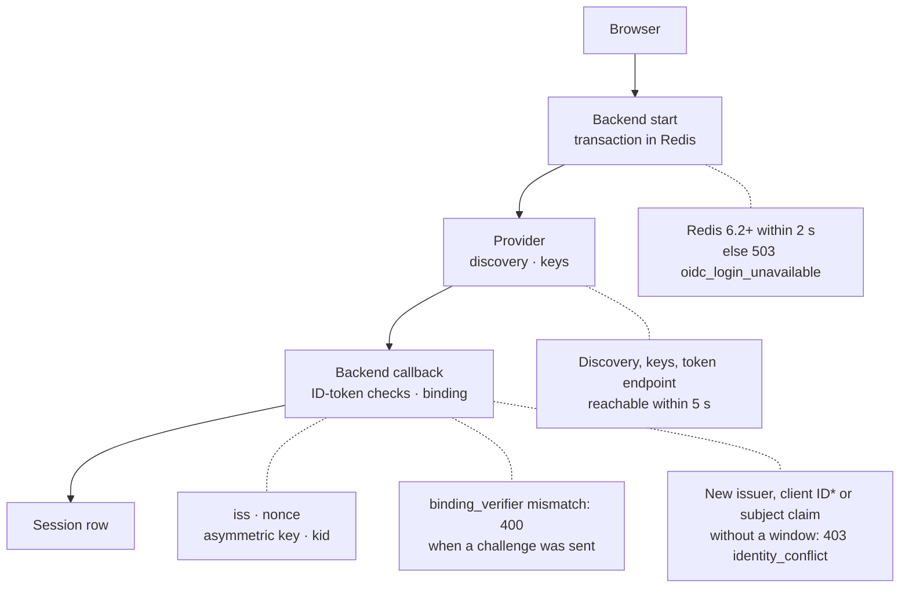

import { Callout } from "nextra/components";

# Upgrade notes

This page is for operators, administrators and API consumers who upgrade from 2.3 to the next release. Work through the checklist first, then scan the table for your area: "Nothing" in the Do column asks nothing of you, and a linked change has a detail section below.

The general update procedure is in [Updating Eneo](/guides/deployment#updating-eneo). The changes in 2.3.0 to 2.3.2 are in their [release notes](https://github.com/eneo-ai/eneo/releases); changes up to 2.2 are in [Upgrading to 2.2.0](/guides/upgrade-2-2-0) and [Upgrading to 1.7.0](/guides/upgrade-1-7-0).

## Do this before you upgrade [#before-you-upgrade]

<Callout type="warning">
  This release empties the stored content of every existing question log and deletes the logs that no question refers to. That cannot be undone. Take a database backup and stop every backend and worker of the earlier version before running the migrations.
</Callout>

Each item can stop the backend from starting, stop sign-in or lose data:

1. Take a `pg_dump` backup and stop every old backend and worker. See [Question logs are emptied](#question-logs-emptied).
2. Object storage grants the three bucket permissions, has never had versioning (not even suspended), and Object Lock is off. See [Object storage](#object-storage-versioning).
3. `UPLOAD_TMP_DIR` is on a local filesystem. See [`UPLOAD_TMP_DIR`](#upload-tmp-dir-local).
4. `BROWSER_SESSION_MAX_AGE`, if set, is at least `JWT_EXPIRY_TIME`; unset, the React app keeps people signed in for up to 30 days. See [Sessions](#server-side-sessions).
5. `DEFAULT_USER_PASSWORD`, if set, has at least 12 characters and at most 72 bytes, or db-init fails when it creates the default user. See [Password lifecycle](#password-lifecycle).
6. Go through the [OIDC checklist](#oidc-checklist).
7. `TRUSTED_PROXY_COUNT` matches the number of proxies. See [`TRUSTED_PROXY_COUNT`](#trusted-proxy-count).
8. Edit the reference Compose file's new web-app router. See [The React web app](#react-web-app-main-host).
9. Tell users that names and feedback comments of conversations older than their retention period are removed on the first night. See [Names and feedback text](#names-and-feedback-follow-retention).
10. Plan downtime for `db-init`: migration `202611091200` locks `sessions` while it rewrites every row, and several migrations build indexes concurrently. If `db-init` is interrupted, run it again. See [Migration `202611091200`](#sessions-migration).
11. Export the audit log first if you need file names: the upgrade removes them for good. See [Exporting audit logs](/guides/audit-logging#exporting-audit-logs).

**Rolling back to 2.3:** restore the `pg_dump` backup taken before `db-init`, with a matching object storage snapshot. A schema downgrade stops at migration `202610291900` ("Cannot discard approved Skill reference history") once an approved Skill revision references another Skill. A downgrade never brings back emptied or deleted logs, cleared names or rewritten audit entries.

## Sign-in with OIDC: what an existing setup must check [#oidc-checklist]

The diagram shows one sign-in and, on dotted lines, where an existing setup can get stuck. *A new client ID needs a window only with per-client `sub`.

"Stored settings" means the provider is registered in Eneo (`FEDERATION_ENABLED=true`); "environment settings" means the `OIDC_*` variables (`FEDERATION_ENABLED=false`).

**Every provider:**

- Every backend replica reaches the same Redis. [Redis](#redis-required-for-sign-in)
- ID tokens are signed asymmetrically (not `HS256`); clocks are synchronised. [Strict verification](#strict-relying-party)
- The discovery URL names your own directory (no `{tenantid}`). [Templated issuer](#templated-issuer-refused), [Reachability](#discovery-and-jwks-reachable)
- Replace the frontend and all backend replicas together; sign-ins in progress start again. [Deploy together](#deploy-frontend-and-backend-together)
- Accounts need nothing: each is bound by email at its next sign-in, and sessions stay valid. [Account binding](#account-binding)
- Requests to the provider use https; a provider on the backend's own machine only with `ENVIRONMENT=development`. The token endpoint and `jwks_uri` are on the discovery host, or the host goes into `allowed_endpoint_hosts` right after the upgrade. [Provider requests](#provider-requests-on-its-host)

**Providers that give each client its own `sub`** (Entra ID; any provider with pairwise subjects):

- Stored settings: right after the upgrade, before people sign in, set the subject claim (for Entra ID, `oid`). [Account binding](#account-binding)
- Environment settings always use `sub`. Never change `OIDC_CLIENT_ID` without a migration window. [Changing the client ID](/guides/oidc-federation#changing-the-client-id)

**Environment settings:** set all of `OIDC_DISCOVERY_ENDPOINT`, `OIDC_CLIENT_ID` and `OIDC_CLIENT_SECRET`, or the login page shows only the password form. Stored settings on the organization are ignored, and a sign-in that names no organization uses the first active tenant. [Sign-in table](#sign-in)

**Stored settings:**

- Remove the `OIDC_*` variables the startup warning names. [Sign-in table](#sign-in)
- Check who holds the administrator role. [Administrators](#admins-change-sign-in-settings)
- `PUT` automation sends `subject_claim`. [Account binding](#account-binding)
- Scripts accept `502`. [Saving settings](#provider-save-checks-sign-in)
- Check the allowed domains if you used the move script with 2.3 or earlier. [Move script](#move-script-allowed-domains)
- If access tokens create accounts, store the allowed domains on the provider: access tokens no longer read `OIDC_ALLOWED_DOMAINS`. [Access tokens](#resource-server-binding)

**MobilityGuard settings** (`MOBILITYGUARD_*`, `MOBILITY_GUARD_AUTH`): rename to the `OIDC_*` names. [MobilityGuard](#mobilityguard-sign-in-removed)

**Zitadel in the Svelte app:** still works but is deprecated; move it to the OIDC settings before the release that removes it. [Sign-in table](#sign-in)

**API consumers:** with `OIDC_RESOURCE_SERVER_ENABLED=true`, compare the issuer and subject of access tokens with ID tokens before upgrading. Own callers of `/api/v1/auth/callback` forward `iss`, read errors by `code` and call `POST /api/v1/users/logout/` on sign-out. [Access tokens](#resource-server-binding), [Error format](#error-envelope), [Sessions](#server-side-sessions)

**Coming from 2.2 or earlier:** also read the sign-in changes in the [2.3.0 release notes](https://github.com/eneo-ai/eneo/releases/tag/v2.3.0).

## What changes [#what-changes]

### Sign-in (OIDC) [#sign-in]

| Change | Who | Do |
|---|---|---|
| [Accounts are bound to one provider identity](#account-binding) | Every OIDC installation | Set the subject claim for per-client `sub` |
| [Provider access tokens use the same binding](#resource-server-binding) | `OIDC_RESOURCE_SERVER_ENABLED=true` | Compare token issuer and subject |
| [A removed account keeps its identity](#removed-accounts-keep-identity) | Administrators who remove accounts | Reactivate, don't recreate |
| [Every OIDC sign-in is verified strictly](#strict-relying-party) | Every OIDC installation | Check algorithm, `nonce`, `kid`, NTP |
| [Redis is required for OIDC sign-in](#redis-required-for-sign-in) | Every OIDC installation | Redis 6.2+, `noeviction` |
| [Discovery and signing keys must stay reachable](#discovery-and-jwks-reachable) | Backends behind egress rules or a proxy | Reach the provider within 5 s |
| [Requests to the provider stay on its host, over https](#provider-requests-on-its-host) | Every OIDC installation | Compare the hosts in discovery; list other hosts after the upgrade |
| [A templated issuer is refused](#templated-issuer-refused) | Multi-directory Entra ID endpoint | Use your own directory |
| [Deploy frontend and backend together](#deploy-frontend-and-backend-together) | Operators, own callbacks | Deploy together, forward `iss` |
| API clients may bind the code with `binding_challenge` and `binding_verifier`; a wrong `binding_verifier` answers `400` and logs `binding_mismatch`; replaying a used callback answers `400` | API clients | Nothing; binding is optional |
| [MobilityGuard's own sign-in is removed](#mobilityguard-sign-in-removed) | `MOBILITYGUARD_*` installations | Rename the variables |
| Zitadel sign-in in the Svelte app is deprecated; a later release removes it | Zitadel installations | [Migrate](/guides/oidc-federation#migrate-from-the-zitadel-settings) before that release |
| SSO is offered only with a discovery URL, client ID and client secret | Everyone | Remove `OIDC_*` variables the warning names; store the allowed domains on the provider if access tokens use them |
| [The move script dropped the allowed domains](#move-script-allowed-domains) | Ran the move script with `OIDC_ALLOWED_DOMAINS` set | Check stored domains |
| [Administrators can change the sign-in settings](#admins-change-sign-in-settings) | Stored settings | Review the administrator role |
| SCIM accounts are bound at first sign-in | SCIM installations | Nothing |
| The login tenant list shows only tenants with a stored provider | Multi-tenant installations | [Register](/guides/oidc-federation) missing providers |
| Environment settings ignore settings stored on the organization; only `{PUBLIC_ORIGIN}/login/callback` is accepted; a sign-in that names no organization uses the first active tenant | Environment settings | Move stored values into Eneo if needed ([OIDC settings](/guides/oidc-federation)) |
| [Saving provider settings checks what sign-in checks](#provider-save-checks-sign-in) | Scripts that save or test settings | Accept `502` |
| `REDIS_CONN_TIMEOUT` (default 5 s) is now also the read timeout of the Redis clients the API and workers share, and of their background-job enqueue | Slow Redis | Raise the value if needed |

### Sessions, passwords and the web app [#sessions]

| Change | Who | Do |
|---|---|---|
| [Sign-out ends the session on the server](#server-side-sessions) | Operators, browser-token API consumers | Check `BROWSER_SESSION_MAX_AGE` |
| Svelte `GET /logout` shows a sign-out button | Users of `/logout` links | Nothing |
| [`TRUSTED_PROXY_COUNT` counts proxies exactly](#trusted-proxy-count) | More than one proxy, or nginx | Set it to the proxy count |
| [The React web app runs on the main host](#react-web-app-main-host) | Reference Compose file users | Choose React or Svelte |
| [HTTP hardening](#http-hardening) | Proxies that set HSTS or CSP | Decide who owns HSTS and CSP |
| Password login: a correct password for an inactive account or suspended organisation answers `403` (9019, 9025) instead of `500`; `422` lists only `loc`, `type` and `msg`; an unexpected failure answers `500` with code `login_unavailable` | Password API clients | Handle the two codes; update `422` parsing |
| [Password lifecycle](#password-lifecycle) | Seeded users, password integrations | Check `DEFAULT_USER_PASSWORD` |

### API contract [#api-contract]

| Change | Who | Do |
|---|---|---|
| [One error format](#error-envelope) | API consumers, generated clients | Read `code` and `message` |
| [Icons](#icons) | Icon API consumers, multi-tenant administrators | Deploy backend and both frontends together |
| The audit action `user_access_token_issued` records each token the operator takes for a user with the super API key, always and before the token is issued | Clients with a fixed list of audit actions | Accept the new value |

### Retention, logs and storage [#retention-logs-storage]

| Change | Who | Do |
|---|---|---|
| [One retention engine](#retention-engine) | Scripts and alerts on the old jobs | Update them |
| A new Prompt Guide no longer sets 30 days; existing guides keep their period | Administrators who want a period | [Set it](/guides/data-retention#change-the-rules) explicitly |
| Copies of removed conversations answer `410`. Nothing produces copies yet, so no `410` appears today. On PostgreSQL 13 conversation reads cost more | API consumers; PostgreSQL 13 installations | Treat `410` as gone. Before a downgrade, drain the job queue. On PostgreSQL 13, plan a move to 16 |
| [Question logs are emptied](#question-logs-emptied) | Everyone | Back up, stop old writers |
| [File names leave the audit log](#audit-names-removed) | Audit log kept as evidence | Export first if you need names |
| [Object storage must not keep old versions](#object-storage-versioning) | Object storage installations | Grant permissions; no versioning |
| Bundled SeaweedFS image is `4.40-eneo.8` | Bundled SeaweedFS | Set `ENEO_SEAWEEDFS_IMAGE` to the digest in `IMAGE-DIGESTS.txt` ([Pin the release image](/guides/object-content-storage#pin-the-release-image)) |
| A question whose log holds no request answers `400` instead of `500` | API consumers | Treat `400` as no log |
| [`UPLOAD_TMP_DIR` must be a local filesystem](#upload-tmp-dir-local) | Operators | Keep it local |
| [Migration `202611091200` rewrites every conversation row](#sessions-migration) | Operators | Plan downtime |
| [Names and feedback text follow the retention period](#names-and-feedback-follow-retention) | Administrators, API consumers | Tell users |
| Failed jobs carry `failure_code` instead of error text | API consumers of failed jobs | Read `failure_code` |
| A failed job is logged without its error message | Log alerts on a failed job's error text | Match on `error_type` and, where the line carries it, `failure_code`. Other worker and cron error and summary lines, such as the audit log purge, keep their message, so keep those alerts |
| [A new step after restoring a backup](#readback-after-restore) | Operators, at every restore | Run the readback |

### Models, tools and integrations [#integrations]

| Change | Who | Do |
|---|---|---|
| `MAX_TOOL_ROUNDS` defaults to 40 (was a fixed 10), so a tool-heavy turn can cost up to four times the calls and tokens; LiteLLM's `REQUEST_TIMEOUT` no longer applies | Everyone | `MAX_TOOL_ROUNDS=10` keeps the old cap; move a custom `REQUEST_TIMEOUT` to `COMPLETION_REQUEST_TIMEOUT_SECONDS` (default 600) |
| Provider types that cannot route are refused with `400`; model names no longer double the prefix | Administrators | Fix `mistral/mistral/…` completion model names; embedding and reranking need new models; [recreate refused providers](/guides/ai-providers#adding-a-provider-admin-ui) |
| Images have no `apt`; the frontend image also has no `npm`, `npx`, `corepack` or `yarn` | Builds on the images | Install in a separate build stage |
| `MCP_APP_CONTENT_BASE_URL` is validated at startup | Installations that set it | Nothing; typical values pass |
| [SharePoint](#sharepoint) | SharePoint installations | Let syncs finish; review Problems; re-import personal sources of deactivated owners |
| [Web widgets](#widgets) | Operators | Run the sessions check |
| New permission Own Skills (`personal_skills`) for Owner roles | Administrators | Nothing; grant it to other roles if wanted |

### Maintainers [#maintainers]

| Change | Who | Do |
|---|---|---|
| Managed release workflow, off until `RELEASE_MANAGED=true` | Maintainers only | Nothing |

## Details: sign-in [#details-sign-in]

### Accounts are bound to one provider identity [#account-binding]

The first federated sign-in binds the account, per tenant, to issuer, client ID, subject claim and subject value. Later sign-ins never match by email; a conflict answers `403 identity_conflict`. Keycloak, Okta, Auth0 and Zitadel use one `sub` for every client by default.

**Do:** for per-client `sub` providers with stored settings, set `subject_claim` right after the upgrade (`PATCH /api/v1/admin/federation`). Open a migration window before a new issuer, a new client ID with per-client `sub`, or a new subject claim. Automation that replaces the settings with `PUT` must send `subject_claim`.

**Check:** `GET /api/v1/admin/users/{user_id}/identity` lists one binding per provider and client.

**Rollback:** downgrading `202611091110` drops bindings, windows and allowances. See [Upgrading to account binding](/guides/oidc-federation#upgrading-to-account-binding).

### Provider access tokens use the same binding [#resource-server-binding]

With `OIDC_RESOURCE_SERVER_ENABLED=true`, access tokens are matched through the binding with `OIDC_ACCEPTED_ISSUER` and `OIDC_ACCEPTED_AUDIENCE`. A token without the subject claim answers `401`.

Access tokens use the allowed domains of the selected settings: with `FEDERATION_ENABLED=true` only the domains stored on the provider, otherwise `OIDC_ALLOWED_DOMAINS`. With `FEDERATION_ENABLED=true` and no stored domains, or no provider stored at all:

- an access token no longer creates accounts from `OIDC_ALLOWED_DOMAINS`;
- an access token admits every existing account in the organisation whose email matches, also outside `OIDC_ALLOWED_DOMAINS`. With a stored provider, browser sign-in already admitted them; with none stored, there is no browser sign-in to compare with.

The keys that validate access tokens follow the [rules for requests to the provider](#provider-requests-on-its-host), with no list of other hosts.

**Do:** compare `iss` and subject of an ID token and an access token for the same person. With Entra ID, request v2 access tokens and set `OIDC_ACCEPTED_ISSUER` to the `v2.0` issuer. If they cannot match, an administrator opens a migration window. If access tokens created accounts from `OIDC_ALLOWED_DOMAINS`: with a stored provider, `PATCH` `allowed_domains` on it; with none stored (a `PATCH` answers `404`), store one with `PUT /api/v1/sysadmin/tenants/{tenant_id}/federation` or set `FEDERATION_ENABLED=false`.

### A removed account keeps its identity [#removed-accounts-keep-identity]

A removed account keeps its binding, so a second account for the same person cannot use single sign-on.

**Do:** reactivate through SCIM (`active=true`) or `POST /api/v1/admin/users/{username}/reactivate`, which answers `400` (code 9004) when another live account holds the address.

### Every OIDC sign-in is verified strictly [#strict-relying-party]

Every sign-in uses `state`, `nonce` and PKCE (`S256`). The ID token needs an asymmetric algorithm (never `none` or `HS*`), a `kid` and the issuer the sign-in started with.

**Do:** switch Auth0 or Keycloak clients from `HS256`; check that the `nonce` is returned and servers use NTP.

**Check:** the backend logs no `oidc_response_refused` or `oidc_transaction_refused`.

### Redis is required for OIDC sign-in [#redis-required-for-sign-in]

The sign-in transaction lives in Redis and is read once with `GETDEL`. If Redis does not answer within 2 seconds, or is older than 6.2, sign-in answers `503 oidc_login_unavailable`.

**Do:** every backend replica reaches the same Redis, 6.2 or later. Keep the default `noeviction` policy.

**Check:** `redis-cli CONFIG GET maxmemory-policy` shows `noeviction`.

### Discovery and signing keys must stay reachable [#discovery-and-jwks-reachable]

Discovery is cached for `OIDC_JWKS_CACHE_TTL_SECONDS` (3600) with no stale fallback. Every call to the provider is cut after 5 seconds.

**Do:** every backend reaches the discovery URL, `jwks_uri` and the token endpoint. If not, nobody can sign in after the first hour, or at once after a restart.

**Check:** `curl` the discovery URL from inside the backend container.

### Requests to the provider stay on its host, over https [#provider-requests-on-its-host]

Discovery, the token request and the signing keys, at sign-in and when settings are saved or tested:

- use https. A provider on the backend's own machine (`localhost`, `127.0.0.1`, `::1`) is accepted only with `ENVIRONMENT=development`, and then over http too. Without it (unset means production), an installation whose provider runs on the backend's machine cannot sign in after the upgrade.
- never go to link-local or cloud metadata addresses, never follow a redirect, and refuse an answer over 256 KiB or one that is not a JSON object.
- reach the token endpoint and `jwks_uri` only on the discovery host or on a host in the new `allowed_endpoint_hosts`, which only the super API key sets (`PUT` or `PATCH /api/v1/sysadmin/tenants/{tenant_id}/federation`). Saving answers `400` and names the host. Environment settings have no list.

A `discovery_endpoint` no request may go to answers `422`. Saving or testing answers `502` when discovery redirects, is over 256 KiB or is not a JSON object; 2.3 followed the redirect, read any size and answered `400` for a document that was not an object. When stored settings break these rules, `/api/v1/auth/initiate` and the callback answer `500` with a fixed message and the backend logs `OIDC provider configuration is unusable` with the reason. The list is new, so for such an organisation sign-in stops at the upgrade until the operator adds the host.

With `OIDC_RESOURCE_SERVER_ENABLED=true`, the same rules apply to the discovery document of `OIDC_ACCEPTED_ISSUER` and to its `jwks_uri`, which must be on the issuer's host. `allowed_endpoint_hosts` does not apply to these requests, and moving the settings into Eneo does not change that. A provider that breaks a rule fails every bearer token with `401`, and the backend logs `Failed to fetch JWKS for IdP token validation`.

**Do:** before the upgrade, run `curl -s <discovery URL> | jq -r '.issuer, .token_endpoint, .jwks_uri'` and compare the hosts. Right after it, `PATCH` `allowed_endpoint_hosts` with every other host. With environment settings and another host, [move the settings into Eneo](/guides/oidc-federation/single-tenant#move-the-settings-into-eneo) and add the list. A provider on the backend's machine: set `ENVIRONMENT=development` (only in development) or give the provider a real host.

**Check:** the backend logs no `OIDC provider configuration is unusable` and, with access tokens, no `Failed to fetch JWKS for IdP token validation`.

### A templated issuer is refused [#templated-issuer-refused]

An issuer containing `{` or `}` (Entra ID's `common` or `organizations`) is refused.

**Do:** use `https://login.microsoftonline.com/{directory-tenant-id}/v2.0/.well-known/openid-configuration`. This works on 2.3 too.

### Deploy frontend and backend together [#deploy-frontend-and-backend-together]

`POST /api/v1/auth/callback` requires `iss` when discovery announces `authorization_response_iss_parameter_supported`. An older frontend does not forward it.

**Do:** deploy the Svelte frontend and the backend from the same release, replace all backend replicas at once. The login page's `detailCode` now carries the typed codes instead of `http_400`, `unauthorized` or `http_500`: update monitoring that matches it.

**Rollback:** frontend and backend together.

### MobilityGuard's own sign-in is removed [#mobilityguard-sign-in-removed]

The backend refuses to start when a `MOBILITYGUARD_*` variable is set without its `OIDC_*` counterpart.

**Do:** rename `MOBILITYGUARD_DISCOVERY_ENDPOINT`, `MOBILITYGUARD_CLIENT_ID`, `MOBILITYGUARD_CLIENT_SECRET` and `MOBILITYGUARD_TENANT_ID` to `OIDC_DISCOVERY_ENDPOINT`, `OIDC_CLIENT_ID`, `OIDC_CLIENT_SECRET` and `OIDC_TENANT_ID`. With several active tenants, keep one or move to stored settings. At MobilityGuard, register `{PUBLIC_ORIGIN}/login/callback`, allow the `profile` scope, accept `client_secret_post` and return the `nonce`. API clients move to `/api/v1/auth/initiate` and `/api/v1/auth/callback`; the old route answers `404`. See [Migrate from the MobilityGuard settings](/guides/oidc-federation#migrate-from-the-mobilityguard-settings).

### The move script dropped the allowed domains [#move-script-allowed-domains]

The move script up to 2.3 left the stored allowed domains empty: no domain check at sign-in. The upgrade does not repair this.

**Do:** compare `GET /api/v1/sysadmin/tenants/{tenant_id}/federation` with the old `OIDC_ALLOWED_DOMAINS`, `PATCH` `allowed_domains`, and review accounts created since the move.

### Administrators can change the sign-in settings [#admins-change-sign-in-settings]

With stored settings, an organisation's administrator can change client ID, client secret, allowed domains and subject claim.

**Do:** review who holds the administrator role. A wrong value stops single sign-on; `/login?showUsernameAndPassword=true` stays available.

### Saving provider settings checks what sign-in checks [#provider-save-checks-sign-in]

Saving and testing provider settings answer `502` when discovery cannot be read or parsed, and `400` when it parses but lacks what sign-in needs. A `PATCH` without `discovery_endpoint` fetches nothing, so it never answers `502`. `PUT` always reads the provider.

**Do:** scripts that expected `400` for an unreachable provider accept `502`.

## Details: sessions and the web app [#details-sessions]

### Sign-out ends the session on the server [#server-side-sessions]

Every password or OIDC sign-in in both web apps writes a `browser_sessions` row. `POST /api/v1/users/logout/` ends the session (`204` done, `503` retry). A worker job at 00:30 worker time (UTC unless `TZ` is set) deletes expired rows.

**Do:** if you set `BROWSER_SESSION_MAX_AGE` (default 43200), keep it at least `JWT_EXPIRY_TIME`, or the backend does not start. Keep the worker running. Do not rotate `JWT_SECRET` for this: it also signs widget and module tokens, and hashes API keys when `API_KEY_HASH_SECRET` is unset. API consumers treat WebSocket `1008` as final and `1013` as retryable.

**Rollback:** downgrading `202611021100` drops the table; React users sign in again.

### `TRUSTED_PROXY_COUNT` counts proxies exactly [#trusted-proxy-count]

The client address is the `N`-th `X-Forwarded-For` entry from the right. One Traefik proxy with `N=1`: unchanged. A load balancer in front of Traefik needs `N=2`.

**Do:** set `N` to the number of proxies that append to the header. Never higher.

### The React web app runs on the main host [#react-web-app-main-host]

The React app is now inside the backend image. The reference Compose file adds a router for the main host, a placeholder (`your-domain.com`) until you edit it.

**Do:** to keep Svelte, set `WEB_APP_ENABLED=false` and `FRONTEND_ROUTER_PRIORITY=7`. To switch, set the router host, make the proxy pass the public `Host`, register `https://<public host>/login/callback` at the provider, with Zitadel [move to the OIDC settings](/guides/oidc-federation#migrate-from-the-zitadel-settings) first (the React app has no Zitadel sign-in), and announce that everyone signs in again. Custom builds need `--build-context web=./frontend`; operators of the 2.3 beta remove the web-next profile and move its link settings to `env_backend.env`. Then run `docker compose --env-file .env --env-file release.env up -d --remove-orphans`, with your installation's Compose files and profiles between `docker compose` and `up`; with the bundled store that is `--profile object-content -f docker-compose.yml -f docker-compose.object-content.yml` (see [Review network changes](/guides/deployment#review-network-changes)).

**Check:** `HEAD /healthz` answers `200`.

**Rollback:** `FRONTEND_ROUTER_PRIORITY=7` brings Svelte back. See [Main host and UI rollback](/guides/deployment#main-host-and-ui-rollback).

### HTTP hardening [#http-hardening]

Outside development, every `/api/` response gets HSTS for one year, unless the endpoint sets its own. A `*` in the host of `PUBLIC_ORIGIN` or `MCP_APP_HOST_ORIGINS` is refused at startup. Outside development, `/docs` and `/redoc` answer `404` when a browser-session flag is on, and loopback origins pass CORS only in development.

**Do:** use concrete hosts, serve every host over HTTPS, and decide whether the proxy or Eneo owns HSTS and CSP. Use `/openapi.json` instead of `/docs`; add `http://localhost:*` to the allowed origins if you need it.

**Rollback:** browsers keep HSTS.

### Password lifecycle [#password-lifecycle]

Passwords set by an administrator must be changed at first sign-in (`403` code 9070 until then). When db-init creates the default user, it fails if `DEFAULT_USER_PASSWORD` is shorter than 12 characters or longer than 72 bytes.

**Do:** check `DEFAULT_USER_PASSWORD`; integrations handle 9070 or use API keys.

## Details: API contract [#details-api-contract]

### One error format [#error-envelope]

HTTP errors answer `{message, eneo_error_code?, code?, context?, details?, request_id?}`; a copy in `detail` stays for one release. `422` and unexpected `500` keep their shapes; the new OIDC refusals and `identity_conflict` have no `detail`; extra fields such as `retry_after_seconds` move to the top level. `Retry-After` on `429` is the seconds left in the window, also for API keys, whose `Retry-After` was the full window length.

**Do:** read `code` and `message` instead of `detail`, and extras at the top level; regenerate OpenAPI clients. See [Errors](/docs/api#errors).

### Icons [#icons]

A migration clears icons that point across tenants. Deleting an icon in use answers `409`; clear the `icon_id` instead. A new `icon_id` must be an icon the calling user uploaded in their own tenant, else `400`. Service keys cannot upload icons (`403`).

**Do:** deploy backend and both frontends together; re-upload cleared icons. See [Icons](/docs/api#icons).

**Rollback:** the clearing cannot be undone.

## Details: retention, logs and storage [#details-retention]

### One retention engine [#retention-engine]

`cleanup_old_data`, `delete_unused_files` and `purge_old_conversations` are replaced by `run_retention` at `RETENTION_CRON_HOUR`:`RETENTION_CRON_MINUTE` (03:30 worker time by default, UTC in the image). Retention periods are unchanged.

**Do:** update scripts and alerts on the old job names.

**Rollback:** downgrade later migrations first.

### Question logs are emptied [#question-logs-emptied]

Migration `202611090600` empties every question log. This cannot be undone.

**Do:** take a `pg_dump` backup. Stop every old backend and worker on every host: `docker compose --env-file .env --env-file release.env stop backend worker`, then check that `docker compose --env-file .env --env-file release.env ps --status running backend worker` lists nothing. On large tables, plan room for the write-ahead log: the migration rewrites every stored log in batches of 5000.

**Rollback:** restore the backup. See [Drain work and stop old writers](/guides/deployment#drain-work-and-stop-old-writers).

### File names leave the audit log [#audit-names-removed]

A migration removes file and conversation names from stored audit entries; searching the audit log by file name stops matching.

**Do:** export the audit log first if you need file names. See [Exporting audit logs](/guides/audit-logging#exporting-audit-logs).

**Rollback:** cannot be undone.

### Object storage must not keep old versions [#object-storage-versioning]

Backend and worker refuse to start unless they can read `s3:GetBucketVersioning`, `s3:GetBucketObjectLockConfiguration` and `s3:ListBucketVersions`, versioning has never been enabled or suspended, and Object Lock is off.

**Do (on 2.3):** grant the three actions on the bucket ARN (`arn:aws:s3:::<bucket>`, not `/*`) for the active bucket and saved connections. If the bucket was ever versioned or locked, [move to a new bucket](/guides/object-content-storage#move-to-another-s3-compatible-service).

**Rollback:** means rolling back the whole release.

### `UPLOAD_TMP_DIR` must be a local filesystem [#upload-tmp-dir-local]

**Do:** keep `UPLOAD_TMP_DIR` (default `/tmp`) on a local filesystem; NFS or SMB is not supported. See [Temporary files](/guides/deployment#temporary-files).

**Rollback:** stop every process, then remove `$UPLOAD_TMP_DIR/eneo-scratch/`.

### Migration `202611091200` rewrites every conversation row [#sessions-migration]

**Do:** plan downtime in proportion to the size of `sessions`.

**Rollback:** `alembic downgrade 202611091110` drops `sessions.name_set_at` and `sessions.feedback_set_at`.

### Names and feedback text follow the retention period [#names-and-feedback-follow-retention]

The first nightly run empties the name and feedback text of every conversation older than its period, including long-running ones whose name someone chose recently. The conversation and session endpoints then return `name: ""` and feedback `text: null`. See [Names and feedback text](/docs/audit-logging#names-and-feedback-text).

**Do:** tell users before the upgrade.

**Check:** `GET /api/healthz` can read `degraded` until the run catches up. `blocked_reasons` can include `names_and_feedback.root_locked`, and for the empty-sessions task (`sessions.empty`) `sessions.root_locked`. See [Copies that follow their source](/guides/data-retention#copies-that-follow-their-source).

### A new step after restoring a backup [#readback-after-restore]

**Do:** with traffic closed, every worker stopped and every retention task turned on, run `docker compose --env-file .env --env-file release.env run --rm backend run-cron --until-complete run_retention` before traffic opens. Add your installation's Compose files and profiles between `docker compose` and `run`; with the bundled store that is `--profile object-content -f docker-compose.yml -f docker-compose.object-content.yml`.

**Check:** exit code 0. [After a restore](/guides/data-retention#after-a-restore) has the full procedure.

## Details: integrations [#details-integrations]

### SharePoint [#sharepoint]

**Do:** before, let syncs finish or stop workers. After, recreate subscriptions if the public address changed, review the Problems tab and convert legacy files. Personal connections stop syncing when their owner is deactivated; re-import those sources with an active account.

**Rollback:** downgrading loses the health history.

### Web widgets [#widgets]

**Do:** set `TRUSTED_PROXY_COUNT`; run `SELECT count(*) FROM sessions WHERE (user_id IS NOT NULL)::int + (api_key_id IS NOT NULL)::int <> 1`, which must return 0.

**Rollback:** downgrades delete widget sessions and tables.
