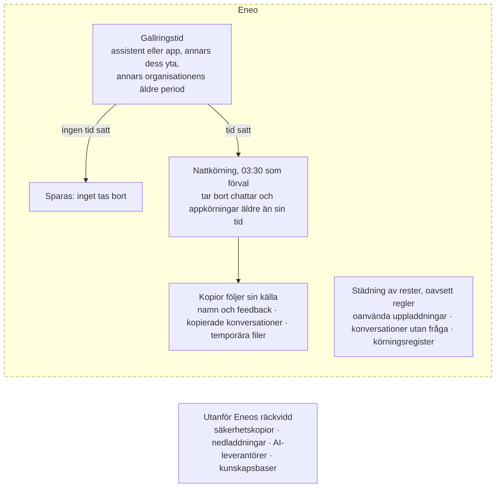
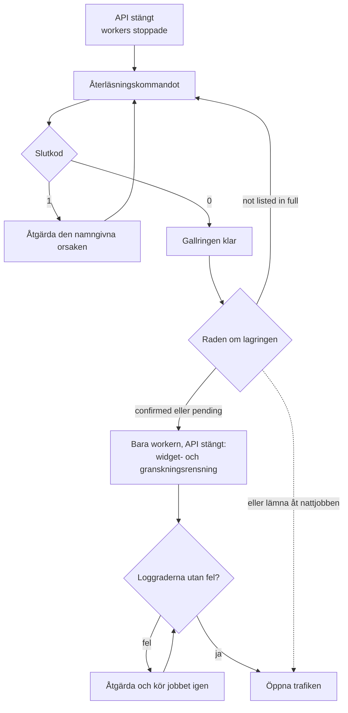

# Gallring



Gallring tar bort lagrat innehåll när den tid som valts för det har gått ut.
Ingen regel, ingen gallring: chattar och appkörningar tas bara bort där någon
har valt en tid; en ny webbwidget har 30 dagar från början. Gallring enligt en
regel hålls isär från städning av rester, som körs oavsett vilka regler som
finns. Kopior följer sin källa: när en tur tas bort försvinner också de kopior
Eneo har av den.

Gränser, räknare, hälsofält och granskningshändelser finns på den tekniska
sidan, [Retention](/docs/audit-logging#retention) (på engelska).

## För administratören [#for-the-administrator]

### Ingen regel, ingen gallring [#no-rule-no-removal]

Där ingen har valt en tid på en yta, en assistent eller en app tar gallringen
inte bort något. Städningen av rester tar ändå bort det som inget längre
använder, till exempel en uppladdning som aldrig bifogades till en chatt, och
register med en egen period, till exempel granskningsloggen; se
[Städning av rester](#cleanup-of-leftovers).

### Hur nivåerna samverkar [#how-the-levels-combine]

En tur i en chatt följer tiden för assistenten som svarade. En appkörning
följer sin app. Den närmaste nivån som har en tid avgör, från den närmaste och
utåt:

1. assistenten eller appen;
2. dess yta;
3. organisationen: en äldre period, `conversation_retention_days`, som bara
   räknas medan dess brytare `conversation_retention_enabled` är påslagen, i
   `audit_retention_policies`. Ingen vy och inget API i den här versionen
   sätter eller visar dem.

När ingen nivå har en tid tas inget bort.

Den närmaste nivån avgör **även när dess tid är längre** än tiden på en nivå
utanför: ytans tid är ett standardvärde, inte ett tak.

- **Gruppchattar:** varje tur följer assistenten som svarade, så en tidigare
  tur kan finnas kvar medan en senare tas bort. En tur vars assistent har
  raderats följer ingen tid och tas inte bort.
- **När en assistent raderas** raderas dess chattar. En fråga som inte
  ställdes till en assistent, till exempel en tjänstekörning, sparas tills
  dess tjänst eller organisationen raderas.
- **Hjälpassistenter**, till exempel Promptguiden, ligger i organisationsytan,
  som ingen vy ger en tid. Ge hjälpassistenten en egen tid om dess chattar ska
  tas bort.
- **Webbwidgetar** följer bara widgetens egen tid, hållen inom organisationens
  widgetpolicy som den ser ut natten för varje körning. En widget med `0`
  sparar ingen konversation efter svaret, även när minimum är högre. Hela konversationen
  tas bort på en gång, räknat från när den startade.
- **Granskningsloggen** har en period för organisationen, oberoende av alla
  tider för konversationer.

| Ändring av en tid | Effekt vid nästa körning |
| --- | --- |
| Kortare | Äldre konversationer blir aktuella och tas bort |
| Längre | Konversationer som inte längre är aktuella sparas |
| Borttagen | Nivån följer nästa nivå utåt, som kan vara kortare, längre eller ingen |
| Första tiden | Konversationer äldre än den tas bort |

En borttagen konversation kommer aldrig tillbaka.

### Ställ in tiden [#change-the-rules]

Varje tid är ett helt antal dagar.

**En yta** (den som får redigera ytan; organisationsytan har ingen
gallringsinställning):

- **Svelte-appen:** **Delat**, ytan, **Inställningar**, **Säkerhet &
  Integritet**, **Gallring av konversationshistorik**. Slå på **Åsidosätt
  policy**, ange dagarna (1 till 2555), **Spara ändringar**.
- **React-appen (beta):** **Delat**, ytan, **Inställningar**, **Säkerhet och
  integritet**, **Gallring av konversationshistorik**. Tomt betyder **Ingen
  gräns**. Värdet sparas när du lämnar fältet.
- **API:** `PATCH /api/v1/spaces/{space_id}/` med
  `{"data_retention_days": 30}`; `null` tar bort tiden, utelämnat behåller den.

**En assistent eller en app** (i en delad yta eller organisationsytan den som
får redigera ytan; i en personlig yta dess ägare; behörighet att redigera en
assistent eller app ger inte i sig rätt att ändra dess gallringstid):

- **Svelte-appen:** ytan, **Assistenter** (eller **Appar**), radens meny
  **Åtgärder**, **Redigera**, **Säkerhet & Integritet**, **Gallring av
  konversationshistorik**. Slå på **Åsidosätt policy**, ange dagarna, **Spara
  ändringar**.
- **React-appen (beta):** ytan, **Assistenter** (eller **Appar**),
  **Redigera**, **Säkerhet och integritet**, **Gallring av
  konversationshistorik**. Tomt följer ytan.
- **API:** `POST /api/v1/assistants/{assistant_id}/` eller
  `PATCH /api/v1/apps/{app_id}/` med `data_retention_days`; `null` följer ytan.

Hjälpassistenter: **Administratör → Hjälpassistenter → Öppna inställningar**,
på samma sätt.

**Webbwidgetar:** intervallet finns under **Administratör → Webbwidgetar →
Policy** (**Minst dagar**, **Högst dagar**, vardera 0 till 3650; 0 till 365
tills en policy sparas). En widgets egen tid finns under **Webbwidget → Öppna
widgetinställningar → Regler → Integritet → Lagringstid i dagar**. `0` sparar
ingen konversation efter svaret. Se
[Bädda in en chattwidget](/guides/embed-widget#conversation-retention).

**Granskningsloggen** (1 till 2555 dagar): i Svelte-appen **Administratör →
Granskningsloggar**, ange skälet till åtkomsten, och öppna sedan
**Gallringspolicy** på fliken **Loggar** och klicka på **Redigera**;
**Administratör → Inställningar → Gallringspolicy → Ändra** i React-appen
(beta); eller `PUT /api/v1/audit/retention-policy` med
`{"retention_days": 365}`.

En borttagning går inte att ångra, så kontrollera en kortare tid innan du
sparar den.

### Vad som tas bort [#what-removal-means]

När en tur tas bort raderar Eneo den ur databasen tillsammans med de kopior
Eneo har, och innehållslagringen raderar filernas bytes. Därefter kan Eneo
varken visa den eller ta tillbaka den. Borttagningen omfattar:

- frågan och dess svar;
- filer som bara den här turen använde, till exempel uppladdningar,
  ljudinspelningar och deras transkriberingar, och filer som härletts ur dem;
- med utökad loggning turens lagrade logg och innehållet i varje senare logg i
  konversationen;
- själva konversationen, när dess sista fråga är borta.

Turen visas inte längre när borttagningen genomförs. Filernas bytes raderas
efteråt, i bakgrunden, så en borttagen fil kan vara oåtkomlig medan dess bytes
väntar. Se
[What happens when a File is deleted?](/guides/object-content-storage#what-happens-when-a-file-is-deleted)
(på engelska).

### Kopior som följer sin källa [#copies-that-follow-their-source]

| Kopia | Hur den följer |
| --- | --- |
| En konversations namn (första frågan, en genererad rubrik eller ett namn någon valt) och dess feedbacktext | När tiden då den skrevs är äldre än konversationens period töms namnet (båda apparna visar Namnlös) och feedbacktexten tas bort, även medan frågor finns kvar. Tummen upp eller ned finns kvar. En gruppchatt följer den kortaste perioden bland sina assistenter |
| En konversation som kopierats från en annan | Går inte att läsa så snart en fråga den kopierades från tas bort, och tas sedan bort själv. Se [Copies of removed conversations](/docs/audit-logging#copies-of-removed-conversations) (på engelska) |
| Temporära filer för en uppladdning, en transkribering, en webbläsning eller en SharePoint-import | Tas bort när processen stannar; efter en krasch av nästa process på samma volym. `UPLOAD_TMP_DIR` måste därför ligga på ett lokalt filsystem |
| Registret för ett misslyckat jobb | Behåller en felkod, aldrig feltexten. Jobb som registrerades före uppgraderingen behåller sin text |

### Kopior utom räckhåll för Eneo [#copies-outside-eneos-reach]

Gallringen tar aldrig bort backuper och deras ögonblicksbilder (se
[Efter en återställning](#after-a-restore)), nedladdade dokument och exporter,
innehåll som skickats till en leverantör av AI-modeller eller en annan extern
tjänst, eller text som lagts till i en kunskapsbas. Ett svar i Insikter sparas
i 24 timmar efter att det senast uppdaterades, även när konversationerna bakom
det är borta. En kopia av databasvolymen kan fortfarande innehålla raderade
rader; en backup med `pg_dump` innehåller bara befintliga rader.

### När borttagningen sker [#when-removal-happens]

Innehåll blir **aktuellt** när det är äldre än sin tid, räknat från när det
skapades. Nästa schemalagda körning tar bort det.

#### Gallring enligt en regel [#retention-by-a-rule]

| Vad | Tiden ställs in på | Utan val | Körs |
| --- | --- | --- | --- |
| Chattar, gruppchattar och chattar med hjälpassistenter | Assistenten, annars dess yta | Sparas | Varje natt, 03:30 som standard (`RETENTION_CRON_HOUR`, `RETENTION_CRON_MINUTE`) |
| Appkörningar | Appen, annars dess yta | Sparas | Varje natt, med chattarna |
| Filer i en tur eller appkörning | De följer den; en fil som används någon annanstans finns kvar | Sparas | Med turen eller körningen |
| Namn och feedbacktext | Konversationens period | Sparas | Varje natt, med chattarna |
| Konversationer i webbwidgetar | Widgeten, inom widgetpolicyn | 30 dagar | Varje natt, 03:30 |

#### Städning av rester [#cleanup-of-leftovers]

Påslagen från början. Driften kan stänga av städningen av oanvända
uppladdningar, konversationer utan fråga och gallringens körningsregister; se
[Inställningar](#settings).

| Vad | Tas bort | Körs |
| --- | --- | --- |
| Uppladdningar som inget använder | 24 timmar efter uppladdningen | Varje natt, med chattarna |
| Konversationer utan fråga | 24 timmar efter att de startade | Varje natt, med chattarna |
| En process temporära filer | När processen stannar; efter en krasch när nästa process startar på samma volym | Processen |
| Förberedda filer för en kunskapsimport | När importen är klar; efter 1 timme om importen inte längre finns | Ett städjobb i workern |
| Granskningslogg | Efter 365 dagar eller organisationens period | Varje dygn, 02:00 |
| Exporter av granskningsloggen | Kan laddas ned i 24 timmar; filen vid nästa dagliga städning (`export_max_age_hours`) | Varje dygn, 03:00 |
| Gallringens körningsregister | Efter granskningsloggens period | Varje natt, med chattarna |

Tiderna gäller i workerns tidszon: UTC om du inte sätter `TZ` för workern.
Filernas bytes i innehållslagringen raderas i bakgrunden, varje minut, efter
att filen raderats. En tur tas normalt bort inom ett dygn efter sin tid. Den finns kvar längre när en
natt har mer aktuellt arbete än tillåtet (nästa natt fortsätter), när en rad
hålls eller en konversation överskrider körningens gränser (den sparas och
rapporteras; se [För driftansvariga](#for-operators)), eller när workern är
stoppad (nästa schemalagda körning tar igen det).

Kör den direkt:

```bash
docker compose --env-file .env --env-file release.env exec worker run-cron run_retention
```

Kommandot köar bara körningen och returnerar innan den har körts, så följ
workerns logg.

## För driftansvariga [#for-operators]

### Hälsa [#health]

`GET /api/healthz` rapporterar varje gallringsuppgift som `healthy`,
`degraded`, `unknown`, `initializing` eller `disabled`. En uppgift är
`degraded` när dess senaste avslutade körning misslyckades, när ingen körning
blivit klar på två dygn, eller när den senaste körningen hittade innehåll som
varit aktuellt i mer än ett dygn (`RETENTION_OVERDUE_WINDOW_DAYS`). En
misslyckad körning håller uppgiften `degraded` tills en ny körning är avslutad.
En uppgift visar `unknown` med `overdue_not_measured` när dess senaste avslutade
körning inte kunde mäta vad som är försenat, tills en senare körning har mätt
det. `limiting_settings` anger den inställning vars gräns höll kvar aktuellt
innehåll. Problem med gallringen gör aldrig ett i övrigt redo API
otillgängligt. Se [Health](/docs/audit-logging#health) och
[Scheduled execution and limits](/docs/audit-logging#scheduled-execution-and-limits)
(på engelska).

Rensningen av granskningsloggen skriver `retention_policy_applied` bara för en
organisation där den raderade minst en händelse, så en saknad händelse betyder
inte att rensningen misslyckades.

### Inställningar [#settings]

Schemat, brytarna per uppgift och gränserna är miljöinställningar för workern;
se [Settings](/docs/audit-logging#settings) (på engelska). En avstängd uppgift
behåller det den skulle ha tagit bort. Brytarna är en nödbroms, inte ett sätt
att behålla innehåll: en avstängd uppgift får också återläsningen efter en
återställning att misslyckas.

### Objektlagring [#object-storage]

Använd en hink som aldrig haft versionshantering eller Object Lock; med något
av dem går en raderad fil att läsa som en gammal version, så Eneo startar inte
med en sådan hink. Se [Välj innehållslagring](/guides/object-content-storage).

## Efter en återställning [#after-a-restore]

Gallringen når inte backuper. En återställning tar tillbaka det som togs bort
efter att backupen togs. Så här gör Eneo, och här slutar det.

### Gallringen körs ikapp innan trafiken öppnas [#retention-catches-up]



Med API:et stängt, alla workers stoppade och alla gallringsuppgifter påslagna
(varje `RETENTION_*_ENABLED` som `true`, standardvärdet), kör
återläsningskommandot:

```bash
docker compose --env-file .env --env-file release.env run --rm backend run-cron --until-complete run_retention
```

Lägg till installationens Compose-filer och profiler mellan `docker compose`
och `run`. Med det medföljande lagret är det
`--profile object-content -f docker-compose.yml -f docker-compose.object-content.yml`
(se [Välj innehållslagring](/guides/object-content-storage)).

Det tar bort, omgång efter omgång, det som reglerna i den återställda databasen
gör aktuellt, så att det innehållet tas bort igen innan någon kan nå det; det
som blir aktuellt medan det körs lämnas åt nattkörningen.
Slutkod 0 betyder att gallringen är klar och att lagringen är bekräftad eller
väntande. Slutkod 1 namnger varje uppgift och orsaken, till exempel en
avstängd uppgift (`conversations.history: skipped (disabled_by_deployment_setting)`),
en worker som fortfarande körs eller `still removing after 10000 rounds`;
åtgärda orsaken och kör kommandot igen.

Sista raden redovisar lagringen, eftersom rader som är borta ur databasen inte
betyder att lagret har raderat filernas bytes. `storage: confirmed` kräver
inget. `storage: pending N (held H, retrying R, waiting W)` betyder att
gallringen är klar och att trafiken får öppnas, men att lagret inte har
bekräftat varje borttagning. Workern fortsätter borttagningarna när den körs;
`held` ligger kvar tills spärren eller minimiretentionen löper ut. Vill du se
`confirmed`: kör igen med trafiken stängd och workers stoppade, efter
karenstiden (`OBJECT_CONTENT_ORPHAN_GRACE_SECONDS`, en timme som standard).
Efter `store not listed in full`: kör kommandot igen; det fortsätter
listningen. Varje rad förklaras i
[Read back after a restore](/docs/audit-logging#read-back-after-a-restore)
(på engelska).

Kommandot omfattar inte konversationer i webbwidgetar eller granskningsloggen.
För att ta bort det som de gör aktuellt innan trafiken öppnas: starta bara
workern, med API:et fortfarande stängt:

```bash
docker compose --env-file .env --env-file release.env up -d --no-deps worker
docker compose --env-file .env --env-file release.env exec worker run-cron purge_widget_sessions
docker compose --env-file .env --env-file release.env exec worker run-cron purge_old_audit_logs
```

Lägg till samma Compose-filer och profiler mellan `docker compose` och `up`
eller `exec`. Utan `--no-deps` startar Compose också backend, som öppnar
API:et. Varje `exec` köar bara sitt jobb: det skriver `Enqueued` och returnerar
innan jobbet har körts. Vänta i workerns logg på `Widget retention purge
completed` med `errors` 0 och utan någon rad `Widget retention purge failed`,
och på `Audit log retention purge completed successfully`. Felräkningen syns
bara i JSON-loggar (`JSON_LOGS=true`, standard); utan dem är frånvaron av rader
om fel kontrollen. Rapporterar ett jobb fel: åtgärda dem och kör jobbet igen.
Hoppar du över steget tar deras nattliga jobb bort det.

### Det här kan komma tillbaka [#what-can-come-back]

Kommandot känner bara reglerna i den återställda databasen. Detta kan komma
tillbaka tills de ansvariga har lagt in sina ändringar igen:

- innehåll som togs bort för hand efter backupen, till exempel en
  konversation, fil, assistent eller app;
- innehåll som gallrades enligt en regel som sattes eller kortades efter
  backupen.

För en förteckning över sådana ändringar utanför backupen, och gör om dem innan
trafiken öppnas.

### Backuperna är ert ansvar [#backups-are-yours]

Eneo tar aldrig bort backupkopior. En lyckad körning, eller
`storage: confirmed`, är inte bevis för att alla kopior är borta: backuper och
ögonblicksbilder behåller det de innehåller så länge ni sparar dem. Bestäm hur
länge backuper lever, och vem som får läsa dem, så att det stämmer med era
beslut om gallring. Se
[Back up and restore](/guides/object-content-storage#back-up-and-restore)
(på engelska).

### Känd begränsning [#restore-known-limit]

Kommandot förutsätter att Eneos prefix i hinken (`v1/<deployment id>/`) bara
innehåller det som Eneo skrivit. Ett främmande objekt eller en ofullständig
multipart-uppladdning där stoppar det med slutkod 1, före raden om lagringen,
och den schemalagda avstämningen misslyckas på samma sätt. Ta bort objektet
eller avbryt uppladdningen och kör sedan kommandot igen.
