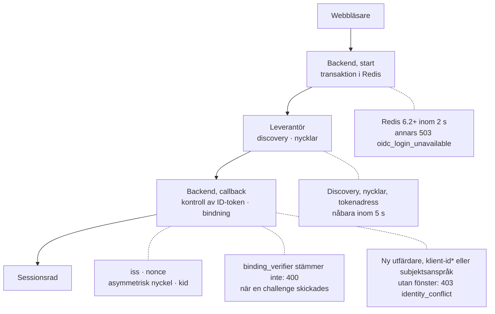

import { Callout } from "nextra/components";

# Uppgraderingsanteckningar

Den här sidan är till för driftansvariga, administratörer och API-konsumenter som uppgraderar från 2.3 till nästa version. Gå igenom checklistan först och läs sedan tabellen för ditt område: "Inget" i kolumnen Gör kräver inget av dig, och en länkad ändring har ett detaljavsnitt längre ned.

Den allmänna uppdateringsrutinen finns i [Uppgradera och återställ](/guides/deployment#uppgradera-och-återställ). Ändringarna i 2.3.0–2.3.2 finns i deras [versionsanteckningar](https://github.com/eneo-ai/eneo/releases); ändringar fram till 2.2 finns i [Uppgradera till 2.2.0](/guides/upgrade-2-2-0) och [Uppgradera till 1.7.0](/guides/upgrade-1-7-0).

## Gör detta före uppgraderingen [#before-you-upgrade]

<Callout type="warning">
  Den här versionen tömmer det lagrade innehållet i varje befintlig frågelogg och tar bort de loggar som ingen fråga hänvisar till. Det går inte att ångra. Ta en databassäkerhetskopia och stoppa varje backend och worker av den tidigare versionen innan migreringarna körs.
</Callout>

Varje punkt kan hindra backend från att starta, stoppa inloggningen eller förlora data:

1. Ta en säkerhetskopia med `pg_dump` och stoppa varje gammal backend och worker. Se [Frågeloggar töms](#question-logs-emptied).
2. Objektlagringen ger de tre bucket-behörigheterna, har aldrig haft versionshantering (inte ens pausad) och Object Lock är avstängt. Se [Objektlagring](#object-storage-versioning).
3. `UPLOAD_TMP_DIR` ligger på ett lokalt filsystem. Se [`UPLOAD_TMP_DIR`](#upload-tmp-dir-local).
4. `BROWSER_SESSION_MAX_AGE`, om den är satt, är minst `JWT_EXPIRY_TIME`; utan den håller React-appen personer inloggade i upp till 30 dagar. Se [Sessioner](#server-side-sessions).
5. `DEFAULT_USER_PASSWORD`, om den är satt, har minst 12 tecken och högst 72 byte, annars misslyckas db-init när den skapar standardanvändaren. Se [Lösenordens livscykel](#password-lifecycle).
6. Gå igenom [OIDC-checklistan](#oidc-checklist).
7. `TRUSTED_PROXY_COUNT` stämmer med antalet proxyer. Se [`TRUSTED_PROXY_COUNT`](#trusted-proxy-count).
8. Ändra den nya routern för webbappen i referensfilen för Compose. Se [React-webbappen](#react-web-app-main-host).
9. Berätta för användarna att namn och feedbackkommentarer på konversationer som är äldre än sin gallringstid tas bort den första natten. Se [Namn och feedbacktext](#names-and-feedback-follow-retention).
10. Planera driftstopp för `db-init`: migreringen `202611091200` låser `sessions` medan den skriver om varje rad, och flera migreringar bygger index samtidigt med drift. Om `db-init` avbryts, kör den igen. Se [Migreringen `202611091200`](#sessions-migration).
11. Exportera granskningsloggen först om du behöver filnamnen: uppgraderingen tar bort dem för gott. Se [Exportera granskningsloggar](/guides/audit-logging#exporting-audit-logs).

**Gå tillbaka till 2.3:** läs tillbaka säkerhetskopian från `pg_dump` som togs före `db-init`, tillsammans med en matchande ögonblicksbild av objektlagringen. En nedgradering av schemat stannar vid migreringen `202610291900` ("Cannot discard approved Skill reference history") så snart en godkänd Skill-version hänvisar till en annan Skill. En nedgradering tar aldrig tillbaka tömda eller borttagna loggar, tömda namn eller omskrivna granskningsposter.

## Inloggning med OIDC: vad en befintlig installation ska kontrollera [#oidc-checklist]

Diagrammet visar en inloggning och, på prickade linjer, var en befintlig installation kan fastna. *Ett nytt klient-id kräver ett fönster bara med `sub` per klient.

"Lagrade inställningar" betyder att leverantören är registrerad i Eneo (`FEDERATION_ENABLED=true`); "miljöinställningar" betyder variablerna `OIDC_*` (`FEDERATION_ENABLED=false`).

**Alla leverantörer:**

- Alla backend-repliker når samma Redis. [Redis](#redis-required-for-sign-in)
- ID-token signeras asymmetriskt (inte `HS256`); klockorna är synkroniserade. [Strikt verifiering](#strict-relying-party)
- Discovery-adressen anger din egen katalog (ingen `{tenantid}`). [Platshållare](#templated-issuer-refused), [Nåbarhet](#discovery-and-jwks-reachable)
- Byt ut frontend och alla backend-repliker samtidigt; pågående inloggningar startas om. [Driftsätt tillsammans](#deploy-frontend-and-backend-together)
- Konton behöver inget: varje konto binds via e-post vid nästa inloggning, och sessioner förblir giltiga. [Kontobindning](#account-binding)
- Anrop till leverantören går över https; en leverantör på backendens egen maskin bara med `ENVIRONMENT=development`. Tokenadressen och `jwks_uri` ligger på discovery-värden, annars läggs värden i `allowed_endpoint_hosts` direkt efter uppgraderingen. [Anrop till leverantören](#provider-requests-on-its-host)

**Leverantörer som ger varje klient ett eget `sub`** (Entra ID; alla leverantörer med parvisa subjekt):

- Lagrade inställningar: direkt efter uppgraderingen, innan någon loggar in, sätt subjektsanspråket (för Entra ID `oid`). [Kontobindning](#account-binding)
- Miljöinställningar använder alltid `sub`. Ändra aldrig `OIDC_CLIENT_ID` utan ett migreringsfönster. [Byta klient-id](/guides/oidc-federation#changing-the-client-id)

**Miljöinställningar:** sätt alla tre `OIDC_DISCOVERY_ENDPOINT`, `OIDC_CLIENT_ID` och `OIDC_CLIENT_SECRET`, annars visar inloggningssidan bara lösenordsformuläret. Inställningar som är lagrade på organisationen ignoreras, och en inloggning som inte anger någon organisation använder den första aktiva organisationen. [Inloggningstabellen](#sign-in)

**Lagrade inställningar:**

- Ta bort de `OIDC_*`-variabler som varningen vid start nämner. [Inloggningstabellen](#sign-in)
- Kontrollera vem som har administratörsrollen. [Administratörer](#admins-change-sign-in-settings)
- Automatisering med `PUT` skickar `subject_claim`. [Kontobindning](#account-binding)
- Skript godtar `502`. [Spara inställningar](#provider-save-checks-sign-in)
- Kontrollera de tillåtna domänerna om du använde flyttskriptet med 2.3 eller tidigare. [Flyttskriptet](#move-script-allowed-domains)
- Om åtkomsttoken skapar konton: lagra de tillåtna domänerna på leverantören, eftersom åtkomsttoken inte längre läser `OIDC_ALLOWED_DOMAINS`. [Åtkomsttoken](#resource-server-binding)

**MobilityGuard-inställningar** (`MOBILITYGUARD_*`, `MOBILITY_GUARD_AUTH`): döp om till `OIDC_*`-namnen. [MobilityGuard](#mobilityguard-sign-in-removed)

**Zitadel i Svelte-appen:** fungerar fortfarande men är föråldrad; flytta den till OIDC-inställningarna före den version som tar bort den. [Inloggningstabellen](#sign-in)

**API-konsumenter:** med `OIDC_RESOURCE_SERVER_ENABLED=true`, jämför utfärdare och subjekt i åtkomsttoken och ID-token före uppgraderingen. Egna anropare av `/api/v1/auth/callback` skickar vidare `iss`, läser fel via `code` och anropar `POST /api/v1/users/logout/` vid utloggning. [Åtkomsttoken](#resource-server-binding), [Felformat](#error-envelope), [Sessioner](#server-side-sessions)

**Från 2.2 eller tidigare:** läs också inloggningsändringarna i [versionsanteckningarna för 2.3.0](https://github.com/eneo-ai/eneo/releases/tag/v2.3.0).

## Vad ändras [#what-changes]

### Inloggning (OIDC) [#sign-in]

| Ändring | Vem | Gör |
|---|---|---|
| [Konton binds till en identitet hos leverantören](#account-binding) | Varje OIDC-installation | Sätt subjektsanspråket vid `sub` per klient |
| [Åtkomsttoken från leverantören använder samma bindning](#resource-server-binding) | `OIDC_RESOURCE_SERVER_ENABLED=true` | Jämför utfärdare och subjekt i token |
| [Ett borttaget konto behåller sin identitet](#removed-accounts-keep-identity) | Administratörer som tar bort konton | Återaktivera, skapa inte nytt |
| [Varje OIDC-inloggning verifieras strikt](#strict-relying-party) | Varje OIDC-installation | Kontrollera algoritm, `nonce`, `kid`, NTP |
| [Redis krävs för OIDC-inloggning](#redis-required-for-sign-in) | Varje OIDC-installation | Redis 6.2+, `noeviction` |
| [Discovery och signeringsnycklar måste förbli nåbara](#discovery-and-jwks-reachable) | Backend bakom utgående regler eller proxy | Nå leverantören inom 5 s |
| [Anrop till leverantören stannar på dess värd, över https](#provider-requests-on-its-host) | Varje OIDC-installation | Jämför värdarna i discovery; lägg till andra värdar efter uppgraderingen |
| [En utfärdare med platshållare nekas](#templated-issuer-refused) | Entra ID-adress för flera kataloger | Använd din egen katalog |
| [Driftsätt frontend och backend tillsammans](#deploy-frontend-and-backend-together) | Driftansvariga, egna callbacks | Driftsätt tillsammans, skicka vidare `iss` |
| API-klienter kan binda koden med `binding_challenge` och `binding_verifier`; en felaktig `binding_verifier` svarar `400` och loggar `binding_mismatch`; en återanvänd callback svarar `400` | API-klienter | Inget; bindningen är frivillig |
| [MobilityGuards egen inloggning är borttagen](#mobilityguard-sign-in-removed) | Installationer med `MOBILITYGUARD_*` | Döp om variablerna |
| Zitadel-inloggningen i Svelte-appen är föråldrad; en senare version tar bort den | Zitadel-installationer | [Flytta](/guides/oidc-federation#migrate-from-the-zitadel-settings) före den versionen |
| SSO erbjuds bara med discovery-adress, klient-id och klienthemlighet | Alla | Ta bort `OIDC_*`-variabler som varningen nämner; lagra de tillåtna domänerna på leverantören om åtkomsttoken använder dem |
| [Flyttskriptet tappade de tillåtna domänerna](#move-script-allowed-domains) | Körde flyttskriptet med `OIDC_ALLOWED_DOMAINS` satt | Kontrollera lagrade domäner |
| [Administratörer kan ändra inloggningsinställningarna](#admins-change-sign-in-settings) | Lagrade inställningar | Granska administratörsrollen |
| SCIM-konton binds vid första inloggningen | SCIM-installationer | Inget |
| Organisationslistan vid inloggning visar bara organisationer med lagrad leverantör | Installationer med flera organisationer | [Registrera](/guides/oidc-federation) saknade leverantörer |
| Miljöinställningar ignorerar inställningar som är lagrade på organisationen; bara `{PUBLIC_ORIGIN}/login/callback` godtas; en inloggning som inte anger någon organisation använder den första aktiva organisationen | Miljöinställningar | Flytta lagrade värden in i Eneo vid behov ([OIDC-inställningar](/guides/oidc-federation)) |
| [Att spara leverantörsinställningar kontrollerar det inloggningen kontrollerar](#provider-save-checks-sign-in) | Skript som sparar eller testar inställningar | Godta `502` |
| `REDIS_CONN_TIMEOUT` (standard 5 s) är nu också lästidsgräns för de Redis-klienter som API och workers delar, och för deras köläggning av bakgrundsjobb | Långsam Redis | Höj värdet vid behov |

### Sessioner, lösenord och webbappen [#sessions]

| Ändring | Vem | Gör |
|---|---|---|
| [Utloggning avslutar sessionen på servern](#server-side-sessions) | Driftansvariga, API-konsumenter med webbläsartoken | Kontrollera `BROWSER_SESSION_MAX_AGE` |
| `GET /logout` i Svelte visar en utloggningsknapp | Användare av `/logout`-länkar | Inget |
| [`TRUSTED_PROXY_COUNT` räknar proxyer exakt](#trusted-proxy-count) | Mer än en proxy, eller nginx | Sätt den till antalet proxyer |
| [React-webbappen körs på huvudvärden](#react-web-app-main-host) | Användare av referensfilen för Compose | Välj React eller Svelte |
| [Härdning av HTTP](#http-hardening) | Proxyer som sätter HSTS eller CSP | Bestäm vem som äger HSTS och CSP |
| Lösenordsinloggning: ett korrekt lösenord för ett inaktivt konto eller en avstängd organisation svarar `403` (9019, 9025) i stället för `500`; `422` listar bara `loc`, `type` och `msg`; ett oväntat fel svarar `500` med koden `internal_error` och ett `error_id` | API-klienter med lösenord | Hantera de två koderna; uppdatera tolkningen av `422` |
| [Lösenordens livscykel](#password-lifecycle) | Förinlagda användare, lösenordsintegrationer | Kontrollera `DEFAULT_USER_PASSWORD` |

### API-kontrakt [#api-contract]

| Ändring | Vem | Gör |
|---|---|---|
| [Ett felformat](#error-envelope) | API-konsumenter, genererade klienter | Läs `code` och `message` |
| [Ikoner](#icons) | API-konsumenter för ikoner, administratörer med flera organisationer | Driftsätt backend och båda frontends tillsammans |
| Granskningshändelsen `user_access_token_issued` registrerar varje token som driftansvarig tar ut för en användare med super-API-nyckeln, alltid och innan tokenet lämnas ut | Klienter med en fast lista över granskningshändelser | Godta det nya värdet |

### Gallring, loggar och lagring [#retention-logs-storage]

| Ändring | Vem | Gör |
|---|---|---|
| [En gallringsmotor](#retention-engine) | Skript och larm på de gamla jobben | Uppdatera dem |
| En ny Promptguide sätter inte längre 30 dagar; befintliga guider behåller sin period | Administratörer som vill ha en gallringstid | [Sätt den](/guides/data-retention#change-the-rules) uttryckligen |
| Kopior av borttagna konversationer svarar `410`. Inget skapar kopior ännu, så inget `410` förekommer i dag. På PostgreSQL 13 kostar läsningar av konversationer mer | API-konsumenter; installationer på PostgreSQL 13 | Behandla `410` som borta. Töm jobbkön före en nedgradering. På PostgreSQL 13, planera en övergång till 16 |
| [Frågeloggar töms](#question-logs-emptied) | Alla | Säkerhetskopiera, stoppa gamla skrivare |
| [Filnamn försvinner ur granskningsloggen](#audit-names-removed) | Granskningslogg som sparas som bevis | Exportera först om du behöver namnen |
| [Objektlagringen får inte behålla gamla versioner](#object-storage-versioning) | Installationer med objektlagring | Ge behörigheter; ingen versionshantering |
| Den medföljande SeaweedFS-avbilden är `4.40-eneo.8` | Medföljande SeaweedFS | Sätt `ENEO_SEAWEEDFS_IMAGE` till digesten i `IMAGE-DIGESTS.txt` ([Lås versionens avbild](/guides/object-content-storage#pin-the-release-image)) |
| En fråga vars logg inte innehåller något anrop svarar `400` i stället för `500` | API-konsumenter | Behandla `400` som ingen logg |
| [`UPLOAD_TMP_DIR` måste vara ett lokalt filsystem](#upload-tmp-dir-local) | Driftansvariga | Håll den lokal |
| [Migreringen `202611091200` skriver om varje konversationsrad](#sessions-migration) | Driftansvariga | Planera driftstopp |
| [Namn och feedbacktext följer gallringstiden](#names-and-feedback-follow-retention) | Administratörer, API-konsumenter | Informera användarna |
| Misslyckade jobb har `failure_code` i stället för feltext | API-konsumenter av misslyckade jobb | Läs `failure_code` |
| Ett misslyckat jobb loggas utan sitt felmeddelande | Logglarm på ett misslyckat jobbs feltext | Matcha på `error_type` och, där raden har det, `failure_code`. Andra fel- och sammanfattningsrader från worker och cron, till exempel rensningen av granskningsloggen, har kvar sitt meddelande, så behåll de larmen |
| [Ett nytt steg efter att en säkerhetskopia återställts](#readback-after-restore) | Driftansvariga, vid varje återställning | Kör kontrolläsningen |

### Modeller, verktyg och integrationer [#integrations]

| Ändring | Vem | Gör |
|---|---|---|
| `MAX_TOOL_ROUNDS` är som standard 40 (var fast 10), så en verktygstung tur kan kosta upp till fyra gånger så många anrop och token; LiteLLM:s `REQUEST_TIMEOUT` gäller inte längre | Alla | `MAX_TOOL_ROUNDS=10` behåller det gamla taket; flytta en egen `REQUEST_TIMEOUT` till `COMPLETION_REQUEST_TIMEOUT_SECONDS` (standard 600) |
| Leverantörstyper som inte kan routas nekas med `400`; modellnamn dubblerar inte längre prefixet | Administratörer | Rätta `mistral/mistral/…`-namn på chattmodeller; inbäddnings- och omrankningsmodeller kräver nya modeller; [skapa om nekade leverantörer](/guides/ai-providers#adding-a-provider-admin-ui) |
| Avbilderna saknar `apt`; frontend-avbilden saknar också `npm`, `npx`, `corepack` och `yarn` | Byggen ovanpå avbilderna | Installera i ett separat byggsteg |
| `MCP_APP_CONTENT_BASE_URL` valideras vid start | Installationer som sätter den | Inget; vanliga värden godtas |
| [SharePoint](#sharepoint) | Installationer med SharePoint | Låt synkar bli klara; gå igenom Problem; importera om personliga källor för inaktiverade ägare |
| [Webbwidgetar](#widgets) | Driftansvariga | Kör kontrollen av sessioner |
| Ny behörighet Egna Skills (`personal_skills`) för Ägarroller | Administratörer | Inget; ge den till andra roller vid behov |

### Underhållare [#maintainers]

| Ändring | Vem | Gör |
|---|---|---|
| Styrt arbetsflöde för versioner, avstängt tills `RELEASE_MANAGED=true` | Bara underhållare | Inget |

## Detaljer: inloggning [#details-sign-in]

### Konton binds till en identitet hos leverantören [#account-binding]

Den första federerade inloggningen binder kontot, per organisation, till utfärdare, klient-id, subjektsanspråk och subjektsvärde. Senare inloggningar matchar aldrig via e-post; en konflikt svarar `403 identity_conflict`. Keycloak, Okta, Auth0 och Zitadel använder som standard samma `sub` för alla klienter.

**Gör:** för leverantörer med `sub` per klient och lagrade inställningar, sätt `subject_claim` direkt efter uppgraderingen (`PATCH /api/v1/admin/federation`). Öppna ett migreringsfönster före en ny utfärdare, ett nytt klient-id med `sub` per klient, eller ett nytt subjektsanspråk. Automatisering som ersätter inställningarna med `PUT` måste skicka `subject_claim`.

**Kontroll:** `GET /api/v1/admin/users/{user_id}/identity` visar en bindning per leverantör och klient.

**Återställning:** nedgradering av `202611091110` tar bort bindningar, fönster och tillstånd. Se [Uppgradera till kontobindning](/guides/oidc-federation#upgrading-to-account-binding).

### Åtkomsttoken från leverantören använder samma bindning [#resource-server-binding]

Med `OIDC_RESOURCE_SERVER_ENABLED=true` matchas åtkomsttoken via bindningen med `OIDC_ACCEPTED_ISSUER` och `OIDC_ACCEPTED_AUDIENCE`. En token utan subjektsanspråket svarar `401`.

Åtkomsttoken använder de tillåtna domänerna i de valda inställningarna: med `FEDERATION_ENABLED=true` bara domänerna som är lagrade hos leverantören, annars `OIDC_ALLOWED_DOMAINS`. Med `FEDERATION_ENABLED=true` och inga lagrade domäner, eller ingen lagrad leverantör alls:

- en åtkomsttoken skapar inte längre konton utifrån `OIDC_ALLOWED_DOMAINS`;
- en åtkomsttoken släpper in varje befintligt konto i organisationen vars e-post stämmer, också utanför `OIDC_ALLOWED_DOMAINS`. Med en lagrad leverantör släppte inloggningen i webbläsaren redan in dem; utan lagrad leverantör finns ingen inloggning i webbläsaren att jämföra med.

Nycklarna som kontrollerar åtkomsttoken följer [reglerna för anrop till leverantören](#provider-requests-on-its-host), utan lista över andra värdar.

**Gör:** jämför `iss` och subjekt i en ID-token och en åtkomsttoken för samma person. Med Entra ID, begär åtkomsttoken av version 2 och sätt `OIDC_ACCEPTED_ISSUER` till utfärdaren för `v2.0`. Om de inte kan bli lika öppnar en administratör ett migreringsfönster. Om åtkomsttoken skapade konton utifrån `OIDC_ALLOWED_DOMAINS`: med en lagrad leverantör, gör `PATCH` på `allowed_domains` hos den; utan lagrad leverantör (en `PATCH` svarar `404`), lagra en med `PUT /api/v1/sysadmin/tenants/{tenant_id}/federation` eller sätt `FEDERATION_ENABLED=false`.

### Ett borttaget konto behåller sin identitet [#removed-accounts-keep-identity]

Ett borttaget konto behåller sin bindning, så ett andra konto för samma person kan inte använda inloggning via SSO.

**Gör:** återaktivera via SCIM (`active=true`) eller `POST /api/v1/admin/users/{username}/reactivate`, som svarar `400` (kod 9004) när ett annat aktivt konto har adressen.

### Varje OIDC-inloggning verifieras strikt [#strict-relying-party]

Varje inloggning använder `state`, `nonce` och PKCE (`S256`). ID-token kräver en asymmetrisk algoritm (aldrig `none` eller `HS*`), en `kid` och den utfärdare som inloggningen startade med.

**Gör:** byt Auth0- eller Keycloak-klienter från `HS256`; kontrollera att `nonce` returneras och att servrarna använder NTP.

**Kontroll:** backend loggar inget `oidc_response_refused` eller `oidc_transaction_refused`.

### Redis krävs för OIDC-inloggning [#redis-required-for-sign-in]

Inloggningstransaktionen ligger i Redis och läses en gång med `GETDEL`. Om Redis inte svarar inom 2 sekunder, eller är äldre än 6.2, svarar inloggningen `503 oidc_login_unavailable`.

**Gör:** alla backend-repliker når samma Redis, 6.2 eller senare. Behåll standardpolicyn `noeviction`.

**Kontroll:** `redis-cli CONFIG GET maxmemory-policy` visar `noeviction`.

### Discovery och signeringsnycklar måste förbli nåbara [#discovery-and-jwks-reachable]

Discovery cachas i `OIDC_JWKS_CACHE_TTL_SECONDS` (3600) utan reserv med gamla värden. Varje anrop till leverantören avbryts efter 5 sekunder.

**Gör:** varje backend når discovery-adressen, `jwks_uri` och tokenadressen. Annars kan ingen logga in efter den första timmen, eller direkt efter en omstart.

**Kontroll:** kör `curl --noproxy '*'` mot discovery-adressen inifrån backend-containern. Eneo använder inte `HTTPS_PROXY` för sina anrop till leverantören, så en kontroll genom proxyn kan gå igenom medan inloggningen misslyckas.

### Anrop till leverantören stannar på dess värd, över https [#provider-requests-on-its-host]

Discovery, tokenanropet och signeringsnycklarna, vid inloggning och när inställningar sparas eller testas:

- går över https. En leverantör på backendens egen maskin (`localhost`, `127.0.0.1`, `::1`) godtas bara med `ENVIRONMENT=development`, och då även över http. Utan den inställningen (osatt betyder produktion) kan en installation vars leverantör körs på backendens maskin inte logga in efter uppgraderingen.
- går aldrig till länklokala adresser eller molnets metadataadresser, följer aldrig en omdirigering och nekar ett svar över 256 KiB eller ett svar som inte är ett JSON-objekt.
- når tokenadressen och `jwks_uri` bara på discovery-värden eller på en värd i det nya fältet `allowed_endpoint_hosts`, som bara super-API-nyckeln sätter (`PUT` eller `PATCH /api/v1/sysadmin/tenants/{tenant_id}/federation`). Att spara svarar `400` och namnger värden. Miljöinställningar har ingen lista.

En `discovery_endpoint` som inget anrop får gå till svarar `422`. Att spara eller testa svarar `502` när discovery omdirigerar, är större än 256 KiB eller inte är ett JSON-objekt; 2.3 följde omdirigeringen, läste vilken storlek som helst och svarade `400` för ett dokument som inte var ett objekt. När lagrade inställningar bryter mot reglerna svarar `/api/v1/auth/initiate` och callbacken `500` med ett fast meddelande, och backenden loggar `OIDC provider configuration is unusable` med skälet. Listan är ny, så för en sådan organisation slutar inloggningen fungera vid uppgraderingen tills driftansvarig lägger till värden.

Med `OIDC_RESOURCE_SERVER_ENABLED=true` gäller samma regler för discovery-dokumentet för `OIDC_ACCEPTED_ISSUER` och för dess `jwks_uri`, som måste ligga på utfärdarens värd. `allowed_endpoint_hosts` gäller inte de här anropen, och att flytta inställningarna till Eneo ändrar inte det. En leverantör som bryter mot en regel får varje bearer-token att svara `401`, och backenden loggar `Failed to fetch JWKS for IdP token validation`.

**Gör:** före uppgraderingen, kör `curl --noproxy '*' -s <discovery-adress> | jq -r '.issuer, .token_endpoint, .jwks_uri'` och jämför värdarna. Direkt efter uppgraderingen, gör `PATCH` på `allowed_endpoint_hosts` med varje annan värd. Med miljöinställningar och en annan värd: [flytta inställningarna till Eneo](/guides/oidc-federation/single-tenant#move-the-settings-into-eneo) och lägg till listan. En leverantör på backendens maskin: sätt `ENVIRONMENT=development` (bara i utveckling) eller ge leverantören en riktig värd. Med åtkomsttoken och en `jwks_uri` på en annan värd än `OIDC_ACCEPTED_ISSUER` finns inget i Eneo som tillåter det: servera nycklarna på utfärdarens värd eller sätt `OIDC_RESOURCE_SERVER_ENABLED=false`.

**Kontroll:** backenden loggar inget `OIDC provider configuration is unusable` och, med åtkomsttoken, inget `Failed to fetch JWKS for IdP token validation`.

### En utfärdare med platshållare nekas [#templated-issuer-refused]

En utfärdare som innehåller `{` eller `}` (Entra ID:s `common` eller `organizations`) nekas.

**Gör:** använd `https://login.microsoftonline.com/{directory-tenant-id}/v2.0/.well-known/openid-configuration`. Det fungerar också på 2.3.

### Driftsätt frontend och backend tillsammans [#deploy-frontend-and-backend-together]

`POST /api/v1/auth/callback` kräver `iss` när discovery anger `authorization_response_iss_parameter_supported`. En äldre frontend skickar inte vidare den.

**Gör:** driftsätt Svelte-frontend och backend från samma version och byt ut alla backend-repliker samtidigt. `detailCode` på inloggningssidan bär nu de nya felkoderna i stället för `http_400`, `unauthorized` eller `http_500`: uppdatera övervakning som matchar den.

**Återställning:** frontend och backend tillsammans.

### MobilityGuards egen inloggning är borttagen [#mobilityguard-sign-in-removed]

Backend vägrar starta när en `MOBILITYGUARD_*`-variabel är satt utan sin `OIDC_*`-motsvarighet.

**Gör:** döp om `MOBILITYGUARD_DISCOVERY_ENDPOINT`, `MOBILITYGUARD_CLIENT_ID`, `MOBILITYGUARD_CLIENT_SECRET` och `MOBILITYGUARD_TENANT_ID` till `OIDC_DISCOVERY_ENDPOINT`, `OIDC_CLIENT_ID`, `OIDC_CLIENT_SECRET` och `OIDC_TENANT_ID`. Med flera aktiva organisationer: behåll en eller gå över till lagrade inställningar. Hos MobilityGuard: registrera `{PUBLIC_ORIGIN}/login/callback`, tillåt scopet `profile`, acceptera `client_secret_post` och se till att `nonce` returneras. API-klienter går över till `/api/v1/auth/initiate` och `/api/v1/auth/callback`; den gamla vägen svarar `404`. Se [Flytta från MobilityGuard-inställningarna](/guides/oidc-federation#migrate-from-the-mobilityguard-settings).

### Flyttskriptet tappade de tillåtna domänerna [#move-script-allowed-domains]

Flyttskriptet till och med 2.3 lämnade de lagrade tillåtna domänerna tomma: ingen domänkontroll vid inloggning. Uppgraderingen rättar inte detta.

**Gör:** jämför `GET /api/v1/sysadmin/tenants/{tenant_id}/federation` med den gamla `OIDC_ALLOWED_DOMAINS`, gör `PATCH` på `allowed_domains` och granska konton som skapats sedan flytten.

### Administratörer kan ändra inloggningsinställningarna [#admins-change-sign-in-settings]

Med lagrade inställningar kan en organisations administratör ändra klient-id, klienthemlighet, tillåtna domäner och subjektsanspråk.

**Gör:** granska vem som har administratörsrollen. Ett felaktigt värde stoppar inloggning via SSO; `/login?showUsernameAndPassword=true` finns kvar.

### Att spara leverantörsinställningar kontrollerar det inloggningen kontrollerar [#provider-save-checks-sign-in]

Att spara och testa leverantörsinställningar svarar `502` när discovery inte kan läsas eller tolkas, och `400` när det går att tolka men saknar det inloggningen behöver. En `PATCH` utan `discovery_endpoint` hämtar ingenting och svarar därför aldrig `502`. `PUT` läser alltid leverantören.

**Gör:** skript som väntade sig `400` för en leverantör som inte går att nå godtar `502`.

## Detaljer: sessioner och webbappen [#details-sessions]

### Utloggning avslutar sessionen på servern [#server-side-sessions]

Varje inloggning med lösenord eller OIDC i båda webbapparna skriver en rad i `browser_sessions`. `POST /api/v1/users/logout/` avslutar sessionen (`204` klart, `503` försök igen). Ett workerjobb kl. 00:30 workerns tid (UTC om inte `TZ` är satt) tar bort utgångna rader.

**Gör:** om du sätter `BROWSER_SESSION_MAX_AGE` (standard 43200), håll den minst `JWT_EXPIRY_TIME`, annars startar inte backend. Håll workern igång. Byt inte `JWT_SECRET` för detta: den signerar också widget- och modultoken, och hashar API-nycklar när `API_KEY_HASH_SECRET` inte är satt. API-konsumenter behandlar WebSocket `1008` som slutgiltigt och `1013` som värt att försöka igen.

**Återställning:** nedgradering av `202611021100` tar bort tabellen; React-användare loggar in igen.

### `TRUSTED_PROXY_COUNT` räknar proxyer exakt [#trusted-proxy-count]

Klientadressen är den `N`:te posten i `X-Forwarded-For` räknat från höger. En Traefik-proxy med `N=1`: oförändrat. En lastbalanserare framför Traefik behöver `N=2`.

**Gör:** sätt `N` till antalet proxyer som lägger till i huvudet. Aldrig högre.

### React-webbappen körs på huvudvärden [#react-web-app-main-host]

React-appen ligger nu i backend-avbilden. Referensfilen för Compose lägger till en router för huvudvärden, en platshållare (`your-domain.com`) tills du ändrar den.

**Gör:** för att behålla Svelte, sätt `WEB_APP_ENABLED=false` och `FRONTEND_ROUTER_PRIORITY=7`. För att byta: sätt värden på routern, låt proxyn skicka vidare den publika `Host`, registrera `https://<publik värd>/login/callback` hos leverantören, [flytta från Zitadel till OIDC-inställningarna](/guides/oidc-federation#migrate-from-the-zitadel-settings) först om du använder Zitadel (React-appen har ingen Zitadel-inloggning) och meddela att alla loggar in igen. Egna byggen behöver `--build-context web=./frontend`; den som körde betan i 2.3 tar bort web-next-profilen och flyttar dess länkinställningar till `env_backend.env`. Kör sedan `docker compose --env-file .env --env-file release.env up -d --remove-orphans`, med installationens Compose-filer och profiler mellan `docker compose` och `up`; med det medföljande lagret är det `--profile object-content -f docker-compose.yml -f docker-compose.object-content.yml` (se [Välj innehållslagring](/guides/object-content-storage)).

**Kontroll:** `HEAD /healthz` svarar `200`.

**Återställning:** `FRONTEND_ROUTER_PRIORITY=7` tar tillbaka Svelte. Se [Huvuddomän och återställning av webbgränssnittet](/guides/deployment#main-host-and-ui-rollback).

### Härdning av HTTP [#http-hardening]

Utanför utveckling får varje `/api/`-svar HSTS i ett år, om inte vägen sätter egna värden. En `*` i värden för `PUBLIC_ORIGIN` eller `MCP_APP_HOST_ORIGINS` nekas vid start. Utanför utveckling svarar `/docs` och `/redoc` `404` när en flagga för webbläsarsessioner är på, och loopback-origins klarar CORS bara i utveckling.

**Gör:** använd konkreta värdar, servera varje värd över HTTPS och bestäm om proxyn eller Eneo äger HSTS och CSP. Använd `/openapi.json` i stället för `/docs`; lägg till `http://localhost:*` i tillåtna origins vid behov.

**Återställning:** webbläsare minns HSTS.

### Lösenordens livscykel [#password-lifecycle]

Lösenord som en administratör satt måste bytas vid första inloggningen (`403` kod 9070 tills dess). När db-init skapar standardanvändaren misslyckas den om `DEFAULT_USER_PASSWORD` är kortare än 12 tecken eller längre än 72 byte.

**Gör:** kontrollera `DEFAULT_USER_PASSWORD`; integrationer hanterar 9070 eller använder API-nycklar.

## Detaljer: API-kontrakt [#details-api-contract]

### Ett felformat [#error-envelope]

HTTP-fel svarar `{message, eneo_error_code?, code?, context?, details?, request_id?}`; en kopia i `detail` finns kvar i en version. `422` och oväntade `500` behåller sina format; de nya OIDC-avvisningarna och `identity_conflict` har ingen `detail`; extra fält som `retry_after_seconds` flyttar till toppnivån. `Retry-After` vid `429` är sekunderna kvar i fönstret, även för API-nycklar, vars `Retry-After` var hela fönstrets längd.

**Gör:** läs `code` och `message` i stället för `detail`, och extra fält på toppnivån; generera om OpenAPI-klienter. Se [Errors](/docs/api#errors).

### Ikoner [#icons]

En migrering tömmer ikoner som pekar över organisationsgränser. Att ta bort en ikon som används svarar `409`; töm `icon_id` i stället. Ett nytt `icon_id` måste vara en ikon som den anropande användaren laddat upp i sin egen organisation, annars `400`. Tjänstenycklar kan inte ladda upp ikoner (`403`).

**Gör:** driftsätt backend och båda frontends tillsammans; ladda upp tömda ikoner igen. Se [Icons](/docs/api#icons).

**Återställning:** tömningen går inte att ångra.

## Detaljer: gallring, loggar och lagring [#details-retention]

### En gallringsmotor [#retention-engine]

`cleanup_old_data`, `delete_unused_files` och `purge_old_conversations` ersätts av `run_retention` vid `RETENTION_CRON_HOUR`:`RETENTION_CRON_MINUTE` (03:30 i workerns tid som förval, UTC i avbilden). Gallringstiderna är oförändrade. Ett andra jobb, `run_retention_frequent`, startar var femte minut; ingen uppgift i den här versionen använder det, så det slutar direkt.

`GET /api/healthz` rapporterar varje gallringsuppgift. En misslyckad körning håller uppgiften `degraded` tills en ny körning är avslutad, medan `error_code` följer den senaste körningen. En uppgift som inte är `degraded` visar `unknown` med `overdue_not_measured` när dess senaste avslutade körning inte kunde mäta vad som är försenat. Se [Health](/docs/audit-logging#health).

**Gör:** uppdatera skript och larm på de gamla jobbnamnen.

**Återställning:** nedgradera senare migreringar först.

### Frågeloggar töms [#question-logs-emptied]

Migreringen `202611090600` tömmer varje frågelogg. Det går inte att ångra.

**Gör:** ta en säkerhetskopia med `pg_dump`. Stoppa varje gammal backend och worker på varje värd: `docker compose --env-file .env --env-file release.env stop backend worker`, och kontrollera sedan att `docker compose --env-file .env --env-file release.env ps --status running backend worker` inte listar något. På stora tabeller: planera utrymme för transaktionsloggen; migreringen skriver om varje lagrad logg, i omgångar om 5000.

**Återställning:** läs tillbaka säkerhetskopian. Se [Uppgradera och återställ](/guides/deployment#uppgradera-och-återställ).

### Filnamn försvinner ur granskningsloggen [#audit-names-removed]

En migrering tar bort fil- och konversationsnamn ur lagrade granskningsposter; sökning i granskningsloggen på filnamn ger inte längre träffar.

**Gör:** exportera granskningsloggen först om du behöver filnamnen. Se [Exportera granskningsloggar](/guides/audit-logging#exporting-audit-logs).

**Återställning:** går inte att ångra.

### Objektlagringen får inte behålla gamla versioner [#object-storage-versioning]

Backend och worker vägrar starta om de inte kan läsa `s3:GetBucketVersioning`, `s3:GetBucketObjectLockConfiguration` och `s3:ListBucketVersions`, om versionshantering någon gång har varit på eller pausad, eller om Object Lock är på.

**Gör (på 2.3):** ge de tre åtgärderna på bucketens ARN (`arn:aws:s3:::<bucket>`, inte `/*`) för den aktiva bucketen och sparade anslutningar. Om bucketen någon gång har haft versionshantering eller varit låst, [flytta till en ny bucket](/guides/object-content-storage#move-to-another-s3-compatible-service).

**Återställning:** innebär att hela versionen rullas tillbaka.

### `UPLOAD_TMP_DIR` måste vara ett lokalt filsystem [#upload-tmp-dir-local]

**Gör:** håll `UPLOAD_TMP_DIR` (standard `/tmp`) på ett lokalt filsystem; NFS eller SMB stöds inte. Se avsnittet om temporära filer i den engelska versionen av driftsättningsguiden.

**Återställning:** stoppa varje process och ta sedan bort `$UPLOAD_TMP_DIR/eneo-scratch/`.

### Migreringen `202611091200` skriver om varje konversationsrad [#sessions-migration]

**Gör:** planera driftstopp i proportion till storleken på `sessions`.

**Återställning:** `alembic downgrade 202611091110` tar bort `sessions.name_set_at` och `sessions.feedback_set_at`.

### Namn och feedbacktext följer gallringstiden [#names-and-feedback-follow-retention]

Den första nattliga körningen tömmer namn och feedbacktext för varje konversation som är äldre än sin gallringstid, även långlivade konversationer vars namn någon valt nyligen. Konversations- och sessionsvägarna returnerar då `name: ""` och feedback med `text: null`. Se [Namn och feedbacktext](/docs/audit-logging#names-and-feedback-text).

**Gör:** informera användarna före uppgraderingen.

**Kontroll:** `GET /api/healthz` kan visa `degraded` tills körningen har kommit ikapp. `blocked_reasons` kan innehålla `names_and_feedback.root_locked`, och för uppgiften för tomma sessioner (`sessions.empty`) `sessions.root_locked`. Se [Kopior som följer sin källa](/guides/data-retention#copies-that-follow-their-source).

### Ett nytt steg efter att en säkerhetskopia återställts [#readback-after-restore]

**Gör:** med trafiken stängd, varje worker stoppad och varje gallringsuppgift påslagen, kör `docker compose --env-file .env --env-file release.env run --rm backend run-cron --until-complete run_retention` innan trafiken öppnas. Lägg till installationens Compose-filer och profiler mellan `docker compose` och `run`; med det medföljande lagret är det `--profile object-content -f docker-compose.yml -f docker-compose.object-content.yml`.

**Kontroll:** slutkod 0. [Efter en återställning](/guides/data-retention#after-a-restore) har hela rutinen.

## Detaljer: integrationer [#details-integrations]

### SharePoint [#sharepoint]

**Gör:** före, låt synkar bli klara eller stoppa workers. Efter, skapa om prenumerationer om den publika adressen har ändrats, gå igenom fliken Problem och konvertera äldre filer. Personliga anslutningar slutar synka när ägaren inaktiveras; importera om de källorna med ett aktivt konto.

**Återställning:** nedgradering tappar hälsohistoriken.

### Webbwidgetar [#widgets]

**Gör:** sätt `TRUSTED_PROXY_COUNT`; kör `SELECT count(*) FROM sessions WHERE (user_id IS NOT NULL)::int + (api_key_id IS NOT NULL)::int <> 1`, som måste returnera 0.

**Återställning:** nedgraderingar tar bort widgetsessioner och tabeller.
